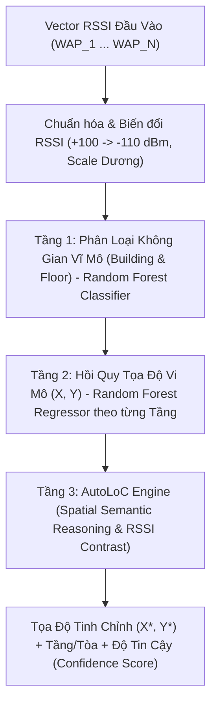

# AGENTS.md - Hướng Dẫn Dành Cho AI Agents & Nhà Phát Triển

Tài liệu này cung cấp toàn bộ bối cảnh, kiến trúc hệ thống, chuẩn dữ liệu và quy ước vận hành dự án dành riêng cho các AI Agent (Antigravity/Gemini/Claude/GPT) và kỹ sư nghiên cứu khi tiếp cận repository này.

---

## 1. Bối Cảnh Dự Án (Project Context)

- **Mục tiêu nghiên cứu**: Luận văn Thạc sĩ (Master's Thesis Research) về Hệ thống định vị trong nhà (**Indoor Positioning System - IPS**) dựa trên công nghệ **Wi-Fi Fingerprinting**.
- **Phương pháp trọng tâm**: Mô hình lai ghép **RF + AutoLoC** (Random Forest kết hợp Khung suy luận không gian ngữ nghĩa / LLM-assisted Spatial Reasoning).
- **Mục đích**: 
  1. Đạt độ chính xác cao trong bài toán hồi quy tọa độ 2D/3D và phân loại tầng/tòa nhà.
  2. Khả năng chống chịu trong điều kiện **dữ liệu khuyết thiếu (Data Scarcity)** khi chỉ thu thập 20% - 50% số điểm đo mẫu (fingerprints).
  3. Khả năng khái quát hóa (Generalizability) trên nhiều môi trường thực tế khác nhau (Multi-benchmark).
- **Tính chất**: Đây là đề tài nghiên cứu khoa học học thuật nghiêm túc, yêu cầu tính trung thực, chuẩn hóa đo đạc lặp lại (multi-run) và đối sánh học thuật quốc tế.

---

## 2. Môi Trường Vận Hành (Environment & Branch)

- **Hệ điều hành**: Windows 10/11 x64.
- **Python Virtual Environment**: `.venv39` (Python 3.9.8 x64).
  - Đường dẫn chạy script: `.\.venv39\Scripts\python.exe <script_path>`
  - Các thư viện cốt lõi: `numpy`, `pandas`, `scikit-learn`, `scipy`, `openpyxl`, `torch` (nếu có).
- **Git Branch**: `feature/llm-autoloc-ips`
  - Nhánh này chứa toàn bộ mã nguồn của thuật toán AutoLoC và mô hình Hybrid.
  - Luôn đảm bảo làm việc trên nhánh này hoặc kiểm tra branch trước khi chỉnh sửa.

---

## 3. Kiến Trúc Mô Hình (Model Architecture: RF + AutoLoC)

Mô hình hoạt động theo mô hình 3 tầng phân cấp (Hierarchical 3-Tier Positioning):



1. **Tiền xử lý RSSI (Preprocessing)**:
   - Giá trị thiếu/không bắt được sóng ($+100\text{ dBm}$) được gán về sàn tín hiệu $-110\text{ dBm}$.
   - Chuyển dịch về hệ số dương: $S = \max(0, \text{RSSI} + 110)$.
   - Phi tuyến hóa tỷ lệ năng lượng (Power Scaling): $X' = (S / 110)^{1.5}$.

2. **Tầng 1 (Coarse Localization)**:
   - Random Forest Classifier dự đoán `BUILDINGID` (nếu có đa tòa nhà) và `FLOOR`.
   - Độ chính xác tầng/tòa trên các tập benchmark thường đạt từ 95% - 99.8%.

3. **Tầng 2 (Fine Localization Regression)**:
   - Mô hình Random Forest Regressor chuyên biệt cho từng không gian/tầng nhằm dự đoán tọa độ mặt bằng 2D $(X, Y)$ (hoặc Longitude, Latitude).

4. **Tầng 3 (AutoLoC Spatial Refinement)**:
   - Định vị tại `src/ips/algorithms/llm/hybrid_autoloc.py`.
   - Tìm kiếm $k$-láng giềng gần nhất trong không gian tín hiệu ($k$-NN Candidates).
   - Kiểm tra ràng buộc vật lý, tường ngăn và độ suy hao log-distance.
   - Hiệu chỉnh tọa độ cuối cùng, loại bỏ hiện tượng nhảy điểm định vị xuyên tầng/xuyên tường.

---

## 4. Cấu Trúc Dữ Liệu & Benchmark (Dataset Layout)

Tất cả dữ liệu benchmark đã được chuẩn hóa và lưu trữ tại thư mục `data/benchmarks/`:

| Thư mục | Tên Bộ Dữ Liệu | Không gian | Số WAPs | Kích thước Train / Test | Tọa độ |
| :--- | :--- | :--- | :--- | :--- | :--- |
| `ujiindoorloc_raw/` | **UJIIndoorLoc** | 3 tòa nhà, 5 tầng (Khuôn viên ĐH Jaume I, Tây Ban Nha) | 520 | 19,937 train / 1,111 blind test | Toàn cầu (UTM WGS84) |
| `dlulib/` | **DLU Library** | Thư viện Đại học Đại Lý (1 tòa nhà, 3 tầng) | 321 | 9,566 train / 1,063 test | Cục bộ (Local X, Y, Z mét) |
| `tuji/` | **TUJI** | Tầng đơn viện nghiên cứu ($22\text{m} \times 32\text{m}$, mật độ AP cao) | 320 | 2,866 train / 319 test | Cục bộ (Local X, Y mét) |
| `syl/` | **SYL** | Phòng thí nghiệm mở 1 tầng | 114 | 2,340 train / 260 test | Cục bộ (Local X, Y mét) |
| `UJI_LIB_DB_Floor_3/` | UJI Lib Tầng 3 | Dữ liệu chi tiết tầng 3 thư viện UJI | Biến thiên | Chuyên biệt nghiên cứu tầng | Cục bộ |
| `UJI_LIB_DB_Floor_5/` | UJI Lib Tầng 5 | Dữ liệu chi tiết tầng 5 thư viện UJI | Biến thiên | Chuyên biệt nghiên cứu tầng | Cục bộ |
| `hcxy/` | HCXY | Tòa nhà hành chính thực tế | Biến thiên | Dữ liệu kiểm thử bổ trợ | Cục bộ |
| `hus/` | HUS | Tòa nhà thực tế HUS | Biến thiên | Dữ liệu kiểm thử bổ trợ | Cục bộ |

> **Cảnh báo Zero-shot Transfer**: Mỗi bộ dữ liệu đo tại một tòa nhà vật lý riêng biệt với danh sách địa chỉ MAC WAP hoàn toàn tách rời nhau (Disjoint WAP MAC set) và hệ tọa độ khác nhau (UTM vs Local Meter). **Không thể** lấy model đã train trên UJI để chạy trực tiếp (zero-shot inference) trên DLULIB/TUJI/SYL mà bắt buộc phải huấn luyện và đánh giá trên từng không gian tương ứng.

---

## 5. Quy Chuẩn Đánh Giá & Báo Cáo Học Thuật (Evaluation Guidelines)

Khi báo cáo kết quả, AI Agent cần tuân thủ nghiêm ngặt các nguyên tắc sau:

### 5.1. Phân biệt Validation Set vs. Official Blind Test Set
- **Validation Set ($N=300$ trong UJI)**: Thu thập cùng thời điểm, cùng thiết bị, cùng người đo với tập train $\to$ Sai số rất thấp ($\sim 2.32\text{ m}$). Đây **chỉ là kiểm tra nội bộ (Sanity check)**, tuyệt đối **không** dùng để công bố độ chính xác của mô hình với bên ngoài.
- **Blind Test Set ($N=1,111$ trong UJI)**: Thu thập độc lập sau nhiều tháng, bởi nhiều người đo khác nhau, sử dụng nhiều dòng smartphone khác nhau (gây lệch RSSI $\pm 10\text{ dBm}$) $\to$ Sai số thực tế đạt $\approx 8.60\text{ m} - 8.61\text{ m}$. Đây là **kết quả chính thức, có giá trị học thuật quốc tế**.

### 5.2. Các chỉ số đo lường (Metrics)
1. **Mean Positioning Error (MPE / Sai số trung bình)**: Là chỉ số chính thức khi so sánh trong bài báo khoa học. Thể hiện khoảng cách Euclidean trung bình giữa vị trí ước lượng và thực tế.
2. **Median Positioning Error (Sai số trung vị - 50%)**: Phản ánh trải nghiệm thực tế của 50% người dùng. Chỉ số này thường thấp hơn Mean vì không bị kéo lệch bởi các điểm ngoại lai (outliers do multipath).
3. **90th Percentile Error (P90 / Cam kết sai số tối đa)**: Đo lường độ tin cậy trong các tình huống xấu nhất (SLA công nghiệp).
4. **Floor / Building Accuracy (%)**: Tỷ lệ phần trăm dự đoán chính xác tầng và tòa nhà.
5. **Thực nghiệm lặp lại (Multi-run N=5)**: Mọi kết quả công bố cần được chạy trên 5 hạt giống ngẫu nhiên (seeds: 42, 100, 2024, 777, 999) và báo cáo dưới dạng $\text{Mean} \pm \text{Std}$ để chứng minh tính ổn định.

---

## 6. Danh Mục Tài Liệu & Kết Quả (Key Artifacts)

- `docs/Hoc/Bao_Cao_Hybrid_RF_AutoLoC_Chi_Tiet.md`: Báo cáo khoa học chi tiết toàn diện về thuật toán RF + AutoLoC, so sánh giữa các bộ dữ liệu và đánh giá suy hao dữ liệu.
- `docs/Hoc/IPS_Benchmark_Comparison_Results.xlsx`: Bảng tính Excel đa sheet trình bày so sánh đa phương pháp và đánh giá khuyết thiếu dữ liệu.
- `docs/Hoc/multirun_results.json`: Dữ liệu JSON gốc của 5 lượt chạy độc lập trên 4 bộ benchmark.
- `docs/Hoc/all_scarcity_results.json`: Dữ liệu JSON gốc đo lường suy giảm độ chính xác theo tỷ lệ dữ liệu (20%, 30%, 40%, 50%, 100%).

---

## 7. Các Lệnh Script Quan Trọng

```powershell
# Chạy đánh giá đa benchmark (5 runs)
.\.venv39\Scripts\python.exe scripts/run_multi_benchmark_evaluation.py

# Chạy đánh giá khuyết thiếu dữ liệu trên toàn bộ các bộ benchmark
.\.venv39\Scripts\python.exe scripts/run_all_scarcity_benchmark.py

# Tạo/Cập nhật file Excel báo cáo
.\.venv39\Scripts\python.exe scripts/build_professional_excel.py
```

