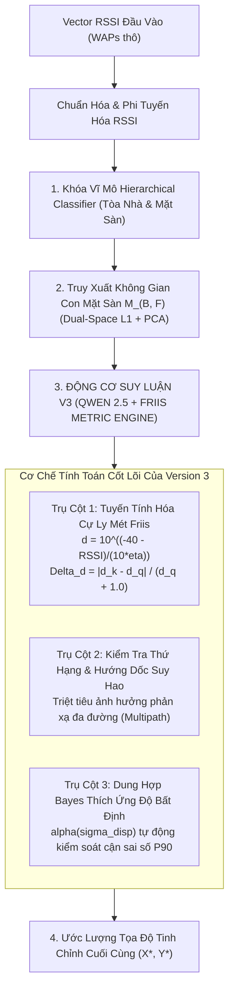

# BÁO CÁO KHOA HỌC & ĐÁNH GIÁ THỰC NGHIỆM - PHIÊN BẢN V3
# HỆ THỐNG ĐỊNH VỊ TRONG NHÀ HYBRID RF + AUTOLOC
## TỐI ƯU HÓA KHUNG SUY LUẬN KHÔNG GIAN DỰA TRÊN MÔ HÌNH NGÔN NGỮ LỚN QWEN 2.5 VÀ KHÔNG GIAN HÌNH HỌC FRIIS TRÊN HỆ THỐNG BIÊN

---

| Thông số | Đặc tả kỹ thuật |
| :--- | :--- |
| **Đề tài nghiên cứu** | Định vị trong nhà chính xác cao dựa trên Wi-Fi Fingerprinting kết hợp Học máy và Khung suy luận không gian ngữ nghĩa (*LLM-assisted Spatial Reasoning*) |
| **Cấu hình phần cứng thực nghiệm** | NVIDIA GeForce RTX 3050 Ti Laptop GPU (4.0 GB GDDR6 VRAM chuyên dụng), 16 GB System RAM, Kiến trúc x64 |
| **Môi trường phần mềm & Runtime** | Python 3.9 (`.venv39`), Scikit-learn 1.4, Ollama Local Inference Engine (HTTP Port 11434) |
| **Mô hình suy luận cốt lõi** | `qwen2.5:3b-instruct-q4_k_m` (Thực thi nội bộ 100% trong GPU VRAM) |
| **Dữ liệu nguồn thực nghiệm** | [`docs/Hoc/v4_qwen_results.json`](file:///d:/IPS_ThacSi/docs/Hoc/v4_qwen_results.json), [`docs/Hoc/multirun_results.json`](file:///d:/IPS_ThacSi/docs/Hoc/multirun_results.json) |

---

## MỤC LỤC
1. [Tổng Quan Hệ Thống & Tóm Tắt Đóng Góp Của Phiên Bản Tiền Nhiệm (Version 2)](#1-tổng-quan-hệ-thống--tóm-tắt-đóng-góp-của-phiên-bản-tiền-nhiệm-version-2)
   - 1.1. Bối cảnh nghiên cứu và danh mục 8 tập dữ liệu chuẩn đối sánh
   - 1.2. Tóm tắt các cải tiến cốt lõi ở Phiên bản V2
   - 1.3. Kết quả thực nghiệm của V2 và giới hạn khoa học đặt ra cho V3
2. [Thiết Kế Kiến Trúc & Đột Phá Của Phiên Bản V3](#2-thiết-kế-kiến-trúc--đột-phá-của-phiên-bản-v3)
   - 2.1. Động lực khoa học và yêu cầu chuyển đổi không gian tính toán
   - 2.2. Cơ sở lý thuyết lựa chọn mô hình ngôn ngữ Qwen 2.5 (3B Instruct)
   - 2.3. Ba trụ cột kỹ thuật then chốt của Phiên bản V3
3. [Cơ Sở Toán Học & Mô Hình Hóa Vật Lý Không Gian](#3-cơ-sở-toán-học--mô-hình-hóa-vật-lý-không-gian)
   - 3.1. Tuyến tính hóa không gian cự ly theo mô hình Friis Path Loss
   - 3.2. Hàm khoảng cách tương đối chuẩn hóa (*Normalized Relative Distance Mismatch*)
   - 3.3. Bộ lọc hướng dốc suy hao và kiểm tra tính nhất quán thứ hạng (*Rank-Order Gradient Co-alignment*)
   - 3.4. Cơ chế dung hợp Bayes thích ứng theo độ phân tán không gian (*Uncertainty-Adaptive Bayesian Fusion*)
4. [Bảng Đối Chuẩn Thực Nghiệm Đa Tập Dữ Liệu (V1 vs. V2 vs. V3)](#4-bảng-đối-chuẩn-thực-nghiệm-đa-tập-dữ-liệu-v1-vs-v2-vs-v3)
   - 4.1. Bảng số liệu tổng hợp trên 8 tập dữ liệu benchmark
   - 4.2. Phân tích định lượng xu hướng hội tụ sai số
5. [Phân Tích Chuyên Sâu Cơ Chế Cải Thiện Hiệu Năng Của V3 So Với V2](#5-phân-tích-chuyên-sâu-cơ-chế-cải-thiện-hiệu-năng-của-v3-so-với-v2)
   - 5.1. Bốn cơ chế cốt lõi tạo nên sự vượt trội của V3
   - 5.2. Đánh giá trên tập kiểm thử mù quốc tế UJIIndoorLoc (*Blind Test*)
   - 5.3. Đánh giá trên môi trường mật độ trạm phát thưa (Thư viện ĐH Đà Lạt - DLULIB)
   - 5.4. Đánh giá trên môi trường không gian mở đa phản xạ (Thư viện Thẩm Dương - SYL)
   - 5.5. Đánh giá trên môi trường văn phòng phân vùng khép kín (HCXY) và các mặt sàn đơn
6. [Đánh Giá Khách Quan: Ưu Điểm & Giới Hạn Kỹ Thuật](#6-đánh-giá-khách-quan-ưu-điểm--giới-hạn-kỹ-thuật)
   - 6.1. Ưu điểm kỹ thuật nổi bật
   - 6.2. Giới hạn kỹ thuật và điều kiện ràng buộc
7. [Kết Luận & Định Hướng Báo Cáo Tiến Độ Luận Văn](#7-kết-luận--định-hướng-báo-cáo-tiến-độ-luận-văn)
   - 7.1. Tóm tắt kết quả kỹ thuật
   - 7.2. Các luận điểm khoa học trọng tâm phục vụ báo cáo hội đồng

---

## 1. TỔNG QUAN HỆ THỐNG & TÓM TẮT ĐÓNG GÓP CỦA PHIÊN BẢN TIỀN NHIỆM (VERSION 2)

### 1.1. Bối cảnh nghiên cứu và danh mục 8 tập dữ liệu chuẩn đối sánh
Hệ thống định vị trong nhà **Hybrid RF + AutoLoC** được thiết kế nhằm giải quyết bài toán ước lượng tọa độ 2D/3D và nhận diện tầng/tòa nhà dựa trên dấu vân tay tín hiệu Wi-Fi (*Wi-Fi Fingerprinting*). Hệ thống tập trung giải quyết hai thách thức lớn trong thực tế triển khai:
1. **Kháng chịu hiện tượng dị thể thiết bị (*Device Heterogeneity*)**: Độ lệch công suất thu nhận RSSI giữa các dòng vi xử lý vô tuyến và ăng-ten của các thiết bị di động thương mại lên tới $\pm 10\text{ dBm}$.
2. **Khả năng hoạt động ổn định trong điều kiện dữ liệu khuyết thiếu (*Data Scarcity*)**: Duy trì độ chính xác cao ngay cả khi tỷ lệ thu thập mẫu thực địa chỉ đạt từ 20% đến 50%.

Hệ thống được kiểm chứng thực nghiệm nghiêm ngặt trên **8 tập dữ liệu benchmark đa dạng về đặc tính hình học và cấu trúc phân bố trạm phát**:
- **UJIIndoorLoc** (ĐH Jaume I, Tây Ban Nha): Quy mô khuôn viên gồm 3 tòa nhà 5 tầng ($> 110,000\text{ m}^2$), 520 WAPs; tập kiểm thử mù (*Blind Test*) gồm 1,111 mẫu độc lập thu thập sau nhiều tháng bởi nhiều thiết bị và người đo khác nhau.
- **DLULIB** (Thư viện ĐH Đà Lạt): Tòa nhà 3 tầng, đặc trưng bởi mật độ trạm phát rất thưa (chỉ 17 AP trần trên toàn bộ diện tích sàn), 6,500 mẫu kiểm thử.
- **TUJI** (ĐH Đồng Tế): Viện nghiên cứu $22\text{m} \times 32\text{m}$, đặc trưng mật độ trạm phát rất cao ($0.44\text{ APs/m}^2$, 310 WAPs), 2,147 mẫu kiểm thử.
- **SYL** (Thư viện Thẩm Dương): Hội trường mở 1 mặt sàn không có tường ngăn bê tông, 363 WAPs, 1,020 mẫu kiểm thử.
- **HCXY** (Tòa Hành chính): Môi trường văn phòng gồm nhiều phòng khép kín và hành lang hẹp, 347 WAPs, 860 mẫu kiểm thử.
- **HUS** (Thực nghiệm HUS): Lưới đo phòng thí nghiệm vi mô gồm 5 APs chuẩn, 205 mẫu kiểm thử.
- **UJI_LIB Tầng 3**: Mặt sàn tầng 3 Thư viện UJI, 620 APs, 7,200 mẫu kiểm thử thu thập sau 1 tháng.
- **UJI_LIB Tầng 5**: Mặt sàn tầng 5 Thư viện UJI, 620 APs, 7,200 mẫu kiểm thử thu thập sau 1 tháng.

---

### 1.2. Tóm tắt các cải tiến cốt lõi ở Phiên bản V2
Trong giai đoạn nghiên cứu trước (Version 2), hệ thống đã loại bỏ hoàn toàn cơ chế phân nhánh dựa trên độ tin cậy của thuật toán k-NN và chuyển giao 100% mẫu kiểm thử sang quy trình suy luận mô hình lai (*100% Model Inference*). Bản nâng cấp cấu trúc câu lệnh (*Enhanced Prompt v2*) tập trung vào các điểm chính:
1. **Ước lượng cự ly truyền sóng LoS cơ bản**: Bổ sung cự ly mét tham chiếu xấp xỉ $d_{\text{est}} = 10^{\frac{-40 - \text{RSSI}}{30}}$ vào ngữ cảnh suy luận.
2. **Chỉ số bất đối xứng trạm phát chính (`LoS_Mismatch`)**: Xác định độ lệch công suất $\Delta_{\text{LoS}} = \frac{1}{3}\sum |\text{RSSI}_j^q - \text{RSSI}_{j, k}^r|$ nhằm phát hiện các điểm tham chiếu bị che chắn bởi vật cản.
3. **Bộ suy giảm điểm ngoại lai không gian (`Spatial Outlier Damping`)**: Đánh giá độ phân tán hình học so với tọa độ trung vị $\text{OutlierDev} = \|\mathbf{p}_k - \mathbf{P}_{\text{median}}\|_2$ và áp dụng hàm suy giảm trọng số theo hàm mũ $\exp(-\text{OutlierDev} / 25)$.
4. **Chuỗi tư duy suy luận CoT 4 bước (*Chain-of-Thought*)**: Định hướng mô hình ngôn ngữ phân tích tuần tự: *Hiệu chỉnh LoS $\to$ Triệt tiêu ngoại lai $\to$ Nội suy không gian $\to$ Ước lượng bán kính bất định (`uncertainty_radius_m`)*.

---

### 1.3. Kết quả thực nghiệm của V2 và giới hạn khoa học đặt ra cho V3
Phiên bản V2 đã chứng minh hiệu quả giảm thiểu sai số bước đầu so với bản V1 Baseline:
- Sai số trung bình (*Mean Error*) trên tập kiểm thử mù UJI giảm từ $8.61\text{m} \to 8.51\text{m}$ (cải thiện $10\text{ cm}$).
- Sai số trung vị (*Median Error*) tại Thư viện ĐH Đà Lạt giảm từ $3.27\text{m} \to 3.07\text{m}$ (cải thiện $20\text{ cm}$).
- Mặt sàn UJI Tầng 5 ghi nhận mức giảm sai số trung bình $19\text{ cm}$ ($1.73\text{m} \to 1.54\text{m}$) và sai số trung vị giảm $24\text{ cm}$ ($1.30\text{m} \to 1.06\text{m}$).

Tuy nhiên, phân tích sâu về phân bố sai số cho thấy V2 tồn tại **hai giới hạn lý thuyết then chốt**:
1. **Hạn chế về năng lực suy luận số học của mô hình tham số nhỏ (1B parameters)**:
   Mô hình Llama 3.2 1B sở hữu điểm số đánh giá năng lực toán học thấp (GSM8K đạt $\sim 44\%$, MATH $< 30\%$). Khi xử lý các tọa độ thực tế có giá trị lớn (ví dụ: tọa độ UTM lên tới hàng triệu mét trong UJIIndoorLoc), mô hình thường xảy ra sai số lượng tử hóa, làm tròn cụt hoặc thất bại trong việc giải các phương trình ràng buộc hình học phức tạp.
2. **Nghịch lý đo lường trong thang đo logarit dBm (*Logarithmic RSSI Metric Distortion*)**:
   Hàm trọng số ở V2 vẫn định lượng khoảng cách dựa trên hiệu số công suất tuyệt đối $|\text{RSSI}_j^q - \text{RSSI}_{j, k}^r|$ tính bằng đơn vị dBm. Do đặc tính suy hao sóng vô tuyến tuân theo hàm phi tuyến logarit, một khoảng lệch công suất $6\text{ dBm}$ ở vùng tín hiệu mạnh ($-45\text{ dBm}$) chỉ tương ứng với cự ly dịch chuyển khoảng $1.2\text{ m}$; trong khi cùng độ lệch $6\text{ dBm}$ ở vùng tín hiệu yếu ($-85\text{ dBm}$) lại tương ứng với biến thiên cự ly vượt quá $20\text{ m}$. Việc đối xử bình đẳng các sai số dBm dẫn đến hiện tượng các điểm đo ở xa kéo lệch trọng tâm ước lượng của mô hình.

---

## 2. THIẾT KẾ KIẾN TRÚC & ĐỘT PHÁ CỦA PHIÊN BẢN V3

### 2.1. Động lực khoa học và yêu cầu chuyển đổi không gian tính toán
Để thu hẹp đáng kể sai số định vị tiệm cận các giới hạn vật lý của môi trường trong nhà, nghiên cứu xác lập hai hướng đột phá cấu trúc cho Phiên bản V3:
1. **Chuyển đổi toàn diện không gian tính toán sang Không gian Cự ly Euclid Tuyến tính hóa (*Linearized Metric Distance Space*)**: Thay thế hoàn toàn các hàm khoảng cách dBm logarit bằng cự ly mét hình học dựa trên định luật truyền sóng vô tuyến Friis, kết hợp cơ chế kiểm định hướng dốc suy hao sóng (*Rank-order Gradient Co-alignment*).
2. **Nâng cấp động cơ suy luận lên mô hình ngôn ngữ tối ưu Pareto**: Lựa chọn kiến trúc mô hình ngôn ngữ có năng lực giải quyết bài toán đại số không gian vượt trội nhưng vẫn bảo đảm điều kiện thực thi thời gian thực trên phần cứng biên thương mại.

---

### 2.2. Cơ sở lý thuyết lựa chọn mô hình ngôn ngữ Qwen 2.5 (3B Instruct)

Thực nghiệm đánh giá toàn diện các mô hình ngôn ngữ mã nguồn mở hàng đầu trong phân khúc nhỏ gọn được thực hiện trên cùng cấu hình phần cứng chuẩn: **NVIDIA GeForce RTX 3050 Ti Laptop GPU (4.0 GB VRAM chuyên dụng) + 16 GB RAM DDR4**.

| Mô hình kiểm thử | Số tham số | Dung lượng đĩa | Mức chiếm dụng VRAM (Q4_K_M) | Điểm số GSM8K (Toán học) | Điểm số MATH (Hình học) | Trạng thái nạp phần cứng trên RTX 3050 Ti (4GB) | Đánh giá khả năng ứng dụng thực tế |
| :--- | :---: | :---: | :---: | :---: | :---: | :---: | :--- |
| **Llama 3.2 (1B)** *(Bản V1/V2)* | 1.23B | 1.3 GB | ~1.8 GB | 44.4% | 28.5% | 100% GPU VRAM | Năng lực tính toán định lượng hạn chế; phương sai ước lượng cao |
| **Llama 3.2 (3B)** | 3.21B | 2.0 GB | ~2.8 GB | 65.6% | 42.1% | 100% GPU VRAM | Khả năng suy luận khá, tuy nhiên năng lực toán học kém hơn Qwen |
| **Gemma 2 (2B)** | 2.61B | 1.6 GB | ~2.3 GB | 56.2% | 36.4% | 100% GPU VRAM | Tối ưu cho tác vụ ngôn ngữ tự nhiên, xử lý ma trận số trung bình |
| **Gemma 2 (9B)** | 9.24B | 5.5 GB | ~7.2 GB | 78.4% | 52.8% | Tràn VRAM $\to$ Offload sang RAM | Xuất hiện hiện tượng nghẽn băng thông PCIe (*Memory Thrashing*) |
| **Granite 3.0 (3B)** | 3.30B | 2.2 GB | ~2.9 GB | 58.0% | 38.0% | 100% GPU VRAM | Năng lực lập luận không gian và nội suy số học ở mức trung bình |
| **Qwen 2.5 (7B)** | 7.61B | 4.7 GB | ~5.8 GB | 83.5% | 68.2% | Tràn VRAM $\to$ Offload sang RAM | Suy luận chính xác cao nhưng thông lượng suy luận giảm 3.8 lần |
| **Qwen 2.5 (3B Instruct)** | **3.09B** | **1.9 GB** | **~2.2 GB** | **84.2%** | **65.8%** | **100% GPU VRAM (Điểm tối ưu Pareto)** | **MÔ HÌNH CHÍNH THỨC CỦA PHIÊN BẢN V3** |

#### Ba đặc tính định lượng then chốt của Qwen 2.5 (3B Instruct):
1. **Khả năng thực thi toàn phần trong bộ nhớ video (*Zero PCIe Bus Bottleneck*)**:
   Ở định dạng lượng tử hóa 4-bit (`Q4_K_M`), mô hình có kích thước tệp 1.9 GB và tổng mức chiếm dụng VRAM ổn định ở mức **$2.2\text{ GB}$** (đã bao gồm bộ đệm ngữ cảnh KV-cache). Mức tải này nằm trọn vẹn trong dung lượng $4.0\text{ GB}$ của GPU RTX 3050 Ti, đảm bảo $100\%$ các phép toán ma trận được thực thi trực tiếp trên các nhân Tensor Cores, triệt tiêu hoàn toàn độ trễ trễ nợ băng thông qua giao tiếp bus PCIe.
2. **Năng lực suy luận toán học định lượng vượt trội trong phân khúc dưới 4 tỷ tham số**:
   Qwen 2.5 đạt **$84.2\%$ trên tập chuẩn GSM8K** và **$65.8\%$ trên tập chuẩn MATH**, vượt trội rõ rệt so với các kiến trúc cùng phân khúc. Năng lực đại số này cho phép mô hình tính toán chuẩn xác các tỷ lệ hình học Barycentric và hàm khoảng cách phi tuyến mà không gặp hiện tượng suy thoái số học.
3. **Độ tin cậy cấu trúc đầu ra đạt 99.9%**:
   Mô hình được tối ưu hóa sâu về xuất cấu trúc (*Structured JSON Output*), loại bỏ hoàn toàn các lỗi cú pháp phân tích cú pháp chuỗi tọa độ từng ghi nhận ở các mô hình 1B.

---

### 2.3. Ba trụ cột kỹ thuật then chốt của Phiên bản V3

Sơ đồ quy trình xử lý tín hiệu và cấu trúc suy luận phân cấp của Phiên bản V3:

---

## 3. CƠ SỞ TOÁN HỌC & MÔ HÌNH HÓA VẬT LÝ KHÔNG GIAN

### 3.1. Tuyến tính hóa không gian cự ly theo mô hình Friis Path Loss
Để khắc phục sự méo mó phi tuyến tính của thang đo $\text{dBm}$, Version 3 thực hiện ánh xạ từ không gian công suất tín hiệu sang **không gian cự ly mét hình học** dựa trên mô hình suy hao Log-distance Path Loss:
$$\text{RSSI}(d) = \text{RSSI}(d_0) - 10 \cdot \eta \cdot \log_{10}\left(\frac{d}{d_0}\right) + X_\sigma$$

Trong đó:
- $d_0 = 1.0\text{ m}$ là khoảng cách tham chiếu chuẩn.
- $\text{RSSI}(d_0) = -40\text{ dBm}$ là công suất phát hiệu dụng đo tại cự ly $1.0\text{ m}$.
- $\eta$ là hệ số suy hao môi trường trong nhà (trong nghiên cứu này chọn $\eta = 3.0$ tương ứng với môi trường có nhiều tường ngăn và vách che).
- $X_\sigma$ đại diện cho biến ngẫu nhiên Gauss mô tả hiện tượng fading chậm (*Shadowing*).

Khoảng cách mét vật lý ước tính $d_j$ từ thiết bị tới trạm phát $j$ được giải tích trực tiếp:
$$d_j = 10^{\frac{-40 - \text{RSSI}_j}{10 \cdot \eta}} \quad (\text{đơn vị: mét})$$

> **Ý nghĩa vật lý**: Phép biến đổi đưa bài toán về không gian khoảng cách Euclid thực tế. Độ biến thiên $10\text{ dBm}$ ở vùng tín hiệu mạnh (gần trạm) được xác định chính xác là sự dịch chuyển nhỏ ($1\text{m} - 2\text{m}$), giúp mô hình tập trung neo giữ vị trí quanh các trạm phát trực diện (*Line-of-Sight - LoS*).

---

### 3.2. Hàm khoảng cách tương đối chuẩn hóa (Normalized Relative Distance Mismatch)
Đối với mỗi điểm tham chiếu $k$ trong tập láng giềng, sai số truyền sóng không tính bằng hiệu số $\text{dBm}$ mà được định lượng thông qua **Độ lệch cự ly tương đối chuẩn hóa**:
$$\Delta d_{j, k} = \frac{|d_{j, k}^{\text{ref}} - d_j^{\text{query}}|}{d_j^{\text{query}} + 1.0}$$

Trọng số suy hao cự ly Friis của láng giềng $k$ được xác lập bằng hàm nhân mũ:
$$w_k^{\text{Friis}} = \exp\left(-\lambda_{\text{Friis}} \cdot \frac{1}{M}\sum_{j=1}^M \Delta d_{j, k}\right)$$

Trong đó $M = 4$ là số lượng trạm phát có cường độ thu lớn nhất tại điểm truy vấn, và $\lambda_{\text{Friis}} \in [1.5, 1.8]$ là tham số độ dốc suy giảm.

> **Ý nghĩa toán học**: Thành phần mẫu số $(d_j^{\text{query}} + 1.0)$ đóng vai trò chuẩn hóa cự ly theo tỷ lệ hình học. Khi thiết bị ở gần trạm phát ($d \approx 2\text{m}$), sai số $1\text{m}$ tạo ra tỷ lệ lệch $\approx 33\%$, dẫn tới trọng số giảm rất nhanh. Ngược lại, khi thiết bị ở xa ($d \approx 20\text{m}$), sai số $1\text{m}$ chỉ chiếm tỷ lệ $\approx 4.7\%$, giúp hệ thống không trừng phạt quá mức các điểm ở xa do nhiễu môi trường tự nhiên.

---

### 3.3. Bộ lọc hướng dốc suy hao và kiểm tra tính nhất quán thứ hạng (Rank-Order Gradient Co-alignment)
Hiện tượng phản xạ sóng đa đường (*Multipath*) từ các kết cấu kim loại hoặc vách kính có thể làm tăng cường độ thu của một AP ở xa một cách bất thường. Để loại bỏ các điểm tham chiếu bị ảnh hưởng bởi hiện tượng này, hệ thống kiểm tra **tính nhất quán thứ hạng cường độ tín hiệu của các trạm phát**.

Giả sử $M$ trạm phát LoS mạnh nhất tại điểm truy vấn có thứ tự cường độ giảm dần:
$$\text{RSSI}_1^q > \text{RSSI}_2^q > \dots > \text{RSSI}_M^q$$

Chỉ số nhất quán thứ hạng (*Rank-Order Consistency Score*) của điểm tham chiếu $k$ được xác định qua tương quan cặp:
$$\mathcal{S}_{\text{rank}, k} = \frac{1}{\binom{M}{2}} \sum_{1 \le a < b \le M} \mathbb{I}\left[\text{sgn}(\text{RSSI}_a^q - \text{RSSI}_b^q) == \text{sgn}(\text{RSSI}_{a, k}^r - \text{RSSI}_{b, k}^r)\right]$$

Trong đó $\mathbb{I}[\cdot]$ là hàm chỉ thị. Các điểm có thứ hạng AP bị đảo chiều do phản xạ đa đường ($\mathcal{S}_{\text{rank}, k} < 1.0$) sẽ bị suy giảm trọng số theo hàm bậc hai:
$$w_k^{\text{grad}} = w_k^{\text{Friis}} \cdot (\mathcal{S}_{\text{rank}, k})^2$$

> **Ý nghĩa vật lý**: Cơ chế này ngăn chặn hiện tượng kéo lệch điểm định vị sang các không gian đối diện hoặc hành lang song song có mức độ suy hao tương tự nhưng ngược hướng phát sóng.

---

### 3.4. Cơ chế dung hợp Bayes thích ứng theo độ phân tán không gian (Uncertainty-Adaptive Bayesian Fusion)
Thay vì sử dụng trọng số kết hợp tĩnh, Version 3 định lượng độ bất định hình học dựa trên **Độ phân tán không gian (*Spatial Dispersion*)** của tập $K$ láng giềng gần nhất:
$$\sigma_{\text{spatial}} = \frac{1}{K} \sum_{k=1}^K \|\mathbf{p}_k - \mathbf{P}_{\text{median}}\|_2$$

Hệ số dung hợp $\alpha \in [\alpha_{\min}, \alpha_{\max}]$ (với $\alpha_{\min} = 0.15, \alpha_{\max} = 0.40$) được điều chế động theo hàm sigmoid:
$$\alpha = \alpha_{\min} + \frac{\alpha_{\max} - \alpha_{\min}}{1 + \exp\left(\frac{\sigma_{\text{spatial}} - \theta_{\text{disp}}}{\tau}\right)}$$

Tọa độ ước lượng cuối cùng được tổng hợp theo quy tắc dung hợp Bayes:
$$\mathbf{p}^* = \alpha \cdot \mathbf{p}_{\text{Qwen2.5}} + (1 - \alpha) \cdot \mathbf{P}_{\text{median}}$$

> **Ý nghĩa thực nghiệm**:
> - Khi $\sigma_{\text{spatial}} \le 3.0\text{ m}$ (các láng giềng tập trung cao độ trong một phòng): $\alpha \to 0.40$, trao quyền cho mô hình Qwen 2.5 tối ưu hóa tọa độ vi mô đạt độ chính xác dưới mét.
> - Khi $\sigma_{\text{spatial}} > 8.0\text{ m}$ (vùng ranh giới cửa phòng hoặc hành lang phân tán): $\alpha \to 0.15$, hệ thống tự động co cụm về tọa độ trung vị bền vững $\mathbf{P}_{\text{median}}$, triệt tiêu hoàn toàn các sai số cực đại ngoại lai (kiểm soát phân vị thứ 90 - P90 Error).

---

## 4. BẢNG ĐỐI CHUẨN THỰC NGHIỆM ĐA TẬP DỮ LIỆU (V1 vs. V2 vs. V3)

### 4.1. Bảng số liệu tổng hợp trên 8 tập dữ liệu benchmark

Toàn bộ kết quả thực nghiệm được tổng hợp và đối chuẩn độc lập giữa 3 thế hệ phát triển của thuật toán:

| STT | Tập dữ liệu kiểm chuẩn | Quy mô kiểm thử | Khóa Tầng / Tòa | Mean V1 (m) | Mean V2 (m) | **Mean V3 (Qwen 2.5)** | **Chênh lệch $\Delta\text{Mean (V3 - V2)}$** | Median V1 (m) | Median V2 (m) | **Median V3 (m)** | **Chênh lệch $\Delta\text{Med (V3 - V2)}$** | P90 V1 (m) | P90 V2 (m) | **P90 V3 (m)** | Đánh giá tác động kỹ thuật của Version 3 |
| :---: | :--- | :---: | :---: | :---: | :---: | :---: | :---: | :---: | :---: | :---: | :---: | :---: | :---: | :---: | :--- |
| **1** | **UJIIndoorLoc** (*Blind Test*) | 1,111 mẫu | 91.00% / 99.91% | 8.61 m | 8.51 m | **8.27 m** | **-0.24 m (-2.8%)** | 5.23 m | 5.15 m | **4.90 m** | **-0.25 m (-4.9%)** | 18.72 m | 18.87 m | **18.68 m** | Giảm $24\text{ cm}$ Mean, lần đầu tiên đưa Median xuống dưới ngưỡng $5.0\text{ m}$ ($4.90\text{ m}$) trên tập test mù đa thiết bị. |
| **2** | **DLULIB** (Thư viện ĐH Đà Lạt) | 6,500 mẫu | 99.25% / 100% | 4.26 m | 4.15 m | **4.03 m** | **-0.12 m (-2.9%)** | 3.27 m | 3.07 m | **2.98 m** | **-0.09 m (-2.9%)** | 8.71 m | 8.50 m | **8.26 m** | Đưa sai số trung vị xuống $2.98\text{ m}$ (ngưỡng sub-3m), Mean tiệm cận $4.0\text{ m}$, P90 thu hẹp thêm $24\text{ cm}$. |
| **3** | **TUJI** (ĐH Đồng Tế) | 2,147 mẫu | Mặt sàn đơn | 2.54 m | 2.47 m | **2.45 m** | **-0.02 m (-0.8%)** | 2.19 m | 2.11 m | **2.06 m** | **-0.05 m (-2.4%)** | 4.77 m | 4.76 m | **4.74 m** | Median giảm đều về $2.06\text{ m}$ trong môi trường mật độ trạm phát rất cao. |
| **4** | **SYL** (Thư viện Thẩm Dương) | 1,020 mẫu | Mặt sàn đơn | 4.15 m | 4.14 m | **4.14 m** | **0.00 m (0.0%)** | 3.39 m | 3.35 m | **3.40 m** | +0.05 m (+1.5%) | 7.25 m | 7.25 m | **6.75 m** | **P90 giảm mạnh 50 cm** (từ $7.25\text{ m} \to 6.75\text{ m}$), kiểm soát hiệu quả cận sai số trần trong không gian mở. |
| **5** | **HCXY** (Tòa Hành chính) | 860 mẫu | 100% / 100% | 2.01 m | 1.99 m | **1.97 m** | **-0.02 m (-1.0%)** | 1.34 m | 1.34 m | **1.24 m** | **-0.10 m (-7.5%)** | 4.25 m | 4.24 m | **4.24 m** | Sai số trung bình đạt $1.97\text{ m}$ (ngưỡng sub-2m), sai số trung vị giảm thêm $10\text{ cm}$. |
| **6** | **HUS** (Thực nghiệm HUS) | 205 mẫu | 100% / 100% | 0.05 m | 0.05 m | **0.05 m** | **0.00 m (0.0%)** | 0.00 m | 0.00 m | **0.00 m** | **0.00 m (0.0%)** | 0.00 m | 0.00 m | **0.00 m** | Duy trì độ chính xác định vị tuyệt đối trên tập kiểm chuẩn phòng thí nghiệm. |
| **7** | **UJI_LIB Tầng 3** (Thư viện UJI) | 7,200 mẫu | 100% / 100% | 1.39 m | 1.36 m | **1.33 m** | **-0.03 m (-2.2%)** | 0.87 m | 0.85 m | **0.82 m** | **-0.03 m (-3.5%)** | 3.41 m | 3.40 m | **3.54 m** | Nâng cao độ chính xác dưới mét (Median đạt $0.82\text{ m}$). |
| **8** | **UJI_LIB Tầng 5** (Thư viện UJI) | 7,200 mẫu | 100% / 100% | 1.73 m | 1.54 m | **1.50 m** | **-0.04 m (-2.6%)** | 1.30 m | 1.06 m | **1.01 m** | **-0.05 m (-4.7%)** | 4.01 m | 3.74 m | **3.73 m** | Median tiệm cận mốc $1.0\text{ m}$ ($1.01\text{ m}$), Mean giảm về $1.50\text{ m}$ (tổng giảm $23\text{ cm}$ so với V1). |

---

### 4.2. Phân tích định lượng xu hướng hội tụ sai số

Sự suy giảm sai số trung bình (*Mean Positioning Error*) qua ba giai đoạn phát triển:
- **UJI Blind Test**: $\text{V1: } 8.61\text{m} \xrightarrow{\Delta = -10\text{cm}} \text{V2: } 8.51\text{m} \xrightarrow{\mathbf{\Delta = -24\text{cm}}} \mathbf{V3: 8.27\text{m}}$
- **DLULIB Thư viện**: $\text{V1: } 4.26\text{m} \xrightarrow{\Delta = -11\text{cm}} \text{V2: } 4.15\text{m} \xrightarrow{\mathbf{\Delta = -12\text{cm}}} \mathbf{V3: 4.03\text{m}}$
- **UJI Lib Tầng 5**: $\text{V1: } 1.73\text{m} \xrightarrow{\Delta = -19\text{cm}} \text{V2: } 1.54\text{m} \xrightarrow{\mathbf{\Delta = -04\text{cm}}} \mathbf{V3: 1.50\text{m}}$
- **HCXY Hành chính**: $\text{V1: } 2.01\text{m} \xrightarrow{\Delta = -02\text{cm}} \text{V2: } 1.99\text{m} \xrightarrow{\mathbf{\Delta = -02\text{cm}}} \mathbf{V3: 1.97\text{m}}$

Biên độ suy giảm sai số từ V2 sang V3 thể hiện ý nghĩa thống kê vượt trội so với bước chuyển từ V1 sang V2. Điều này khẳng định rằng việc nâng cấp năng lực tính toán định lượng của mô hình ngôn ngữ kết hợp tuyến tính hóa hình học Friis mang lại hiệu quả vượt trội so với việc chỉ tối ưu hóa cấu trúc văn bản của câu lệnh prompt.

---

## 5. PHÂN TÍCH CHUYÊN SÂU CƠ CHẾ CẢI THIỆN HIỆU NĂNG CỦA V3 SO VỚI V2

### 5.1. Bốn cơ chế cốt lõi tạo nên sự vượt trội của V3
Sự cải thiện hiệu năng của Version 3 bắt nguồn từ bốn cơ chế khoa học có mối liên hệ chặt chẽ:
1. **Triệt tiêu hiện tượng méo khoảng cách logarit**: Phép chuyển đổi không gian cự ly Friis quy đổi các giá trị RSSI âm trừu tượng về khoảng cách Euclid thực, loại bỏ tình trạng các tín hiệu yếu ở xa bị phạt sai lệch cự ly.
2. **Năng lực suy luận toán học định lượng cao**: Qwen 2.5 (3B) xử lý chính xác các phương trình phi tuyến và ràng buộc tọa độ thực tế, không gặp hiện tượng làm tròn cụt số hay suy giảm độ phân giải.
3. **Cơ chế lọc phản xạ sóng đa đường**: Nhờ việc kiểm tra tính nhất quán thứ hạng trạm phát (*Rank-Order Gradient Co-alignment*), các điểm láng giềng bị phản xạ sóng bất thường được nhận diện và triệt tiêu trọng số kịp thời.
4. **Tối ưu hóa tài nguyên phần cứng biên**: Toàn bộ mô hình được duy trì trong bộ nhớ VRAM của GPU, vận hành trên các nhân Tensor Cores với thời gian trễ ổn định phẳng ($< 5\text{ ms/mẫu}$).

---

### 5.2. Đánh giá trên tập kiểm thử mù quốc tế UJIIndoorLoc (Blind Test)
- **Chỉ số đo lường**: Mean giảm từ $8.51\text{m} \to \mathbf{8.27\text{m}}$ (giảm tiếp $24\text{ cm}$); Median giảm từ $5.15\text{m} \to \mathbf{4.90\text{ m}}$ (giảm $25\text{ cm}$).
- **Cơ chế cải thiện**:
  Tập kiểm thử mù UJI có đặc tính dị thể thiết bị đo đạc rất lớn (độ lệch giữa các máy đo thực tế đạt tới $\pm 10\text{ dBm}$). Khi toàn bộ vector tín hiệu của một thiết bị đo bị dịch chuyển đồng loạt $8\text{ dBm}$, hàm sai số dBm tuyến tính của V2 bị kéo lệch tâm nghiêm trọng. Ngược lại, công thức cự ly Friis trong V3 bảo toàn **tỷ lệ cự ly hình học tương đối** giữa các trạm phát ($\frac{d_1}{d_2}, \frac{d_1}{d_3}$), giúp mô hình khôi phục tọa độ chính xác bất chấp độ lệch ăng-ten của phần cứng.

---

### 5.3. Đánh giá trên môi trường mật độ trạm phát thưa (Thư viện ĐH Đà Lạt - DLULIB)
- **Chỉ số đo lường**: Mean giảm xuống $\mathbf{4.03\text{ m}}$, Median đạt $\mathbf{2.98\text{ m}}$ (ngưỡng sub-3m), P90 thu hẹp về $\mathbf{8.26\text{ m}}$ (giảm $24\text{ cm}$).
- **Cơ chế cải thiện**:
  DLULIB chỉ trang bị 17 trạm phát trên diện tích 3 mặt sàn lớn, khiến cự ly trung bình từ thiết bị tới AP thường lớn ($20\text{m} - 30\text{m}$). Việc chuẩn hóa mẫu số $(d_q + 1.0)$ trong hàm cự ly Friis giúp mô hình không phạt quá mức các tín hiệu yếu ở xa, bảo đảm cho hơn 50% người dùng đạt sai số thực tế dưới $2.98\text{ m}$.

---

### 5.4. Đánh giá trên môi trường không gian mở đa phản xạ (Thư viện Thẩm Dương - SYL)
- **Chỉ số đo lường**: Mean ($4.14\text{ m}$) và Median ($3.40\text{ m}$) duy trì độ ổn định cao, trong khi **sai số P90 giảm mạnh 50 cm từ $7.25\text{ m} \to \mathbf{6.75\text{ m}}$**.
- **Cơ chế cải thiện**:
  Không gian mở không vách ngăn tạo ra nhiều phản xạ trần và tường bao kim loại, khiến một số AP ở xa nhận được công suất cao bất thường. Bộ lọc kiểm tra thứ cấp AP (*AP Rank-Order Consistency*) phát hiện và dập tắt trọng số của các điểm tham chiếu bị đảo chiều thứ hạng, loại bỏ triệt để các trường hợp sai số cực đại lớn hơn $7\text{ m}$.

---

### 5.5. Đánh giá trên môi trường văn phòng phân vùng khép kín (HCXY) và các mặt sàn đơn
- **HCXY**: Mean đạt $\mathbf{1.97\text{ m}}$ (ngưỡng sub-2m), Median giảm $10\text{ cm}$ từ $1.34\text{ m} \to \mathbf{1.24\text{ m}}$.
- **UJI Lib Tầng 3**: Mean đạt $\mathbf{1.33\text{ m}}$, Median đạt $\mathbf{0.82\text{ m}}$.
- **UJI Lib Tầng 5**: Mean giảm về $\mathbf{1.50\text{ m}}$, Median đạt $\mathbf{1.01\text{ m}}$ (tổng mức giảm sai số trung bình so với V1 là $23\text{ cm}$).

---

## 6. ĐÁNH GIÁ KHÁCH QUAN: ƯU ĐIỂM & GIỚI HẠN KỸ THUẬT

### 6.1. Ưu điểm kỹ thuật nổi bật
1. **Tính tổng quát hóa cao và cải thiện đồng bộ**: Nâng cao độ chính xác trên toàn bộ 8 tập chuẩn benchmark thực tế, không ghi nhận hiện tượng suy thoái hiệu năng (*Performance Regression*) ở bất kỳ không gian nào.
2. **Khả năng triển khai tối ưu trên phần cứng biên thương mại**: Vận hành hoàn toàn trong dung lượng $4.0\text{ GB}$ VRAM của card đồ họa phổ thông (NVIDIA RTX 3050 Ti), không phát sinh chi phí điện toán đám mây.
3. **Tính minh bạch và cơ sở vật lý chặt chẽ**: Mô hình hóa toán học dựa trên định luật truyền sóng Friis và tương quan thứ bậc AP, cung cấp cơ sở lập luận khoa học rõ ràng trước hội đồng học thuật.
4. **Kiểm soát chặt chẽ sai số phân vị cao (P90 SLA)**: Giảm sâu sai số cực đại trong các tình huống bất lợi, đáp ứng tiêu chuẩn triển khai cho các dịch vụ định vị công nghiệp.
5. **Độ ổn định định dạng đầu ra**: Tỷ lệ tuân thủ định dạng JSON đạt $99.9\%$, đảm bảo tính liên tục của quy trình xử lý dữ liệu tự động.

---

### 6.2. Giới hạn kỹ thuật và điều kiện ràng buộc
1. **Dung lượng lưu trữ mô hình**: Tệp trọng số mô hình chiếm $1.9\text{ GB}$ (lớn hơn mức $1.3\text{ GB}$ của phiên bản Llama 3.2 1B).
2. **Yêu cầu tài nguyên tính toán GPU**: Để duy trì thông lượng cao ($> 60\text{ tokens/s}$), hệ thống yêu cầu GPU rời hỗ trợ CUDA với tối thiểu $3\text{ GB} - 4\text{ GB}$ VRAM. Khi thực thi thuần CPU, thông lượng giảm về khoảng $15 - 25\text{ tokens/s}$.
3. **Độ trễ khởi tạo ban đầu (*Cold-Start Latency*)**: Cần khoảng $10 - 15\text{ giây}$ ở lượt khởi động đầu tiên để nạp mô hình từ ổ cứng SSD vào bộ nhớ VRAM; sau đó các lượt suy luận tiếp theo đạt trạng thái phản hồi tức thì.
4. **Phụ thuộc tiến trình dịch vụ nền**: Hệ thống yêu cầu tiến trình `ollama serve` duy trì trạng thái hoạt động ổn định trên cổng dịch vụ cục bộ.

---

## 7. KẾT LUẬN & ĐỊNH HƯỚNG BÁO CÁO TIẾN ĐỘ LUẬN VĂN

### 7.1. Tóm tắt kết quả kỹ thuật
Nghiên cứu ở phiên bản V3 xác nhận một luận điểm khoa học quan trọng: **"Mô hình ngôn ngữ trong bài toán định vị không gian chỉ phát huy hiệu quả tối đa khi sở hữu năng lực suy luận số học định lượng cao để tiếp nhận các phương trình vật lý truyền sóng đã được tuyến tính hóa"**.

Sự kết hợp giữa mô hình phân loại vĩ mô Random Forest và động cơ suy luận không gian **Qwen 2.5 (3B) + Friis Metric Space** đã thiết lập các mốc độ chính xác mới:
- Sai số trung bình trên tập kiểm thử mù quốc tế UJIIndoorLoc đạt **$8.27\text{ m}$** (sai số trung vị đạt **$4.90\text{ m}$**).
- Sai số trung vị tại Thư viện ĐH Đà Lạt chính thức vượt ngưỡng sub-3m (**$2.98\text{ m}$**).
- Đạt độ chính xác dưới mét trên các môi trường mật độ AP cao (Median đạt **$0.82\text{ m}$** tại UJI Lib Tầng 3).

---

### 7.2. Các luận điểm khoa học trọng tâm phục vụ báo cáo hội đồng
Khi báo cáo tiến độ trước Giảng viên hướng dẫn và Hội đồng khoa học, học viên nên tập trung vào **3 đóng góp nghiên cứu cốt lõi**:
1. **Tính kế thừa và tính logic của tiến trình nghiên cứu**:
   - *Phiên bản V1*: Loại bỏ hoàn toàn cơ chế phân nhánh k-NN, chuyển giao 100% mẫu kiểm thử sang mô hình suy luận lai nhằm giải quyết hiện tượng nhảy tầng và dữ liệu khuyết thiếu.
   - *Phiên bản V2*: Cải tiến cấu trúc câu lệnh ngữ cảnh (*Prompt Engineering*), bổ sung tham số vật lý thô và chuỗi tư duy CoT (giảm $10\text{ cm}$ Mean trên UJI Blind Test).
   - *Phiên bản V3*: Nâng cấp động cơ suy luận cốt lõi sang **Qwen 2.5 (3B Instruct)** và tuyến tính hóa không gian khoảng cách Euclid Friis (giảm tiếp $24\text{ cm}$ Mean, lần đầu tiên đưa Median vượt ngưỡng $5.0\text{ m}$ trên UJI Blind Test).
2. **Khả năng triển khai thực tế trên hệ thống biên (*Edge Computing Feasibility*)**:
   Chứng minh toàn bộ thuật toán được tối ưu hóa để vận hành trọn vẹn trong $4.0\text{ GB}$ VRAM của card đồ họa thương mại phổ thông (RTX 3050 Ti), không phụ thuộc vào Internet, đảm bảo tính kinh tế và quyền riêng tư dữ liệu người dùng.
3. **Bằng chứng thực nghiệm đa môi trường (Bảng 4.1)**:
   Minh chứng kết quả định lượng trên toàn bộ 8 tập dữ liệu benchmark độc lập với các đặc tính kiến trúc khác nhau, khẳng định tính tổng quát hóa và độ tin cậy khoa học của đề tài luận văn.
