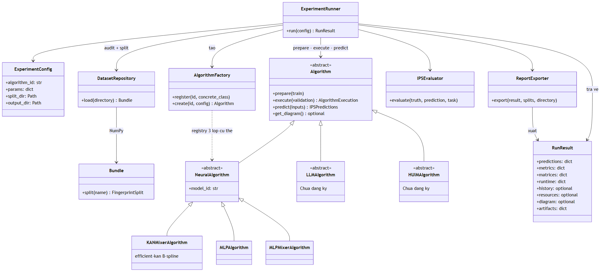

# Kiến trúc dùng chung: Algorithm → KANMixerAlgorithm

**KANMixerAlgorithm kế thừa trực tiếp Algorithm**. Không còn lớp trung gian NeuralAlgorithm trong mã dùng chung.
KAN-Mixer dùng efficient-kan B-spline; default_factory chỉ đăng ký ID kan_mixer.
LLMAlgorithm/HUIMAlgorithm kế thừa Algorithm nhưng còn trừu tượng, chưa có dự đoán IPS để đăng ký.
FastKAN/S-KAN chưa được triển khai.



[Nguồn Mermaid](shared_factory.mmd) · [SVG](shared_factory.svg).

## Luồng và trách nhiệm

1. ExperimentConfig chứa algorithm_id, params riêng nhánh, task, seed, device, split_dir, output_dir và split đánh giá.
2. AlgorithmFactory tạo KANMixerAlgorithm; DatasetRepository audit CSV/hash/schema/manifest và cung cấp split NumPy.
3. Algorithm.prepare(train) chuẩn bị biểu diễn riêng; chỉ fit scaler/binning/index/vocabulary từ train.
4. Algorithm.execute(validation) train, khai phá hoặc chốt suy luận; không bắt buộc optimizer/epoch ở lớp cha.
5. Algorithm.predict(FingerprintInputs) nhận input không có nhãn vị trí, giữ nguồn/thứ tự, trả IPSPredictions.
6. IPSEvaluator tính metric có nghĩa cho output hiện có; ReportExporter ghi artifact; Runner trả RunResult.

KANMixerAlgorithm trong src/ips/algorithms/kan/algorithm.py giữ các bước tạo tensor, gọi train.py hoặc
load_checkpoint(v1), suy luận và inverse tọa độ. Mạng PyTorch nằm trong src/ips/algorithms/kan/models/networks.py:
RSSIMixer → MixerBlock → token/channel KANLinear. Algorithm không phải torch.nn.Module.
Embedding và hai head vẫn cần nn.Linear; đó là thành phần của KAN-Mixer, không phải baseline MLP riêng.

## Phân công

| Phần | File/thư mục | Người phụ trách |
|---|---|---|
| KAN | algorithms/kan/ (mã, config, vendor, tests) | thành viên KAN |
| LLM | algorithms/llm/ | thành viên LLM |
| HUIM | algorithms/huim/ | thành viên HUIM |
| Hợp đồng và đánh giá chung | algorithms/base.py, data_access/, experiments/, metrics.py | cả nhóm review |

Mỗi lượt dùng output_dir mới; có terminal.log và log epoch in trực tiếp. Các lượt chạy trong tiến trình riêng,
không chạy đồng thời nhiều thread trong một Runner vì stdout/RNG là trạng thái toàn tiến trình.
Đổi metric, split hoặc chuẩn đầu ra cần thống nhất để so sánh được ba hướng.

## Dữ liệu và chống rò rỉ

- FingerprintInputs: raw RSSI[N,520], WAP001…WAP520, miền −104..0 hoặc100=không quan sát; source_id và row_indices.
- Row index là chỉ số0-based trong CSV nguồn, không đánh lại theo split; dòng CSV=row index+2.
  Source path phân biệt cùng index ở trainingData và validationData. Arrays được sao chép/chỉ đọc.
- FingerprintSplit bổ sung class_ids, xy float64 gốc, metadata và DatasetInfo. Predict chỉ nhận .inputs,
  không được nhận true class/xy/USERID/PHONEID.
- Giữ manifest và split16025train/3912validation nội bộ/1111test. Chưa phải split giữ riêng người đo;
  user/vị trí/RSSI vẫn có thể chung như tài liệu dữ liệu ghi.
- Center/scale cũ được audit với toàn internal train. Smoke256/128 giữ transform này như pipeline cũ.
  Binning/retrieval/item utility/vocabulary mới chỉ fit train, không dùng validation/test làm dữ liệu học.
- Test không truyền vào prepare/execute; Runner chỉ parse mẫu test sau execute và finalized=True.
  Audit hash vẫn đọc byte CSV test trước để xác minh nguồn. finalized là cam kết backend đã chốt,
  không tự phát hiện tuning test; việc không refit transform trong execute cần review/test.
- IPSPredictions.xy phải về tọa độ gốc, quy ước mét UJIIndoorLoc; chưa xác minh đầy đủ CRS, không tự Haversine/3D.
  Class ID theo13 cặp đã audit; building/floor riêng phải nhất quán và là cặp hợp lệ.

## Kết quả và mở rộng

RunResult giữ prediction arrays, metrics/matrices theo split, runtime từng pha, log_path, config snapshot,
artifact paths; history/resources/diagram tùy chọn. Nếu có xy+class IDs, evaluator dùng nguyên hàm metric cũ.
Nếu chỉ có một output, không giả lập metric của output thiếu. Export có CSV/JSON, confusion/CDF nếu có,
model .mmd/.txt nếu có, history/resources nếu backend cung cấp.

Resources KAN ghi RAM toàn tiến trình lấy mẫu và VRAM allocator PyTorch, không phải memory riêng trọng số.
Backend pipeline time không tính bước audit/tensor đã chuẩn bị trước; xem RunResult.runtime cho toàn lượt.
Backend chưa đo memory trả resources=None. Mỗi nhánh phải ghi phạm vi phép đo phù hợp, ngân sách khác nhau
không tự tương đương epoch/token/vòng khai phá.

```python
from pathlib import Path
from ips.experiments.contracts import ExperimentConfig
from ips.experiments.factory import default_factory
from ips.experiments.runner import ExperimentRunner
from my_team_backend import MyLLMPositionAlgorithm  # concrete Algorithm do nhóm triển khai

factory = default_factory()
factory.register("team_llm_v1", MyLLMPositionAlgorithm)
config = ExperimentConfig("team_llm_v1", Path("runs/team_llm_v1"),
                          params={"model_path": "..."}, task="position")
result = ExperimentRunner(factory=factory).run(config)
```

Không đăng ký adapter trừu tượng hoặc implementation chỉ trả placeholder.
task=position đòi xy và joint building/floor; coordinates đòi xy; classification đòi ít nhất một output phân loại;
auto đánh giá các output có thực.

## Các quyết định còn thiếu

LLM: model cục bộ/API, RSSI/AP/missing serialization, fine-tune/inference, train retrieval/few-shot,
decoding nhãn/tọa độ, phản hồi không hợp lệ, seed/model revision/token/runtime/memory.

HUIM: items/binning fit train, định nghĩa utility/ngưỡng, thuật toán khai phá, khớp pattern với mẫu mới,
quy tắc itemset→tòa/tầng/xy, không khớp/nhiều khớp và chi phí mine/predict. Itemset chưa phải vị trí IPS.

## Phần cá nhân và lịch sử

MLP/MLP-Mixer, tài liệu học cũ, báo cáo so sánh và script suite cũ là ignored; bản trên máy được giữ trong personal_learning/,
không còn là dependency của dự án chung. Xem .gitignore và README root để biết phạm vi.
src/ips/algorithms/kan/configs/model.json là cấu hình KAN; config baseline cũ nằm trong personal_learning/archive/workspace/configs/.
Checkpoint KAN v1 vẫn được hỗ trợ. Suite lịch sử phải tái lập trên commit gốc, không nới audit hash hoặc sửa số liệu cũ.

## Thư mục review KAN

[algorithms/kan/](../../src/ips/algorithms/kan/README.md) chứa toàn bộ triển khai KAN,
kể cả config và tests riêng. Phần dữ liệu/split, hợp đồng Algorithm, Factory/Runner và metrics vẫn dùng chung.
Root tests/test_pipeline.py chỉ nối vào tests KAN để unittest discovery tiếp tục hoạt động.
Các alias backend cũ đã bỏ; import Python dùng ips.algorithms.kan.*.
Dữ liệu dùng chung chỉ cung cấp NumPy/split, không còn Bundle.dataset() phụ thuộc KAN.
Hai tên config cũ configs/kan_mixer.json và configs/experiments/kan_mixer_smoke.json
được ánh xạ khi không có file cũ, để giữ lệnh CLI cũ.
