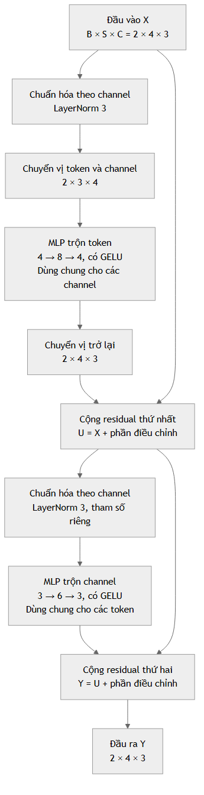

# Chặng 2: MLP-Mixer từ trực giác đến thiết kế cho RSSI

Tài liệu dành cho người đã hoàn thành chặng 1. Bạn học theo bốn buổi, mỗi buổi khoảng 30–45 phút; hoàn thành câu hỏi và bài tập của buổi hiện tại trước khi chuyển tiếp. Thời lượng là gợi ý của người hướng dẫn.

Sau chặng này, bạn cần tự giải thích được: token là gì, channel là gì, hai nhánh mixing khác nhau ở trục nào, vì sao phải chuyển vị tensor, và vì sao đưa RSSI vào Mixer cần một thiết kế riêng.

## 0. Những gì đã kiểm tra trong repo

Sơ đồ dưới đây mô tả repo tại thời điểm viết chặng 2. Cấu trúc hiện tại đã cập nhật trong [README dự án](../../../README.md): PDF ở `references/papers/`, raw ở `data/raw/ujiindoorloc/`.

```text
D:\IPS_ThacSi
├── 3_KSE_2025_Comparative_Study_of_Kolmogorov-Arnold_Network_Models_for_Robust_WiFi_Fingerprinting-based_Positioning.pdf
└── ujiindoorloc\UJIndoorLoc
    ├── trainingData.csv
    └── validationData.csv
```

Trước khi bổ sung chặng 2, repo chưa có tài liệu chặng 1, mã Python hoặc `AGENTS.md`. Vì vậy tài liệu này tiếp nối chặng 1 theo xác nhận của bạn và có một phần nhắc lại ngắn về kích thước dữ liệu.

**Bài báo có sẵn:** *A Comparative Study of Kolmogorov-Arnold Network Models for Robust WiFi Fingerprinting-based Positioning*, KSE 2025, DOI [10.1109/KSE68178.2025.11309684](https://doi.org/10.1109/KSE68178.2025.11309684). Đã đọc sáu trang của PDF tại repo. Mục III và bảng I so sánh KAN, FastKAN, BSRBF-KAN, S-KAN, FC-KAN. Mục IV.A nêu việc tách UJIIndoorLoc thành ba tập tương ứng ba tòa nhà; hình 2 mô tả đầu ra tọa độ 2D. Bài này không định nghĩa MLP-Mixer hoặc KAN-Mixer. Không dùng kết quả của nó làm kết quả cho một mô hình Mixer mới.

**Nguồn kiến trúc cho chặng 2:** Tolstikhin và cộng sự, *MLP-Mixer: An all-MLP Architecture for Vision*, NeurIPS 2021. Đọc [bài báo gốc](https://proceedings.neurips.cc/paper/2021/file/cba0a4ee5ccd02fda0fe3f9a3e7b89fe-Paper.pdf), đặc biệt hình 1 và mục 2; [bản arXiv](https://arxiv.org/abs/2105.01601); [mã của nhóm tác giả, JAX/Flax](https://github.com/google-research/vision_transformer/blob/main/vit_jax/models_mixer.py). Nhánh `main` có thể thay đổi; ở chặng thực nghiệm sẽ khóa commit nếu dùng mã bên ngoài.

**Quy ước về bằng chứng trong bài học:** “Theo nguồn” chỉ thông tin có trong tài liệu được dẫn. “Ví dụ minh họa” là số hoặc dữ liệu do người hướng dẫn đặt ra để giải thích, không phải kết quả đo. “Thiết kế đề xuất” là lựa chọn cần kiểm chứng bằng thực nghiệm trên RSSI.

**Kiểm tra trực tiếp hai CSV trong repo:**

| Tệp | Số dòng dữ liệu | Tổng số cột | Cột RSSI |
|---|---:|---:|---:|
| `trainingData.csv` | 19.937 | 529 | 520 |
| `validationData.csv` | 1.111 | 529 | 520 |

Các cột RSSI là `WAP001` đến `WAP520`. Chín cột còn lại là `LONGITUDE`, `LATITUDE`, `FLOOR`, `BUILDINGID`, `SPACEID`, `RELATIVEPOSITION`, `USERID`, `PHONEID`, `TIMESTAMP`. Không thấy ô RSSI rỗng; tuy nhiên rất nhiều ô bằng `100`. Theo [tài liệu UCI](https://archive.ics.uci.edu/dataset/310/ujiindoorloc), `100` có nghĩa AP không được phát hiện, không phải tín hiệu +100 dBm. Phân biệt “không có ô trống” với “không phát hiện tín hiệu”. Tên `validationData.csv` được giữ nguyên; vai trò dùng làm validation hay test trong nghiên cứu sẽ được xác định ở chặng thiết kế thực nghiệm.

## Buổi 2.1. Từ một vector đến bảng token × channel

### Mục tiêu

Đọc được các dạng `[520]`, `[B, 520]`, `[B, S, C]` và hiểu dữ liệu đi vào Mixer dưới dạng một bảng cho mỗi mẫu.

### Giải thích bằng ngôn ngữ đơn giản

Một **vector** là một dãy số, ví dụ bốn RSSI `[-45, -80, -63, -91]`. Một **ma trận** là bảng số có hàng và cột. **Tensor** là cách gọi chung cho dữ liệu số có các trục: một dãy có một trục, một bảng có hai trục, một chồng bảng có ba trục.

**Shape** là kích thước các trục. Với batch 8 fingerprint và 520 AP, shape là `[8, 520]`. Trục đầu là các mẫu khác nhau; trục sau là các AP của cùng một mẫu. Mixing trong bài này diễn ra bên trong từng mẫu, không trộn dữ liệu của hai người trong cùng batch.

**Token** là một đơn vị được mô hình xử lý. Với ảnh, token bắt đầu từ một mảnh ảnh nhỏ gọi là **patch**. **Channel** là một thành phần của vector đặc trưng biểu diễn token sau phép chiếu. Channel ẩn không nhất thiết là màu RGB, cũng không nhất thiết là một AP.

Theo kiến trúc gốc, ảnh được chia thành các patch không chồng lấn, mỗi patch được đưa qua cùng một lớp tuyến tính để tạo vector đặc trưng; các vector được xếp thành bảng. Nguồn: [MLP-Mixer, mục 2](https://arxiv.org/html/2105.01601v4#S2).

### Ví dụ minh họa về ảnh

Tự đặt một ảnh RGB kích thước `8 × 8`, chia thành patch `4 × 4`:

- Có `(8 / 4) × (8 / 4) = 4` patch, tức `S = 4` token.
- Mỗi patch có `4 × 4 × 3 = 48` số sau khi trải phẳng.
- Chọn một lớp tuyến tính `48 → 6` để có `C = 6` channel ẩn.
- Với batch `B = 2`, chuỗi shape là `[2, 4, 48] → [2, 4, 6]`.

Đây là phép biến đổi có học, không chỉ đổi tên 48 giá trị thành 6 giá trị. Sáu giá trị mới phụ thuộc trọng số và bias của lớp tuyến tính.

### Ví dụ minh họa về RSSI

Trong một thiết kế đề xuất, lấy một AP làm một token. Với bốn AP, chọn `C = 3`, bảng đặc trưng của một mẫu có dạng:

| Token | Channel 1 | Channel 2 | Channel 3 |
|---|---:|---:|---:|
| AP1 | 0,2 | 0,7 | -0,1 |
| AP2 | 0,5 | -0,3 | 0,4 |
| AP3 | -0,2 | 0,8 | 0,6 |
| AP4 | 0,1 | 0,2 | -0,5 |

Các số là đặc trưng ẩn minh họa, không phải RSSI đo thật. Một hàng mô tả một AP; một cột mô tả cùng một thành phần đặc trưng qua bốn AP. Channel chưa được gán nghĩa như “khoảng cách” hoặc “tầng”: muốn khẳng định những nghĩa đó phải có phân tích thêm.

### Câu hỏi tự kiểm tra

1. `[16, 520]` nghĩa là 16 AP hay 16 fingerprint?
2. Trong `[16, 520, 32]`, số 32 biểu thị số tầng hay số đặc trưng ẩn?
3. Nếu ảnh trên dùng patch `2 × 2`, số token tăng thành bao nhiêu?

### Bài tập ngắn

Vẽ một bảng bốn hàng, ba cột như ví dụ. Khoanh một hàng và một cột; ghi lần lượt “đặc trưng của một token” và “một đặc trưng qua nhiều token”. Sau đó viết bằng lời ý nghĩa từng trục của `[2, 4, 3]`.

## Buổi 2.2. Hai phép mixing và một khối Mixer

### Mục tiêu

Phân biệt token-mixing với channel-mixing; đọc được một khối có chuẩn hóa, hai nhánh MLP và hai phép cộng residual.

### Giải thích và ví dụ

**Mixing** ở đây nghĩa là học cách kết hợp thông tin. MLP có hai lớp tuyến tính và một hàm kích hoạt ở giữa. Nếu chỉ xếp hai phép tuyến tính mà không có hàm kích hoạt, chúng vẫn có thể gộp thành một phép affine; khả năng biểu diễn sẽ hạn chế hơn.

**Token-mixing:** trên bảng bốn AP, ba channel ở buổi trước, lấy một cột, chẳng hạn `[0,2; 0,5; -0,2; 0,1]`, đưa qua một MLP `4 → D_t → 4`. Nhánh này cho phép thông tin AP1 ảnh hưởng biểu diễn tại AP2, AP3, AP4. Cùng một MLP được áp dụng cho cả ba cột. Không tạo ba bộ trọng số riêng.

Ví dụ tính tay giản lược: một phép kết hợp có thể tạo số `0,2 + 2 × 0,5 = 1,2`. Đây chỉ minh họa “kết hợp nhiều token”, bỏ qua chuẩn hóa, lớp thứ hai và hàm kích hoạt; không phải toàn bộ phép tính của Mixer.

**Channel-mixing:** lấy một hàng, chẳng hạn `[0,2; 0,7; -0,1]`, đưa qua MLP `3 → D_c → 3`. Nhánh này kết hợp các thành phần đặc trưng tại cùng token. Cùng một MLP được dùng cho bốn hàng.

Ở đầu nhánh, channel-mixing không đọc trực tiếp các hàng khác; nhưng nếu trước đó đã có token-mixing, hàng hiện tại đã chứa thông tin từ nhiều token. “Tính riêng trên mỗi hàng” không có nghĩa toàn mạng không có tương tác giữa AP.

Việc chia sẻ trọng số theo hai trục được xác định trong [mục 2 của bài báo](https://proceedings.neurips.cc/paper/2021/file/cba0a4ee5ccd02fda0fe3f9a3e7b89fe-Paper.pdf) và thể hiện trong [mã nhóm tác giả](https://github.com/google-research/vision_transformer/blob/main/vit_jax/models_mixer.py).

### Những bộ phận còn lại

**LayerNorm:** chuẩn hóa các channel của từng token rồi dùng các hệ số scale/shift có học. Với `[B, S, C]`, dùng `LayerNorm(C)` trước khi chuyển vị. Nó không dùng thống kê toàn bộ tập train, không thay thế bước xử lý RSSI đầu vào. Trực giác là giữ các thành phần trong một vector ở thang đo thuận lợi cho tính toán. Nguồn: [PyTorch 2.9, LayerNorm](https://docs.pytorch.org/docs/2.9/generated/torch.nn.LayerNorm.html).

**GELU:** hàm kích hoạt làm phép biến đổi trở thành phi tuyến. Có thể xem nó như một cổng mềm điều chỉnh giá trị; chưa cần thuộc công thức. Không coi GELU giống hệt ReLU. Nguồn: [PyTorch 2.9, GELU](https://docs.pytorch.org/docs/2.9/generated/torch.nn.GELU.html).

**Residual/skip connection:** giữ một đường dữ liệu đi thẳng và cộng với phần thay đổi nhánh MLP học được: `đầu ra = đầu vào + phần điều chỉnh`. Nếu đầu vào `[B,S,C]`, phần điều chỉnh cũng phải `[B,S,C]` để cộng tương ứng từng phần tử. Residual không bảo đảm mô hình sẽ tốt hơn trong mọi thực nghiệm.

**Pooling:** sau các khối, lấy trung bình trên trục token để tạo vector toàn mẫu. Với hai token `[1,3]` và `[5,7]`, trung bình là `[3,5]`. Đây là trung bình đặc trưng đã học, không phải trung bình RSSI thô. **Head** là lớp đầu ra chuyển vector toàn mẫu thành điểm phân loại hoặc tọa độ theo nhiệm vụ.

### Công thức sau khi đã hiểu trực giác

Xét một mẫu `X ∈ R^(S×C)`. Ký hiệu `X[:,c]` là cột c, `X[s,:]` là hàng s. Đặt `LN_t`, `LN_c` là hai LayerNorm riêng. Bỏ qua dropout khi viết công thức:

```text
U[:, c] = X[:, c] + MLP_token(LN_t(X)[:, c])
Y[s, :] = U[s, :] + MLP_channel(LN_c(U)[s, :])

MLP_token:   S → D_t → S
MLP_channel: C → D_c → C
```

Cụ thể, nếu viết vector dạng cột:

```text
MLP_token(z)   = W_t2 GELU(W_t1 z + b_t1) + b_t2
W_t1: [D_t, S]     W_t2: [S, D_t]

MLP_channel(v) = W_c2 GELU(W_c1 v + b_c1) + b_c2
W_c1: [D_c, C]     W_c2: [C, D_c]
```

`D_t`, `D_c` là độ rộng lớp ẩn; không phải số token/channel sau khối. Công thức là cách viết lại hai nhánh của kiến trúc, thêm bias tường minh. Nguồn đối chiếu: [mã MlpBlock và MixerBlock](https://github.com/google-research/vision_transformer/blob/main/vit_jax/models_mixer.py).

### Luồng kích thước tự đặt để học

Chọn `B=2`, `S=4`, `C=3`, `D_t=8`, `D_c=6`:

| Bước | Shape | Ý nghĩa |
|---|---|---|
| Đầu vào khối | `[2,4,3]` | Hai bảng, mỗi bảng bốn token, ba channel |
| LayerNorm theo channel | `[2,4,3]` | Chuẩn hóa ba channel từng token |
| Chuyển vị token/channel | `[2,3,4]` | Đưa trục token ra cuối |
| Linear token 1 | `[2,3,8]` | `4 → 8` |
| GELU và Linear token 2 | `[2,3,4]` | `8 → 4` |
| Chuyển vị trở lại | `[2,4,3]` | Khôi phục cách xếp trục |
| Cộng đầu vào | `[2,4,3]` | Residual thứ nhất |
| LayerNorm theo channel | `[2,4,3]` | Bộ tham số chuẩn hóa riêng |
| Linear channel 1 | `[2,4,6]` | `3 → 6` |
| GELU và Linear channel 2 | `[2,4,3]` | `6 → 3` |
| Cộng residual | `[2,4,3]` | Đầu ra khối |

`nn.Linear` tác động lên trục cuối; đây là lý do chuyển vị trước token-mixing. Hai phép chuyển vị chỉ đổi cách nhìn dữ liệu, không học trọng số, không tự trộn giá trị. Nguồn: [Linear](https://docs.pytorch.org/docs/2.9/generated/torch.nn.Linear.html), [transpose](https://docs.pytorch.org/docs/2.9/generated/torch.transpose.html).



Sơ đồ được vẽ riêng cho bài học. Kiến trúc tổng thể là `biểu diễn token → L khối Mixer → LayerNorm cuối → trung bình token → head`. Các khối lặp có cùng shape, nhưng thông thường mỗi khối có bộ trọng số riêng, không mặc định chia sẻ giữa các khối.

### Câu hỏi tự kiểm tra

1. Token-mixing nhận vector dài S hay C?
2. Vì sao output MLP token phải trở về S?
3. Channel-mixing dùng một MLP chung hay một MLP riêng cho từng token?
4. Token-mixing có trộn trục batch không?

### Bài tập ngắn

Tự viết lại bảng shape cho `B=8`, `S=10`, `C=16`, `D_t=20`, `D_c=32`. Không mở đáp án trước. Ghi một câu giải thích vì sao hai MLP này không chỉ là một MLP lớn trên vector trải phẳng.

## Buổi 2.3. Chuyển từ ảnh sang Wi-Fi RSSI

### Mục tiêu

Chọn được cách tạo token cho 520 AP, nêu rõ giả định và không coi số thứ tự cột là vị trí vật lý.

### Phần giữ lại và phần phải thiết kế

**Theo nguồn:** Mixer gốc có đầu vào patch ảnh, hai nhánh mixing, chuẩn hóa, residual và head phân loại. Kết quả ảnh trong bài báo không chứng minh hiệu quả trên UJIIndoorLoc. Bài báo ghi nhận lợi ích của dữ liệu lớn và regularization, cùng nguy cơ overfitting trong một số thiết lập. Nguồn: [MLP-Mixer, mục 3.1–3.3](https://arxiv.org/html/2105.01601v4#S3).

**Thiết kế đề xuất cho đề tài:** giữ cơ chế hai nhánh, nhưng thiết kế lại đầu vào token, xử lý không phát hiện AP, số khối, độ rộng và head. Việc mô hình có cải thiện IPS hay không là câu hỏi thực nghiệm.

| Thành phần | Hướng xử lý đề xuất trên RSSI | Lý do |
|---|---|---|
| Patch ảnh | Thay bằng AP hoặc nhóm AP | Đầu vào không có lưới pixel tự nhiên |
| Chiếu patch | Chiếu các thuộc tính RSSI sang C channel | Tạo bảng `[B,S,C]` |
| Hai nhánh mixing | Giữ cấu trúc và chia sẻ trọng số theo trục | Duy trì đối tượng so sánh với Mixer |
| Thứ tự token | Cố định danh sách cột AP | Trọng số token-mixing gắn với vị trí token |
| Quy mô | Bắt đầu với mô hình nhỏ | UJIIndoorLoc khác quy mô dữ liệu ảnh lớn |
| Head | Tòa nhà/tầng, tọa độ hoặc nhiều head | Phù hợp đầu ra IPS |

### Thiết kế A: một AP là một token

Đề xuất dùng hai thuộc tính cho AP j: `z_j` là RSSI đã xử lý và đưa về thang phù hợp; `m_j` là cờ phát hiện, bằng 1 khi RSSI khác 100, bằng 0 khi bằng 100. Giữ cờ trước khi thay giá trị đặc biệt. Công thức thử nghiệm:

```text
RSSI thô:             [B,520]
Hai thuộc tính/AP:    [B,520,2]
Linear dùng chung 2→C:[B,520,C]
```

Ví dụ quy tắc cố định để thử sau này: nếu phát hiện, `z=(RSSI+104)/104`; nếu không phát hiện, `z=0, m=0`. RSSI -104 đã phát hiện có `z=0, m=1`, vì vậy vẫn phân biệt được hai tình huống. Quy tắc này là đề xuất dựa trên khoảng giá trị UCI công bố; chưa phải lựa chọn tối ưu hoặc quy tắc từ bài báo KSE. Các thống kê chuẩn hóa học từ dữ liệu, nếu dùng, chỉ được fit trên tập train.

Ví dụ lựa chọn nhỏ để lập kế hoạch: `S=520`, `C=32`, hai khối, `D_t=64`, `D_c=64`. Đây là siêu tham số khởi điểm đề xuất, chưa phải kết quả chọn bằng validation. Với `B=8`, embedding ra `[8,520,32]`; token MLP đi `520→64→520`, channel MLP đi `32→64→32`.

Token-mixing của mô hình đã huấn luyện nhạy với thứ tự AP. Khi dùng một thứ tự cố định trong cả train và suy luận, trọng số theo vị trí token có thể phân biệt các AP. Nếu chỉ đổi thứ tự AP lúc suy luận, mô hình nhận sai nghĩa cột. Việc huấn luyện lại với một hoán vị cố định là một thí nghiệm khác, không chứng minh mô hình đang dùng bất biến với hoán vị.

### Thiết kế B: một nhóm AP là một token

Ví dụ chia 520 cột theo thứ tự đã lưu thành 52 nhóm, mỗi nhóm 10 AP. Dùng RSSI đã xử lý, có thể ghép thêm 10 cờ phát hiện, rồi chiếu `20→C`. Shape: `[B,520] → [B,52,20] → [B,52,C]` nếu dùng cả mask.

Ưu điểm dự kiến là giảm số token. Hạn chế là gom các cột liên tiếp có thể mang tính tùy ý. `WAP001` và `WAP002` không được tài liệu dữ liệu xác nhận là hai AP ở gần nhau. Không diễn giải nhóm cột như vùng địa lý nếu chưa có thông tin bố trí AP. Muốn so sánh A và B, phải giữ cùng split và ngân sách tìm siêu tham số; đây sẽ là một phân tích biến thể của chặng thực nghiệm.

### Một bẫy cần hiểu: chỉ một channel

Nếu đưa RSSI thẳng vào khối thành `[B,520,1]` và dùng `LayerNorm(1)`, mỗi vector chuẩn hóa có một giá trị: trừ chính trung bình của nó cho kết quả 0. Sau scale/shift, nhánh được chuẩn hóa không còn phân biệt RSSI theo cách mong muốn. Đường residual vẫn còn tín hiệu, nên không kết luận cả mô hình có đầu ra hằng. Cách tránh trong thiết kế hiện tại: embedding sang `C>1` trước khi vào khối. Điều kiện `C>1` tránh bẫy này, nhưng không bảo đảm chất lượng.

Suy luận trên xuất phát từ [định nghĩa LayerNorm](https://docs.pytorch.org/docs/2.9/generated/torch.nn.LayerNorm.html); script buổi 2.4 minh họa trực tiếp.

### Ưu điểm, giới hạn và chi phí

| Tiêu chí | Nhận xét thiết kế cho IPS |
|---|---|
| Tương tác giữa AP | Token-mixing có thể kết hợp nhiều AP trong cùng mẫu |
| Đơn giản khi cài | Dùng Linear, GELU, LayerNorm, transpose và phép cộng |
| Linh hoạt đầu ra | Có thể thay head theo nhiệm vụ IPS |
| Số token | Phải khớp kích thước Linear token đã tạo; bỏ bớt AP cần thay thiết kế/huấn luyện |
| Số AP phát hiện thay đổi | Giữ 520 vị trí và mask; không xóa token mỗi lần quét |
| Thứ tự cột | Cần nhất quán giữa train, validation và suy luận |
| Tính toán | Không có attention không đồng nghĩa luôn ít tham số hoặc nhanh hơn MLP |
| Khả năng tổng quát hóa | Cần kiểm chứng trên người/thiết bị/thời điểm khác |

Có thể tự đếm tham số của hai MLP bằng công thức số trọng số của một Linear `a→b` là `a×b`, cộng `b` bias:

```text
P_token   = 2*S*D_t + D_t + S
P_channel = 2*C*D_c + D_c + C
```

Hai LayerNorm với affine mặc định thêm `4*C` tham số cho một khối. Chi phí hai nhánh, bỏ qua bias/chuẩn hóa/kích hoạt, tỷ lệ với `B*S*C*(D_t+D_c)` (hai lớp trong mỗi nhánh tạo hệ số hằng). Nếu giữ `D_t` cố định thì phần token tăng tuyến tính theo S; nếu chọn `D_t` tỷ lệ với S thì phần đó tăng theo S². Tránh nói “Mixer luôn có chi phí tuyến tính” mà không nêu giả định.

### Câu hỏi tự kiểm tra

1. Giá trị 100 được đưa vào mô hình như tín hiệu rất mạnh có đúng không?
2. Vì sao fingerprint có 12 AP phát hiện vẫn nên giữ đủ 520 vị trí?
3. Vì sao chia nhóm AP theo số thứ tự chưa đủ để gọi là nhóm không gian?
4. Nếu thay `C=32` bằng `C=1`, điều gì xảy ra ở LayerNorm?

### Bài tập ngắn

Viết một thiết kế 8–10 dòng theo mẫu: “Tôi chọn ... làm token; S=...; mỗi token có ... thuộc tính; embedding ...→...; MLP token ...→...→...; MLP channel ...→...→...; head ...; thứ tự AP được lưu bằng ...; giả định cần kiểm chứng là ...”. Chỉ chọn một nhiệm vụ đầu ra cho bài tập này.

## Buổi 2.4. Thực hành từng phép biến đổi trong PyTorch

### Mục tiêu

Chạy một lượt tính xuôi trên dữ liệu nhỏ, dự đoán shape trước mỗi lệnh và phân biệt kiểm tra cấu trúc với đánh giá định vị.

### Môi trường và lệnh chạy

Đã xác minh Python 3.12 và PyTorch `2.9.0+cpu` sẵn có trên máy tại thời điểm kiểm tra; đây là phiên bản đang cài, không phải tuyên bố về bản mới nhất. Script đã chạy bằng môi trường đó. Tài liệu API dẫn bản 2.9 để khớp.

Từ PowerShell:

```powershell
Set-Location D:\IPS_ThacSi
$env:PYTHONIOENCODING = 'utf-8'
python -c "import torch; print(torch.__version__)"
python .\lessons\chang_02\shape_lab.py
```

Nếu dùng máy khác chưa có PyTorch, trước hết tạo môi trường riêng:

```powershell
python -m venv .venv
.\.venv\Scripts\python.exe -m pip install torch --index-url https://download.pytorch.org/whl/cpu
.\.venv\Scripts\python.exe .\lessons\chang_02\shape_lab.py
```

Đây là môi trường học trên CPU, không phải môi trường khóa phiên bản cho thí nghiệm sau này. Nguồn cài đặt: [PyTorch, Start Locally](https://pytorch.org/get-started/locally/). Sau khi ổn định môi trường nghiên cứu sẽ lưu phiên bản phụ thuộc.

### Đọc mã theo bốn phần

Mở `shape_lab.py`. Mã minh họa dùng bốn AP và ba channel ẩn, không đọc CSV và không huấn luyện mô hình IPS. Các số đầu vào là đặc trưng giả lập để quan sát phép toán.

**Phần 1: tạo dữ liệu và nhìn trục.**

```python
x = torch.tensor([
    [[0.2, 0.7, -0.1], [0.5, -0.3, 0.4],
     [-0.2, 0.8, 0.6], [0.1, 0.2, -0.5]],
    [[0.4, 0.1, -0.2], [0.3, -0.1, 0.8],
     [0.2, 0.5, 0.3], [-0.4, 0.2, 0.1]],
], dtype=torch.float32)
```

Hai bảng độc lập, mỗi bảng bốn hàng và ba cột. `float32` là kiểu số thực được dùng cho phép toán mạng trong ví dụ. `manual_seed` làm việc khởi tạo dễ lặp lại trong cùng môi trường; không phải bằng chứng mô hình ổn định qua nhiều seed.

**Phần 2: nhánh token.**

```python
q = norm_token(x).transpose(1, 2)
q = token_fc2(activation(token_fc1(q)))
u = x + q.transpose(1, 2)
```

`transpose(1,2)` hoán đổi trục token và channel, giữ nguyên batch. Lớp token 1 có `in_features=4`; sau chuyển vị trục cuối đúng là 4. Trước khi cộng `x`, phải chuyển vị trở lại.

**Phần 3: nhánh channel.**

```python
r = norm_channel(u)
y = u + channel_fc2(activation(channel_fc1(r)))
```

Trục cuối đã là ba channel nên không cần chuyển vị. Hai LayerNorm là hai đối tượng riêng. Trong một mô hình huấn luyện hoàn chỉnh, các lớp sẽ được đăng ký trong `nn.Module`; chặng này tách từng phép toán để bạn nhìn được luồng.

**Phần 4: gộp token và kiểm tra bẫy C=1.**

```python
pooled = nn.LayerNorm(3)(y).mean(dim=1)
single_channel = torch.tensor([[[-0.4], [-0.8]]])
print(nn.LayerNorm(1)(single_channel))
```

`mean(dim=1)` chỉ gộp token, còn batch và channel, cho `[2,3]`. LayerNorm cuối tương ứng vị trí trước pooling của kiến trúc tham chiếu. Không đặt head vì chưa chọn nhiệm vụ và chưa huấn luyện. Dòng cuối cho tensor toàn 0 với tham số khởi tạo mặc định, giúp thấy bẫy một channel.

### Cách kiểm tra đầu ra

Script in chuỗi shape trùng bảng buổi 2.2, kiểm tra khối giữ `[2,4,3]` và pooling ra `[2,3]`. Dòng cuối báo hoàn tất kiểm tra kích thước. Các trọng số đang khởi tạo ngẫu nhiên: không diễn giải giá trị đầu ra như tọa độ hoặc kết quả nghiên cứu.

| Lỗi thường gặp | Nguyên nhân cần kiểm tra |
|---|---|
| `ModuleNotFoundError: torch` | Lệnh đang dùng Python khác môi trường đã cài |
| `mat1 and mat2 shapes cannot be multiplied` | Trục cuối không khớp `in_features`; kiểm tra transpose |
| Không cộng được residual | Nhánh chưa trở lại cùng shape với đầu vào |
| LayerNorm không khớp shape | `normalized_shape` không bằng số channel |
| Chạy được nhưng ý nghĩa sai | Đổi trục batch, chuẩn hóa sai trục hoặc nhầm AP với channel |

### Câu hỏi tự kiểm tra

1. Lệnh nào đổi shape nhưng không có tham số học?
2. Vì sao pooling ở `dim=1`, không ở `dim=0`?
3. Những shape đúng có chứng minh sai số định vị thấp không?

### Bài tập ngắn

Chạy script một lần rồi thử thay `D_t` từ 8 thành 5 và `D_c` từ 6 thành 7 bằng cách sửa cặp Linear tương ứng. Trước khi chạy, viết các shape mới ở lớp ẩn; xác nhận shape đầu ra khối vẫn `[2,4,3]`. Không chỉ sửa một lớp trong cặp vì kích thước hai lớp phải khớp nhau.

## Đáp án ngắn: chỉ mở sau khi tự làm

**Buổi 2.1:** 16 fingerprint; 32 channel ẩn; ảnh `8×8` với patch `2×2` có 16 token.

**Buổi 2.2:** token-mixing nhận S; phải trở về S để giữ shape và cộng residual; channel-mixing dùng chung MLP cho các token trong một khối; không trộn batch. Bài tập: `[8,10,16] → [8,16,10] → [8,16,20] → [8,16,10] → [8,10,16] → [8,10,32] → [8,10,16]`, chuẩn hóa và residual giữ shape. Một MLP trên vector trải phẳng không có cùng cơ chế tách trục/chia sẻ trọng số.

**Buổi 2.3:** 100 là không phát hiện; giữ vị trí để mỗi token tiếp tục biểu thị cùng AP; số thứ tự chưa cho vị trí vật lý; LayerNorm một phần tử triệt phần biến thiên ở đầu nhánh chuẩn hóa.

**Buổi 2.4:** transpose không học tham số; `dim=1` gộp token còn `dim=0` trộn các mẫu; kiểm tra shape chỉ chứng minh phép toán khớp kích thước, không chứng minh khả năng định vị.

## Điều kiện hoàn thành chặng 2

- [ ] Giải thích token và channel bằng một ví dụ RSSI.
- [ ] Vẽ lại hai nhánh mixing, ghi đúng trục và shape.
- [ ] Nêu đúng cách chia sẻ trọng số trong một khối.
- [ ] Giải thích chuẩn hóa trước chuyển vị và residual.
- [ ] Phân biệt kiến trúc gốc cho ảnh với thiết kế đề xuất cho AP.
- [ ] Nêu được xử lý giá trị 100 và lý do giữ thứ tự AP.
- [ ] Chạy script, thay độ rộng hai nhánh và giải thích đầu ra.
- [ ] Không coi bài báo KSE trong repo là bài định nghĩa KAN-Mixer.

**Bài kiểm tra cuối chặng:** giải thích trong khoảng hai phút: “Tôi đưa một fingerprint 520 AP vào MLP-Mixer bằng cách nào, hai nhánh học gì và vì sao chưa thể khẳng định nó tốt hơn MLP?”. Sau đó gửi câu trả lời cho người hướng dẫn để được sửa các hiểu nhầm trước chặng 3.

Ở chặng 3 sẽ học KAN và xác định một công trình KAN-Mixer cụ thể trước khi quyết định thay nhánh nào. Chặng 2 mới đặt nền về Mixer; chưa lựa chọn phiên bản KAN-Mixer, chưa huấn luyện và chưa có kết quả IPS.
