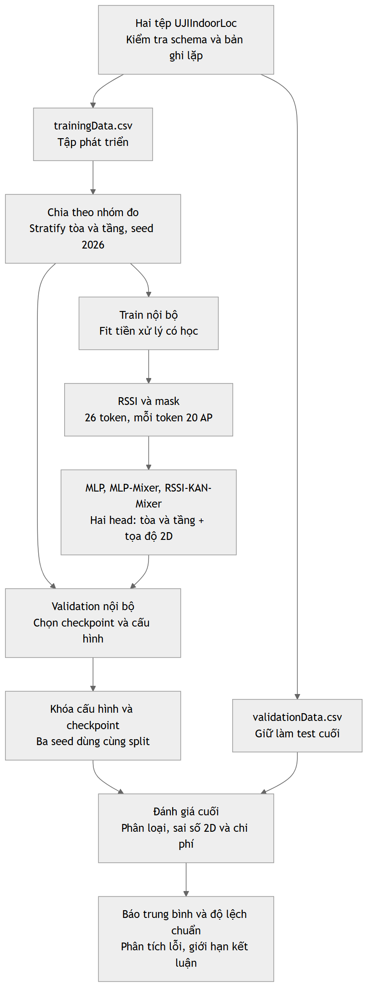

# Chặng 4: Mô hình hóa bài toán định vị trong nhà trên UJIIndoorLoc

Tài liệu tiếp nối `Hoc_MLP_Mixer_KAN_Mixer_IPS_Chang_1_2_3.docx`. Đọc theo năm buổi nhỏ. Mỗi buổi có mục tiêu, giải thích, ví dụ, tự kiểm tra và bài tập. Chặng này chốt thiết kế nghiên cứu; việc tạo split, cài mô hình và chạy huấn luyện thuộc các chặng sau.

**Đường dẫn sau setup chặng 6:** DOCX nguồn ở [references/course_materials](../../../references/course_materials/Hoc_MLP_Mixer_KAN_Mixer_IPS_Chang_1_2_3.docx); mã thực hành ở [chặng 6](../chang_06/README.md). Thiết kế chặng 4 giữ vai trò bản đề xuất; các cấu hình chạy thực tế nằm trong `configs/base.json` và metadata từng run.

**Đề xuất trung tâm:** một fingerprint RSSI đi vào mô hình; mô hình dự đoán một tổ hợp tòa–tầng hợp lệ và hai tọa độ. Thực nghiệm tối thiểu so sánh MLP, MLP-Mixer và RSSI-KAN-Mixer bằng cùng tiền xử lý, cùng split và cùng quy tắc huấn luyện. Thực nghiệm mở rộng kiểm tra từng nhánh KAN, cách token hóa và khả năng tổng quát hóa qua nhóm đo.

## Quy ước về nguồn và kết quả

- **Theo nguồn:** dữ kiện hoặc kiến trúc được dẫn từ bài báo, dữ liệu chính thức, mã tác giả hoặc tài liệu thư viện.
- **Kiểm tra repo:** thống kê tính trực tiếp từ hai CSV tại repo, lưu trong [data_audit.json](data_audit.json), kèm SHA-256 của tệp. Đây là kiểm tra dữ liệu, không phải kết quả mô hình.
- **Đề xuất:** lựa chọn do người hướng dẫn đưa ra cho đề tài, chưa được chứng minh tối ưu.
- **Ví dụ:** phép tính hoặc số tự đặt để học, không phải số đo chất lượng IPS.

Nguồn kiến trúc KAN vẫn là [KAN-Mixers của Canuto và cộng sự, v1](https://arxiv.org/abs/2503.08939v1), mục 2.3, dùng KAN ở cả hai nhánh mixing và cài đặt `efficient-kan`. Bài nghiên cứu phân loại ảnh. Cách tạo token AP, head định vị và giao thức dưới đây là biến thể IPS đề xuất. Bài KSE trong repo nghiên cứu các mô hình KAN khác, có tách theo tòa; kết quả của nó không phải chuẩn đối chiếu trực tiếp cho mô hình dự đoán trên toàn bộ ba tòa của chúng ta.

## Buổi 4.1. Chọn đầu vào, đầu ra và biểu diễn vị trí

### Mục tiêu

Phân biệt điều mô hình được biết khi định vị với điều cần dự đoán; hiểu ba lựa chọn phân loại, hồi quy và nhiều đầu ra.

### Giải thích

Khi người dùng chưa biết mình ở đâu, điện thoại vẫn quét được Wi-Fi. **Đầu vào** của đề tài là 520 RSSI theo thứ tự AP cố định. **Nhãn** là vị trí đã biết khi thu thập dữ liệu. Mô hình học từ cặp này, rồi dự đoán vị trí cho lần quét mới.

| Nhóm cột | Vai trò đề xuất | Lý do |
|---|---|---|
| `WAP001`…`WAP520` | Đầu vào | Có từ lần quét Wi-Fi |
| `BUILDINGID`, `FLOOR` | Nhãn phân loại | Tòa và tầng cần xác định |
| `LONGITUDE`, `LATITUDE` | Nhãn hồi quy | Vị trí ngang cần dự đoán |
| `USERID`, `PHONEID`, `TIMESTAMP` | Chia nhóm và phân tích lỗi | Giúp hiểu điều kiện đo; không dùng làm feature ở thiết kế chính |
| `SPACEID`, `RELATIVEPOSITION` | Metadata dùng kiểm tra nhóm đo | Không giả định biết phòng thật khi đang định vị |

Theo [UCI](https://archive.ics.uci.edu/dataset/310/ujiindoorloc), fingerprint có 520 WAP; tòa được mã hóa 0–2, tầng 0–4. Kiểm tra repo cho thấy chỉ có **13 tổ hợp tòa–tầng**, không có đủ 15 tổ hợp của phép nhân 3×5: tòa 0 và 1 có tầng 0–3, tòa 2 có tầng 0–4.

### Các lựa chọn dự đoán

| Cách đặt bài toán | Đầu ra | Lợi ích | Hạn chế |
|---|---|---|---|
| Chỉ tòa | 3 logits | Dễ học và kiểm tra pipeline | Chưa xác định tầng hoặc điểm |
| Tòa và tầng riêng | 3 và 5 logits | Đánh giá từng nhiệm vụ | Có thể dự đoán tổ hợp không hợp lệ |
| Tổ hợp tòa–tầng | 13 logits | Chỉ chọn trong các tổ hợp hợp lệ | Ít mẫu ở lớp hiếm; phải lưu bảng mã |
| Chỉ tọa độ | 2 số thực | Có sai số định vị ngang | Hai điểm ở hai tầng có thể trùng tọa độ ngang |
| Nhiều đầu ra | Tòa–tầng và tọa độ | Có vị trí ngang cùng thông tin tầng | Cần cân bằng các loss |

**Logit** là điểm số phân loại; dùng softmax khi cần xác suất. **Head** là phần cuối biến biểu diễn chung thành một đầu ra. **Nhiều đầu ra** ở đây có nghĩa một phần trích xuất đặc trưng chung và hai head riêng, cùng học từ một mẫu.

### Biểu diễn nhãn đề xuất

Tòa và tầng là biến phân loại: không huấn luyện MSE trên số tòa để mô hình coi tòa 2 “xa tòa 0 gấp đôi tòa 1”. Tạo bảng mã theo thứ tự tăng dần các cặp trong **tập phát triển**, lưu lại và kiểm tra các lớp có mặt ở train:

```text
0→(0,0)  1→(0,1)  2→(0,2)  3→(0,3)
4→(1,0)  5→(1,1)  6→(1,2)  7→(1,3)
8→(2,0)  9→(2,1) 10→(2,2) 11→(2,3) 12→(2,4)
```

Đây là bảng mã do chúng ta thiết kế từ schema/nhãn tập phát triển, không phải cột nhãn có sẵn của UJIIndoorLoc. Lấy argmax trong 13 logits, rồi tra bảng để nhận tòa và tầng. Nếu gặp một lớp ngoài bảng ở test, phải báo lỗi bao phủ nhãn; không lặng lẽ bỏ mẫu đó.

Tọa độ dùng cặp có thứ tự `q=(LONGITUDE, LATITUDE)`, gọi là `(x,y)` trong mô hình. **Tên cột không đủ để coi chúng là kinh–vĩ độ theo độ.** Bài dữ liệu gốc, mục III.A.2, mô tả tọa độ theo mét. Nguồn: [bản bài do tác giả đăng](https://www.researchgate.net/publication/283894296_UJIIndoorLoc_A_new_multi-building_and_multi-floor_database_for_WLAN_fingerprint-based_indoor_localization_problems), DOI [10.1109/IPIN.2014.7275492](https://doi.org/10.1109/IPIN.2014.7275492).

Chặng này giữ cặp số gốc và dùng Euclid theo quy ước tọa độ của dataset để so sánh benchmark. Không dùng Haversine cho số gốc; không tự gán một mã EPSG hoặc phép chuyển hệ tọa độ chỉ từ tên cột. Bài gốc dùng mô tả “UTM from WGS84” nhưng không xác định đầy đủ mã CRS trong phần đang đối chiếu. Nếu cần khoảng cách thực địa chính xác hoặc đưa điểm lên bản đồ, phải xác minh thêm CRS và độ biến dạng phép chiếu. Trong báo cáo, ghi rõ “sai số 2D trên tọa độ gốc của UJIIndoorLoc, theo quy ước mét của nguồn”.

### Ví dụ và thiết kế lựa chọn

**Ví dụ:** dự đoán lớp 10 suy ra tòa 2, tầng 2. Head tọa độ trả về `(x_hat,y_hat)`. Hai head cùng đọc đặc trưng ẩn, không đọc nhãn thật khi suy luận.

**Thiết kế tối thiểu đề xuất:** hai head, một head tòa–tầng 13 lớp và một head tọa độ 2D. Lý do: đánh giá được cả vị trí theo tầng và sai số ngang, không cần xây chuỗi nhiều mô hình ngay. Đây là định vị 2D kèm nhãn tầng; chưa phải hồi quy độ cao 3D.

Có thể học head tòa–tầng trước để kiểm tra pipeline. Lượt kiểm tra đó là bước chuẩn bị, không thay thế thực nghiệm hai đầu ra cuối cùng.

### Tự kiểm tra và bài tập

1. Vì sao không đưa tọa độ thật vào input?
2. Dự đoán đúng `(x,y)` nhưng sai tầng có được coi là đúng toàn bộ vị trí không?
3. Vì sao dùng 13 lớp thay vì 15?

**Bài tập:** viết một mẫu giả với bốn RSSI, nhãn `(tòa,tầng)` và tọa độ. Khoanh feature được biết lúc suy luận. Vẽ phần đặc trưng chung chia sang hai head.

## Buổi 4.2. Xử lý RSSI và tạo token AP

### Mục tiêu

Biến mã không phát hiện thành biểu diễn có ý nghĩa; tạo đầu vào chung cho ba mô hình mà không dùng thông tin test.

### Giải thích và quy tắc đề xuất

Theo [UCI](https://archive.ics.uci.edu/dataset/310/ujiindoorloc), RSSI phát hiện được nằm trong khoảng −104 đến 0; `100` biểu thị không phát hiện AP. Kiểm tra repo không thấy ô RSSI rỗng, nhưng điều đó không có nghĩa tất cả AP đều có tín hiệu. Không thay 100 bằng trung bình trước khi nhận diện mã đặc biệt.

Với AP j có giá trị thô `r_j`, tạo:

```text
m_j = 1 nếu r_j khác 100 và là RSSI hợp lệ; 0 nếu r_j=100
z_j = (r_j + 104) / 104 nếu m_j=1; 0 nếu m_j=0
```

`m_j` là **mask phát hiện**; `z_j` là tín hiệu đã đưa về thang 0–1. Đây là quy tắc cố định đề xuất từ khoảng UCI, không fit thống kê trên toàn dataset. Ví dụ `−52→(z=0,5,m=1)`; `100→(0,0)`; `−104→(0,1)`. Mask phân biệt không phát hiện với tín hiệu rất yếu. Không dùng 100 như tín hiệu mạnh và không đổi thành 0 dBm rồi coi là phát hiện.

Nếu xuất hiện NaN, ô trống hoặc giá trị ngoài schema, bước đọc dữ liệu phải báo số lượng và dừng để kiểm tra. Sau khi xác định nguyên nhân, mới chốt quy tắc imputation/clipping. Không gộp “lỗi tệp” và “AP không phát hiện” một cách âm thầm. Một phương án thay thế là thay 100 bằng −105 rồi chuẩn hóa, nhưng phải áp dụng cho mọi mô hình trong cùng một ablation.

### Access point được biểu diễn thế nào?

Danh tính AP nằm trong vị trí cột cố định `WAP001`…`WAP520`. Mỗi AP có cặp `(z_j,m_j)`; lưu `ap_order.json` khi triển khai. Giữ đủ 520 AP trong thiết kế chính, kể cả AP không xuất hiện ở train. Nếu muốn lọc AP, chỉ chọn theo **train của split hiện tại** và áp dụng cùng danh sách cho mọi mô hình. Các cột kế nhau không mặc nhiên là AP gần nhau về vật lý.

### Token hóa thống nhất với chặng 3

Đề xuất chính là 26 token, mỗi token gồm 20 AP liên tiếp theo thứ tự đã lưu. Ghép cặp tín hiệu/mask của 20 AP thành vector 40 chiều:

```text
RSSI thô              [B,520]
Cặp (z,m) từng AP      [B,520,2]
Gom 20 AP/token        [B,26,40]
Linear dùng chung 40→64
Biểu diễn Mixer        [B,26,64]
```

Thứ tự trong token là `z_1,m_1,z_2,m_2,…`; MLP baseline nhận trải phẳng `[B,1040]` của **cùng** biểu diễn đó. Mask không phải một loại thông tin thêm chỉ dành cho KAN.

Embedding và head giữ là Linear trong thiết kế đề xuất. Tên đầy đủ của mô hình sẽ là **RSSI-KAN-Mixer B-spline, phỏng theo hai nhánh KAN của Canuto v1, với token hóa AP và head IPS do đề tài thiết kế**. Không tuyên bố đã tái lập nguyên bản mô hình phân loại ảnh.

### Một điểm dễ bỏ sót: mẫu không có AP nào

Repo có 76 mẫu train mà cả 520 AP đều bằng 100; tệp validation có 0 mẫu như vậy. Đề xuất tối thiểu **giữ các mẫu này** và báo số lượng. Cả input của chúng đều giống nhau nên mô hình không thể suy ra các vị trí khác nhau từ tín hiệu không tồn tại; nó chỉ có thể học một dự đoán theo phân bố train. Đây là giới hạn thông tin.

Thiết kế mở rộng có thể bỏ mẫu không tín hiệu khỏi train, hoặc có cơ chế từ chối định vị khi không đủ AP. Phải công bố quy tắc, cùng áp dụng cho mọi mô hình và báo coverage nếu loại/từ chối mẫu test; không chỉ báo sai số trên các mẫu dễ còn lại.

### Tự kiểm tra và bài tập

1. `(z=0,m=0)` khác `(z=0,m=1)` thế nào?
2. Vì sao embedding nhận 40 số, không phải 20?
3. Nếu lọc AP bằng cả test, điều gì đã tham gia quá trình lựa chọn?

**Bài tập:** với `[-52,100,-104,0]`, tính bốn cặp `(z,m)` và viết vector trải phẳng tám chiều. Giải thích vì sao không cần sửa số token theo số AP được phát hiện trong từng lần quét.

## Buổi 4.3. Mô hình, loss và so sánh công bằng

### Mục tiêu

Đọc thiết kế ba mô hình; phân biệt cùng cấu trúc với cùng ngân sách; hiểu vai trò loss và siêu tham số.

### Ba mô hình khởi điểm đề xuất

Các kích thước sau được chọn để bắt đầu nhỏ và dễ kiểm tra; không phải cấu hình tốt nhất từ thực nghiệm.

| Thành phần | MLP baseline | MLP-Mixer | RSSI-KAN-Mixer |
|---|---|---|---|
| Input | 1040 số | `[B,26,40]` | `[B,26,40]` |
| Đặc trưng | Linear `1040→128→64`, GELU sau mỗi lớp | Embedding `40→64`; 2 block | Embedding `40→64`; 2 block |
| Token trong mỗi block | Không có nhánh riêng | Linear `26→32→26`, GELU giữa | KAN `26→32→26` |
| Channel trong mỗi block | Không có nhánh riêng | Linear `64→128→64`, GELU giữa | KAN `64→128→64` |
| Chuẩn hóa/residual | LayerNorm cuối 64 | Pre-LayerNorm, hai residual; LayerNorm cuối | Như Mixer |
| Gộp token | Không cần | Mean theo token | Mean theo token |
| Hai head | Linear `64→13`, Linear `64→2` | Cùng thiết kế | Cùng thiết kế |

Dropout 0,1 sau mỗi activation ở baseline; ở mỗi nhánh Mixer/KAN, sau phép biến đổi thứ nhất và thứ hai, trước cộng residual ở cuối nhánh. Dropout không tác động trực tiếp lên RSSI thô trong thiết kế tối thiểu. LayerNorm dùng tham số affine mặc định. Không mặc định thêm GELU giữa hai KAN: phi tuyến đã nằm trong các hàm KAN.

**Chia sẻ trọng số:** trong một block, token MLP/KAN dùng chung qua các channel; channel MLP/KAN dùng chung qua các token. Các block có bộ tham số riêng. Hai Mixer dùng cùng embedding, pooling và head về **loại lớp và shape**, không cần buộc các giá trị trọng số giống nhau suốt huấn luyện.

### Cấu hình KAN phải ghi cụ thể

Đề xuất khởi điểm `efficient-kan`: B-spline, `grid_size=5`, `spline_order=3`, `base_activation=SiLU`, `enable_standalone_scale_spline=True`, `grid_range=[-3,3]`, không cập nhật grid tự động, các hệ số scale theo mặc định mã đã khóa. Khoảng grid −3…3 là **thay đổi đề xuất**, không khẳng định là cấu hình bài Canuto.

LayerNorm không bảo đảm mọi đặc trưng nằm trong −1…1. Trong cả nhánh KAN, lớp thứ hai còn nhận output từ lớp thứ nhất. Khi cài đặt cần log phân bố input và tỷ lệ ngoài miền các knots của **từng lớp KAN**. Base SiLU vẫn có thể đóng góp ngoài miền spline; không kết luận cả lớp cho output 0. Nếu cần đổi grid hoặc thêm chuẩn hóa giữa hai KAN, phải ghi thành cấu hình khác và chọn bằng validation. Chỉ cập nhật grid bằng train; đóng băng khi đánh giá. Nguồn kiểm tra API và tham số: [efficient-kan, KANLinear](https://github.com/Blealtan/efficient-kan/blob/master/src/efficient_kan/kan.py).

### Hai nghĩa của “công bằng”

1. **Cùng hình dạng để khảo sát thay lớp:** hai Mixer giữ `T,C,L,H_T,H_C`, stem và head. Điều này khảo sát việc thay MLP bằng KAN, nhưng KAN có nhiều hệ số hơn trên mỗi cạnh.
2. **Gần ngân sách để khảo sát hiệu quả thực tế:** điều chỉnh độ rộng/số block để số tham số nằm trong cùng dải, hoặc cấp cùng thời gian huấn luyện trên cùng phần cứng. Báo rõ cấu trúc khác nhau; không còn là phép thay lớp giữ nguyên shape.

Không thể đồng thời đòi mọi mô hình có cùng số neuron, tham số, FLOPs và thời gian. Thiết kế tối thiểu dùng cách 1 cho hai Mixer và báo chi phí; thiết kế mở rộng thêm cách 2. MLP là mốc ứng dụng trên cùng feature, không được gọi là cùng cấu trúc với Mixer.

**Đếm bằng công thức, chưa xây/chạy mô hình:** với cấu hình và các lớp đúng như bảng, bias mặc định ở Linear, mỗi KANLinear không có bias riêng và có scale spline riêng, số tham số tính ra:

| Mô hình | Số tham số dự kiến từ cấu trúc |
|---|---:|
| MLP baseline | 142.607 |
| MLP-Mixer | 40.835 |
| RSSI-KAN-Mixer | 365.199 |

Một Linear `a→b` có `ab+b` tham số. KANLinear đang xét có `ab(1+grid_size+spline_order+1)=10ab`: base weight, 8 hệ số spline/cạnh và scale spline riêng. Knots là buffer, không cộng vào tham số huấn luyện. Cộng stem, hai block, LayerNorm và hai head cho các tổng trên. Khi cài xong phải đếm `numel` thật để xác nhận; nếu cấu hình thay đổi, tính lại. Đây **không phải** bảng thời gian, độ chính xác hoặc kết quả IPS.

### Chuẩn hóa nhãn tọa độ

Đề xuất fit trung bình `mu=(mu_x,mu_y)` và một scale chung `s` từ train, ví dụ `s=sqrt((var(x)+var(y))/2)` với chặn dưới nhỏ để tránh chia 0:

```text
q_norm = (q - mu) / s
q_hat  = mu + s * q_hat_norm
```

Cùng scale cho x và y giữ tỷ lệ khoảng cách Euclid; trừ mu giảm việc học các số nền cỡ hàng triệu. Lưu mu,s trong checkpoint/preprocessing. Không fit riêng test, không chuẩn hóa theo **tòa thật** khi suy luận nếu mô hình không được biết tòa. Khi đánh giá luôn giải chuẩn hóa trước.

### Chọn loss, optimizer và regularization

**Loss phân loại** đo mức mô hình gán xác suất cho lớp đúng. Dùng CrossEntropyLoss trên 13 **logits**, với target là chỉ số lớp; không softmax trước khi đưa vào loss. **Loss tọa độ** đo sai lệch hai số thực, chọn SmoothL1 trên tọa độ chuẩn hóa để bớt nhạy với sai lệch lớn hơn MSE. Nguồn API: [CrossEntropyLoss](https://docs.pytorch.org/docs/2.9/generated/torch.nn.CrossEntropyLoss.html), [SmoothL1Loss](https://docs.pytorch.org/docs/2.9/generated/torch.nn.SmoothL1Loss.html).

Đề xuất tối thiểu:

```text
L = L_CE + lambda_xy * L_SmoothL1
lambda_xy = 1; SmoothL1 beta = 1; reduction = mean
```

Hệ số lambda điều chỉnh mức ưu tiên, không quy đổi trực tiếp thành mét. Log riêng hai loss. Ví dụ tự đặt `L_CE=0,8`, `L_xy=0,2`, lambda=1 thì tổng=1,0; điều này không nói sai số là 1 mét. Thiết kế mở rộng thử lambda `{0,3;1;3}` trên validation, cùng ngân sách cho các mô hình.

**Optimizer** cập nhật tham số từ gradient. Đề xuất AdamW, learning rate `1e-3`, weight decay `1e-4`, batch 64. Weight decay là regularization lên tham số, không giống dropout. Nguồn: [AdamW](https://docs.pytorch.org/docs/2.9/generated/torch.optim.AdamW.html). Tối thiểu dùng LR cố định và cùng optimizer để ít yếu tố gây nhiễu; mở rộng cho mỗi họ mô hình cùng số lượt tìm LR vì LR phù hợp có thể khác.

**Quy tắc huấn luyện đề xuất:** tối đa 100 epoch; early stopping patience 15; chọn checkpoint theo sai số 2D trung bình trên validation nội bộ sau giải chuẩn hóa. Một cải thiện phải ít nhất `0,01` đơn vị mét theo quy ước dữ liệu; nếu không, không reset patience. Gradient clipping chuẩn L2 ở 1. Không bật entropy/L1 đặc thù KAN trong thiết kế tối thiểu để không thêm mục tiêu tối ưu riêng; nếu dùng thì ghi hệ số và làm ablation. Regularization/early stopping giảm nguy cơ overfitting, không bảo đảm tránh hoàn toàn.

Đây là nghiên cứu ưu tiên tọa độ; vẫn báo chất lượng tòa–tầng ở checkpoint ấy. Nếu mục tiêu chuyển thành ưu tiên tầng, phải đổi tiêu chí chọn checkpoint **trước** khi nhìn test, ví dụ macro-F1 tòa–tầng, không chọn checkpoint tốt nhất riêng cho từng chỉ số test rồi ghép báo cáo.

Loss CE không trọng số là thiết kế chính. Vì lớp và tòa mất cân bằng, báo macro-F1. CE có trọng số theo tần suất train hoặc sampler cân bằng là biến thể mở rộng; không tính trọng số từ test, không chỉ cân bằng cho KAN.

### Tự kiểm tra và bài tập

1. Vì sao hai Mixer cùng shape vẫn chênh lệch số tham số?
2. Tổng loss giảm có bảo đảm cả hai nhiệm vụ đều cải thiện không?
3. Mu,s được fit từ tập nào? Khi nào cần giải chuẩn hóa?
4. Vì sao không đưa softmax trước CrossEntropyLoss?

**Bài tập:** viết luồng hai Mixer từ `[8,26,40]` đến hai output `[8,13]` và `[8,2]`; đánh dấu những chỗ thay Linear bằng KAN. Tính số tham số Linear `10→20` rồi so với KANLinear cùng chiều, grid 5, bậc 3, scale spline riêng.

## Buổi 4.4. Chia tập đúng câu hỏi và tránh rò rỉ

### Mục tiêu

Giải thích được một split đang kiểm tra khả năng gì, giữ mẫu liên quan trong cùng nhóm, và không dùng test để lựa chọn mô hình.

### Phát hiện từ dữ liệu repo

| Kiểm tra | Train | Tệp validation chính thức |
|---|---:|---:|
| Dòng dữ liệu | 19.937 | 1.111 |
| Dòng lặp hoàn toàn vượt số dòng duy nhất | 637 | 0 |
| Vector RSSI lặp vượt số vector duy nhất | 852 | 5 |
| Mẫu không AP phát hiện | 76 | 0 |
| AP chưa từng phát hiện trong tệp | 55 | 153 |

Định nghĩa “lặp vượt số duy nhất”: tổng số dòng trừ số chữ ký phân biệt, không phải số nhóm lặp. Hai tệp không có vector RSSI trùng hoàn toàn với nhau; có 10 vị trí trùng theo `(building,floor,x,y)` khớp chính xác chuỗi giá trị. Các điểm trùng không tự động chứng minh rò rỉ: cần phân biệt một vị trí được đo lại với một bản ghi bị sao chép. Không trùng tuyệt đối cũng không chứng minh không có mẫu gần trùng.

Train có USERID 1–18; toàn bộ validation là USERID 0. Theo [tài liệu UCI về USERID](https://archive.ics.uci.edu/dataset/310/ujiindoorloc), 0 là mã người đo của validation. **Không suy ra rằng toàn bộ 1.111 mẫu thuộc một người vật lý duy nhất**, và không thể làm phân tích giữa các người validation dựa trên mã này.

Timestamp thực trong repo cho thấy train được đo từ 30/05 đến 20/06/2013, validation từ 19/09 đến 08/10/2013 (ngày theo UTC khi đọc Unix timestamp). Đây là kiểm tra tệp, không cần giả định khoảng cách thời gian từ bài khác. Tách theo hai tệp vì vậy bao gồm thay đổi thời điểm và thiết bị/phân bố đo; không gọi đó là thí nghiệm cô lập duy nhất ảnh hưởng thời gian hoặc người đo.

### Giao thức tối thiểu đề xuất

1. Giữ `validationData.csv` nguyên vẹn làm **test cuối**. Đây là vai trò do nghiên cứu quy định dù tên tệp là validation. Không gộp hai tệp rồi chia lại.
2. Chỉ dùng `trainingData.csv` để tạo train và validation nội bộ.
3. Tạo khóa nhóm đại diện các lần đo cùng người, thiết bị và điểm: `(USERID,PHONEID,BUILDINGID,FLOOR,LONGITUDE,LATITUDE,SPACEID,RELATIVEPOSITION)`. Không đưa timestamp vào khóa, để những lần đo lặp tại điểm ấy ở thời gian khác nhau vẫn cùng nhóm. Đây là nhóm bảo thủ do đề tài xây, **không phải session ID chính thức**.
4. Đề xuất `StratifiedGroupKFold(n_splits=5, shuffle=True, random_state=2026)`, nhãn stratify là tổ hợp tòa–tầng. Lấy fold đầu làm validation nội bộ, bốn fold còn lại làm train. Tỷ lệ gần 80/20, không bảo đảm đúng số dòng vì nhóm khác cỡ.
5. Kiểm tra nhóm không giao nhau, toàn bộ 13 lớp có ở train và validation, cùng phân bố AP và nhãn. Nếu split không đạt điều kiện, dừng để thiết kế lại theo quy tắc đã ghi; không chọn fold vì nó cho điểm mô hình cao hơn.
6. Kiểm tra dòng trùng, vector RSSI trùng và mức giống nhau giữa hai phần; lưu báo cáo. Khóa trên ngăn dòng lặp hoàn toàn vượt split, nhưng không bảo đảm mọi RSSI tương tự đều cùng nhóm. Có thể có cùng RSSI ở điểm/người khác hoặc không tín hiệu.
7. Fit tiền xử lý có học từ train nội bộ, huấn luyện ở đó; chọn mô hình bằng validation nội bộ. Lưu indices theo số dòng gốc (0-based), hashes CSV, bảng mã nhãn và nhóm để mọi mô hình dùng đúng cùng split.

Đề xuất tối thiểu đánh giá checkpoint chọn từ train nội bộ trên test cuối; chưa huấn luyện lại bằng toàn bộ trainingData. Nếu về sau refit trên toàn tập phát triển, cần chốt epoch/cấu hình từ validation trước, fit lại tiền xử lý bằng tập phát triển, và báo đó là giao thức refit riêng.

Nguồn cơ chế giữ nhóm và stratify: [scikit-learn, group cross-validation](https://scikit-learn.org/stable/modules/cross_validation.html#cross-validation-iterators-for-grouped-data). Dùng nhãn/metadata thật để tạo split được phép khi thiết kế nghiên cứu; chúng không trở thành feature tại suy luận. Không dùng kết quả test để sửa split.

### Split thay đổi câu hỏi thế nào?

| Split | Câu hỏi được kiểm tra | Nguy cơ/cách diễn giải |
|---|---|---|
| Ngẫu nhiên từng dòng | Mẫu mới trong phân bố gần giống | Các phép đo lặp có thể lọt hai bên, dễ tạo kết quả lạc quan |
| Theo nhóm người–thiết bị–điểm | Đợt/nhóm đo khác tại các vị trí khảo sát | Giảm lặp trực tiếp, chưa đảm bảo người hoặc điểm hoàn toàn mới |
| Theo USERID | Dự đoán dữ liệu người đo chưa thấy | Người thường gắn với thiết bị và vùng đo; không cô lập ảnh hưởng người |
| Theo PHONEID | Thiết bị chưa thấy | Thiết bị gắn với người/vùng đo; có thể thiếu nhãn ở train |
| Theo điểm hoặc vùng | Vị trí chưa có trong radio map train | Khó hơn vì cần nội suy/ngoại suy theo không gian |
| Theo thời gian | Phép đo ở giai đoạn sau | Có thể thay đổi AP, thiết bị và phân bố vị trí đồng thời |

**Ví dụ tự đặt:** 10 lần quét gần như giống nhau ở một phòng. Chia tám vào train, hai vào validation có thể kiểm tra khả năng nhận lại kiểu tín hiệu đã biết. Giữ cả 10 cùng một phần rồi kiểm tra một nhóm đo khác tạo nhiệm vụ khác. Không có số accuracy giả cho ví dụ này.

Giữ trọn một tòa làm test không phù hợp với câu hỏi phân loại đóng ba tòa thông thường: mô hình chưa có mẫu của lớp tòa đó. Chỉ làm nếu đề tài chủ động nghiên cứu tổng quát hóa sang tòa mới với nhiệm vụ/biểu diễn phù hợp; không trình bày như một split thay thế tương đương.

### Rò rỉ thường gặp và quy tắc ngăn ngừa

- Chuẩn hóa tọa độ, chọn AP, PCA hoặc feature selection trước split: fit trên train từng split. Quy tắc cố định theo schema như mã 100 không cần fit.
- Cho `SPACEID`, tầng/tòa thật hoặc tọa độ thật vào input: giữ chúng ở nhãn/metadata. Nếu xây mô hình điều kiện theo tòa, dùng **tòa dự đoán** lúc suy luận.
- Cập nhật spline grid bằng validation/test: chỉ dùng train, kể cả thao tác không đọc nhãn.
- Tạo nhiễu/augmentation rồi chia các bản sao: chia bản gốc trước, augmentation chỉ ở train.
- Chọn LR, lambda, epoch, seed hoặc nhóm AP dựa trên test: chỉ chọn trên validation. Không báo seed tốt nhất làm đại diện.
- Đánh giá tọa độ bằng bộ hồi quy được chọn với tòa/tầng thật: đó là **oracle** (được biết nhãn thật), phải tách khỏi hệ thống end-to-end.
- Đếm sai số chỉ ở mẫu đúng tòa–tầng rồi gọi là sai số chung: báo cả tất cả mẫu và phần điều kiện, kèm số lượng/coverage.

Nguồn quy tắc fit trên train và tránh để test tham gia lựa chọn: [scikit-learn, data leakage](https://scikit-learn.org/stable/common_pitfalls.html#data-leakage).

### Tự kiểm tra và bài tập

1. Split theo nhóm điểm có bảo đảm USERID hai bên khác nhau không?
2. USERID 0 trong validation có đủ để đánh giá từng người vật lý không?
3. Vì sao được dùng tọa độ thật để nhóm split nhưng không đưa vào input?
4. Không có bản ghi trùng tuyệt đối có đủ chứng minh không rò rỉ không?

**Bài tập:** tạo sáu bản ghi giả thuộc ba nhóm đo, mỗi nhóm hai bản ghi. Chọn nhóm làm validation và ghi nhóm nào ở train. Nêu một câu hỏi mà split ấy trả lời được và một câu hỏi nó chưa trả lời được.

## Buổi 4.5. Hai thiết kế thực nghiệm và cách báo cáo

### Mục tiêu

Chốt một kế hoạch đủ chạy và một kế hoạch đủ nghiên cứu sâu; biết kết quả nào mới hỗ trợ giả thuyết.

### Thiết kế thực nghiệm tối thiểu

| Quyết định | Đề xuất | Lý do |
|---|---|---|
| Bài toán | Tòa–tầng 13 lớp + tọa độ 2D | Đánh giá vị trí ngang và tầng |
| Input | RSSI và mask của 520 AP | Phân biệt không phát hiện; không cho metadata vị trí |
| Token | 26 nhóm × 20 AP; 40 feature/token | Tiếp nối chặng 3, giảm số token; giả định nhóm được công bố |
| Mô hình | MLP, MLP-Mixer, RSSI-KAN-Mixer | Baseline và so sánh phép thay hai nhánh |
| Split | Group-stratified nội bộ; test chính thức giữ nguyên | Giảm lặp và giữ đánh giá cuối độc lập |
| Tiền xử lý | RSSI cố định; mu,s tọa độ fit train | Dễ tái lập và tránh dùng test |
| Loss | CE + SmoothL1, lambda=1 | Một mục tiêu cho hai head |
| Huấn luyện | AdamW, LR 1e-3, batch64, tối đa100 epoch, dropout0,1, WD1e-4 | Cấu hình khởi điểm nhỏ, ít yếu tố thay đổi |
| Chọn checkpoint | Mean lỗi 2D validation nội bộ; patience15 | Chọn theo mục tiêu tọa độ đã định |
| Seed mô hình | 42, 43, 44; split seed2026 cố định | Tách biến động khởi tạo khỏi thay đổi split |
| Số lượt chính | 3 mô hình × 3 seed = 9 | Đủ có mean/std ban đầu, chi phí vừa phải |
| Tìm siêu tham số | Không tìm trong lượt tối thiểu | Đây là so sánh cấu hình cố định, chưa kết luận họ mô hình tối ưu |

Trước chín lượt chính, chỉ smoke test để kiểm tra shape, loss hữu hạn và giải chuẩn hóa, không dùng test thật để chỉnh. Nếu phải sửa cấu hình do lỗi hoặc mất ổn định, ghi lại và chạy lại bộ so sánh liên quan theo quy tắc đã chốt. Không cứu riêng KAN bằng nhiều lần tuning rồi so với baseline mặc định mà vẫn gọi ngân sách như nhau.

**Trình tự thực hiện:** xác minh schema → lưu split → fit tiền xử lý train → chạy MLP → chạy hai Mixer → chọn checkpoint bằng validation → khóa cấu hình → đánh giá test của cả chín checkpoint → báo mean/std và chi phí. Cùng phần cứng, số worker, precision, batch đo suy luận, quy tắc early stopping; ghi epoch/bước thực tế vì dừng sớm khác nhau.

### Chỉ số phải định nghĩa trước

Tòa, tầng và tổ hợp: accuracy, macro-F1, confusion matrix; tòa/tầng được suy ra từ cùng lớp tổ hợp. **Accuracy tòa–tầng** chỉ đúng khi cả hai đúng. Macro-F1 dùng danh sách lớp cố định; nếu lớp không có mẫu trong một split phải báo support và quy tắc xử lý, không âm thầm đổi danh sách giữa mô hình.

Tọa độ: MAE từng trục, RMSE từng trục, và lỗi định vị ngang:

```text
e_i = sqrt((x_hat_i-x_i)^2 + (y_hat_i-y_i)^2)
Mean2D = mean(e_i)
Median2D = median(e_i)
P90_2D = phân vị 90% của e_i
RMSE2D = sqrt(mean(e_i^2))
```

Đánh giá sau giải chuẩn hóa theo quy ước mét của nguồn dữ liệu. RMSE2D khác RMSE của từng trục. Mean2D khác MAE lấy trung bình hai tọa độ. Sai tầng không xuất hiện trong e_i, nên không dùng riêng e_i làm bằng chứng định vị đúng toàn vị trí. Không tự giả định mỗi tầng cao 3 hoặc 4 mét để biến thành 3D.

Báo Mean2D **tất cả mẫu** là chỉ số chính và lỗi **chỉ ở mẫu đúng tòa–tầng** là chỉ số phụ, kèm N của phần phụ. Một mô hình chọn ít mẫu dễ có thể có lỗi điều kiện thấp; phải đọc cùng tỷ lệ đúng tòa–tầng. Nếu dùng nhiều đầu, không cộng accuracy với mét thành một “điểm tổng” tùy ý.

Theo mỗi seed lưu prediction từng dòng, nhãn thật, error và nhóm. Mean/std giữa ba seed là biến động huấn luyện trên cùng test, không phải khoảng tin cậy do lấy mẫu dân số. Không gộp ba seed thành ba bộ test độc lập. Thực nghiệm mở rộng mới phân tích biến động giữa split và bootstrap theo nhóm thích hợp.

Chi phí: tham số trainable thực, thời gian huấn luyện, số epoch, latency hoặc throughput ở cùng batch, cùng thiết bị và warm-up; đồng bộ GPU trước/sau đo nếu dùng GPU. RAM/VRAM đo cùng phương pháp, không so RAM CPU của mô hình này với VRAM GPU của mô hình khác. Nhiều tham số hơn chưa tự chứng minh thời gian cao hơn; cần đo.

### Bảng kết quả để trống

`Chưa chạy` ở đây là trạng thái thực. Thống kê dữ liệu và phép đếm tham số ở trên không được điền thành kết quả huấn luyện.

| Mô hình | Accuracy tòa–tầng, mean±std | Macro-F1 tổ hợp | Mean2D (m) | P90_2D (m) | Thời gian huấn luyện |
|---|---|---|---|---|---|
| MLP | Chưa chạy | Chưa chạy | Chưa chạy | Chưa chạy | Chưa chạy |
| MLP-Mixer | Chưa chạy | Chưa chạy | Chưa chạy | Chưa chạy | Chưa chạy |
| RSSI-KAN-Mixer | Chưa chạy | Chưa chạy | Chưa chạy | Chưa chạy | Chưa chạy |

### Thiết kế thực nghiệm mở rộng

Làm theo từng đợt sau khi tối thiểu chạy đúng; tránh nhân mọi tùy chọn thành một tích cấu hình quá lớn.

| Đợt | Thay đổi được khảo sát | Điều giữ cố định | Câu hỏi/lý do |
|---|---|---|---|
| A: từng nhánh | MLP-Mixer, KAN-token, KAN-channel, hai nhánh KAN | Stem/head, shape, split và loss | Nhánh nào tạo khác biệt? Các cấu trúc lai là đề xuất |
| B: ngân sách | Các mô hình có khoảng 150.000 tham số, sai lệch ≤10%, khi khả thi | Feature, task, split, quy tắc tìm cấu hình | Lợi ích có còn khi ngân sách gần nhau? |
| C: tìm cấu hình | Mỗi họ cùng 12 trial trên cùng split; đánh giá cấu hình tốt bằng 5 seed 42–46 | Test cuối khóa đến khi chốt | Kết luận về họ mô hình thay vì một cấu hình mặc định |
| D: token hóa | Nhóm20AP, nhóm10AP, 1AP/token | Cùng feature, task và split; báo thay đổi chi phí | Kết luận phụ thuộc cách gom AP không? |
| E: tổng quát hóa | Ngoài split chính: USERID, PHONEID và điểm đo | Cùng cấu hình chọn trong từng tập phát triển | Người/thiết bị/điểm khác ảnh hưởng thế nào? |
| F: đầu ra | Hai head chính, tọa độ đơn, tổ hợp đơn; phân cấp nếu cần | Backbone và giao thức | Đa nhiệm có ích hay gây đánh đổi? |
| G: độ bền | Bỏ một phần AP hoặc thêm nhiễu RSSI theo mức đã định | Cùng mẫu, seed nhiễu và masking cho mọi mô hình | Kiểm tra nhiễu tổng hợp, không gọi là biến đổi thực địa đã xác minh |

**Không gian tuning gợi ý cho C:** LR `[1e-4, 3e-4, 1e-3]`, dropout `[0.0, 0.1, 0.2]`, weight decay `[0.0, 1e-4, 1e-3]`, lambda tọa độ `[0.3, 1.0, 3.0]`; C chọn trong `[32, 64]`, số block `[1, 2]`, chiều ẩn token `[16, 32]`, channel `[64, 128]`; KAN thêm grid `[3, 5]`, bậc 3 cố định trước. Các danh sách cấu hình dùng dấu thập phân chấm theo JSON để tránh nhầm dấu phẩy tiếng Việt. 12 trial là số mẫu cấu hình, không phải chạy mọi tổ hợp. Baseline được cấp 12 trial tương đương, dùng các độ rộng MLP thay cho tham số Mixer/KAN.

Trial có cùng trần epoch và cùng seed tuning; chi phí một trial có thể khác. Báo tổng thời gian tuning. Nếu cần so công bằng về **thời gian tìm kiếm**, bổ sung một ngân sách thời gian bằng nhau và nêu rõ đây là một giao thức khác.

**Điểm đo:** khi giữ riêng vị trí dùng nhóm `(building,floor,x,y)`, có 933 nhóm tọa độ phân biệt ở train repo. Đây không giống nhóm `SPACEID`: một phòng có thể có nhiều điểm, SPACEID còn phụ thuộc tòa. Vị trí gần nhau vẫn có thể nằm hai bên; split theo vùng ô lưới với khoảng đệm giúp kiểm tra mạnh hơn. Chọn kích thước vùng/đệm bằng thiết kế từ train, ghi rõ đơn vị và mục đích.

**Người/thiết bị:** dùng group cross-validation trên tập trainingData và inner validation giữ nhóm, tức chọn siêu tham số bên trong outer-train, rồi đánh giá outer-heldout. Không chọn cấu hình bằng outer-heldout. Kiểm tra mỗi lớp có mặt trong phần huấn luyện. USERID và PHONEID gắn mạnh với vùng khảo sát; nếu fold thiếu nhãn/vùng phải báo đó là bài toán khó khác, không lặng lẽ gộp nhóm cho đẹp điểm. Tệp test chính thức vẫn là benchmark riêng; không diễn giải USERID0 thành nhiều nhóm người giả.

**Mô hình phân cấp:** có thể dự đoán tòa–tầng rồi dùng bộ hồi quy riêng theo vùng dự đoán. Train bộ hồi quy theo nhãn thật là bình thường; chọn bộ hồi quy lúc test bằng nhãn thật là oracle. Cần báo end-to-end với vùng dự đoán và oracle riêng nếu muốn phân tích lỗi routing. Với head floor riêng, dùng mask tổ hợp hợp lệ từ schema/tập phát triển và tòa dự đoán, không dùng tòa thật để làm kết quả dễ hơn.

**Bootstrap theo nhóm** ước lượng bất định lấy mẫu nếu có đủ nhóm thích hợp; không bootstrap theo USERID test vì mọi mã đều 0. Mean/std theo seed, khác biệt theo outer fold và bất định lấy mẫu là ba nguồn biến động cần báo riêng.

### Câu hỏi nghiên cứu và giả thuyết có thể bác bỏ

- RQ1: trong giao thức tối thiểu, thay hai nhánh MLP bằng B-spline KAN có giảm Mean2D không? Giả thuyết có hướng là giảm; kết quả có thể bác bỏ nó.
- RQ2: cải thiện tọa độ có đi kèm cải thiện tòa–tầng hay gây đánh đổi?
- RQ3: lợi ích nếu có có còn dưới ngân sách tham số/thời gian gần nhau và sau tuning cân bằng không?
- RQ4: nhánh token hoặc channel có đóng góp khác nhau không?
- RQ5: kết luận có giữ khi thay token hóa hoặc giữ riêng người/thiết bị/điểm đo không?

Giới hạn kết luận: một dataset, một phép chia và ba seed không chứng minh KAN luôn tốt hơn MLP. Nhóm20AP không cung cấp bằng chứng AP ở gần nhau. Thử nhiễu tổng hợp không thay cho khảo sát thực địa. Kết quả khác giao thức của bài KSE phải được mô tả khác bài, không chỉ so hai con số mét.

### Tự kiểm tra và bài tập cuối chặng

1. Vì sao ba seed cùng split không đo được biến động do đổi split?
2. Khi nào một bảng kết quả có thể gọi là so sánh cùng ngân sách tham số?
3. Vì sao phải báo cả lỗi tất cả mẫu và lỗi điều kiện đúng tòa–tầng?

**Bài tập:** viết đề cương một trang gồm task, feature, token, output, split, loss, checkpoint selection, ba mô hình, seed, chỉ số chính và giới hạn. Đánh dấu đâu là dữ kiện từ nguồn, đâu là đề xuất của bạn. Người hướng dẫn sẽ sửa bản này trước khi cài đặt.

## Sơ đồ và checklist thiết kế



- [ ] Input chỉ gồm RSSI và mask theo danh sách AP cố định.
- [ ] Có bảng mã 13 tổ hợp, kiểm tra coverage trong split.
- [ ] Xác định tọa độ, thứ tự x/y, quy tắc giải chuẩn hóa và cách gọi đơn vị.
- [ ] Ghi cách xử lý 100, ô lỗi và mẫu không tín hiệu.
- [ ] Khóa test cuối, lưu train/validation indices và group keys ở chặng 5.
- [ ] Chỉ fit scaler, chọn AP hoặc cập nhật grid bằng train.
- [ ] Ghi tên đầy đủ biến thể KAN, commit thư viện và cấu hình spline ở chặng cài đặt.
- [ ] Phân biệt cùng shape với gần ngân sách; báo tham số và chi phí thực đo.
- [ ] Chốt loss, lambda và tiêu chí chọn checkpoint trước test.
- [ ] Chạy đủ seed, giữ predictions và không chọn seed tốt nhất.
- [ ] Báo lỗi 2D toàn bộ test cùng chất lượng tòa–tầng.
- [ ] Chỉ điền bảng kết quả sau huấn luyện thật.

## Đáp án ngắn để đối chiếu sau khi tự làm

4.1: tọa độ là mục tiêu chưa biết khi suy luận; sai tầng vẫn sai vị trí đầy đủ; 13 vì có 13 cặp hợp lệ trong tập phát triển. 4.2: mask0 là không phát hiện, mask1 là phát hiện; 20 AP × 2 feature=40; chọn AP bằng test là để test ảnh hưởng lựa chọn. Bài tập: `[0.5,1,0,0,0,1,1,1]`.

4.3: KAN có nhiều hệ số trên cạnh; tổng loss có thể giảm trong khi một thành phần tăng; fit mu,s trên train, giải chuẩn hóa trước metric; CE đã xử lý logits theo định nghĩa API. Linear10→20 có220 tham số; KANLinear cấu hình đang xét có2000, không phải1600 của riêng8 hệ số spline.

4.4: nhóm người–điểm không giữ riêng toàn bộ người; USERID0 không cho danh tính người vật lý; nhãn dùng thiết kế split không phải feature; gần trùng và tiền xử lý vẫn có thể tạo rò rỉ. 4.5: seed chỉ thay quá trình học; cần đếm tham số thật trong cùng dải; lỗi điều kiện có thể thấp vì chỉ giữ những mẫu dễ.

Tài liệu này và [experiment_design.json](experiment_design.json) là kế hoạch đề xuất. Chưa tạo split chính thức, chưa huấn luyện và chưa có kết quả IPS. Bước tiếp theo của lộ trình là chặng 5: triển khai kiểm tra dữ liệu và lưu split có thể tái lập theo thiết kế đã hiểu.
