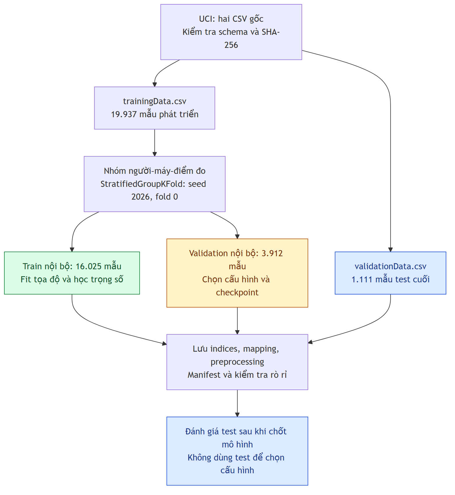

# Chặng 5: Hiểu, kiểm tra và chia dữ liệu UJIIndoorLoc

Chặng này tiếp nối [thiết kế chặng 4](../chang_04/README.md). Kết thúc chặng, bạn cần đọc được một fingerprint, giải thích các mã đặc biệt, tự kiểm kê hai CSV và sử dụng một bộ train/validation/test cố định. Học lần lượt năm buổi dưới đây; chưa cần huấn luyện mạng nơ-ron.

**Cập nhật cấu trúc ở chặng 6:** raw chuyển sang `data/raw/ujiindoorloc/`; reader dùng chung ở [src/ips/data.py](../../../src/ips/data.py), còn `data_utils.py` là wrapper tương thích. Các lệnh bên dưới đã cập nhật đường dẫn. Xem [báo cáo di chuyển](artifacts/relocation_report.json) để xác minh raw và indices giữ nguyên.

**Kết quả thực hành đã tạo trong repo:** bản kiểm kê dữ liệu, đối chiếu với ZIP UCI, bảng phân bố nhãn, chỉ số dòng của ba tập và các quy tắc tiền xử lý. Tất cả số đếm dưới đây được tính từ CSV thật. Chặng này chưa có accuracy hoặc sai số định vị của mô hình.

## Quy ước đọc tài liệu

- **Theo nguồn:** có đường dẫn đến tài liệu gốc hoặc tài liệu thư viện.
- **Kiểm tra thực tế:** thống kê từ hai CSV trong repo, kèm hash để nhận diện đúng phiên bản.
- **Đề xuất của đề tài:** lựa chọn thực nghiệm của chúng ta, chưa phải cách chia chuẩn duy nhất.
- **Ví dụ học:** số đơn giản dùng giải thích, không phải kết quả huấn luyện.

Nguồn chính: [trang dữ liệu UCI](https://archive.ics.uci.edu/dataset/310/ujiindoorloc), [DOI dữ liệu](https://doi.org/10.24432/C5MS59), [bài dữ liệu gốc, DOI 10.1109/IPIN.2014.7275492](https://doi.org/10.1109/IPIN.2014.7275492), và [bản toàn văn do tác giả đăng](https://www.researchgate.net/publication/283894296_UJIIndoorLoc_A_new_multi-building_and_multi-floor_database_for_WLAN_fingerprint-based_indoor_localization_problems). Kiểm tra nguồn ngày 07/10/2026.

## Buổi 5.1. Một dòng dữ liệu kể điều gì?

### Mục tiêu

Phân biệt đầu vào, nhãn và metadata; hiểu hai tệp gốc và tên cột thực tế.

### Giải thích

**Theo UCI:** UJIIndoorLoc thu thập Wi-Fi tại ba tòa nhà của Universitat Jaume I, phục vụ định vị theo fingerprint. Dữ liệu có thể dùng cho phân loại và hồi quy. Nguồn cung cấp hai CSV: `trainingData.csv` và `validationData.csv`.

**Một mẫu** là một dòng tương ứng một lần quét Wi-Fi gắn với vị trí đã biết. **Một feature** là một thông tin có thể đưa vào mô hình. **Nhãn** là đáp án cần học dự đoán. **Metadata** giúp hiểu hoàn cảnh thu thập hoặc tạo nhóm đánh giá. Trong thiết kế chính, mô hình chỉ đọc RSSI cùng mask suy ra từ RSSI.

**Kiểm tra header CSV thực tế:** đúng 529 cột, theo thứ tự sau. Chữ hoa và số 0 ở tên AP phải được giữ.

| Cột | Vai trò đề tài | Ý nghĩa |
|---|---|---|
| `WAP001`…`WAP520` | Input | RSSI của từng AP |
| `LONGITUDE`, `LATITUDE` | Nhãn | Tọa độ ngang |
| `FLOOR` | Nhãn | Mã tầng |
| `BUILDINGID` | Nhãn | Mã tòa |
| `SPACEID` | Metadata | Mã không gian |
| `RELATIVEPOSITION` | Metadata | Vị trí so với không gian |
| `USERID` | Metadata | Mã người đo |
| `PHONEID` | Metadata | Mã thiết bị |
| `TIMESTAMP` | Metadata | Thời điểm UNIX |

Giải nghĩa nhãn/metadata theo bài dữ liệu gốc, mục III.A. Cột WAP là các vị trí cố định trong vector; không phải tọa độ AP. Thứ tự cột không chứng minh AP nằm gần nhau trên bản đồ. Ví dụ, nhóm 20 AP liên tiếp thành token ở chặng 4 là **thiết kế đề xuất**, không phải mô tả bố trí Wi-Fi của dataset.

**Kiểm tra thực tế:** tòa 0 và 1 có tầng 0–3; tòa 2 có tầng 0–4. Có 13 cặp tòa–tầng, không có 15 cặp. `FLOOR=0` là nhãn tầng hợp lệ, không phải thiếu nhãn.

**Theo bài gốc, mục III.A.3–4:** `RELATIVEPOSITION=1` chỉ trong không gian, 2 chỉ ngoài cửa. Trong tệp validation gốc, `SPACEID`, `RELATIVEPOSITION` và `USERID` được gán 0 vì không ghi các thông tin này. **Kiểm tra thực tế:** cả ba cột toàn 0 ở 1.111 dòng test. Vì vậy không suy ra test có một người duy nhất; không diễn giải `SPACEID=0` thành một phòng thật. `PHONEID=0` lại là một mã thiết bị trong danh mục UCI, không được tự xem là thiếu.

`SPACEID` là ID phân loại, không phải khoảng cách. Khi đọc thành số, `015` được dùng như ID 15; raw CSV vẫn giữ nguyên. Định danh điểm đo của chúng ta còn chứa tòa, tầng và tọa độ, không dùng riêng SPACEID.

### Hai cách gọi “validation” cần tách biệt

| Dữ liệu | Tên gốc | Vai trò trong đề tài |
|---|---|---|
| 19.937 dòng | `trainingData.csv` | Tập phát triển, tách tiếp train và validation nội bộ |
| 1.111 dòng | `validationData.csv` | Test cuối giữ nguyên |

**Train** dùng học trọng số. **Validation nội bộ** dùng chọn cấu hình/checkpoint. **Test cuối** dùng đánh giá sau khi chốt các lựa chọn. Đây là giao thức đề xuất ở chặng 4, không phải UCI cung cấp sẵn ba tệp.

Ví dụ học: một dòng có bốn AP đầu là `[-52, 100, -104, 0]`, nhãn `(BUILDINGID=2,FLOOR=1)`, cùng tọa độ. Mô hình nhận RSSI; nhiệm vụ của nó là đoán nhãn vị trí. Nó không được đọc tọa độ thật hoặc mã phòng thật lúc suy luận.

### Lưu ý tọa độ

Tên `LONGITUDE`, `LATITUDE` không đủ để coi số là kinh–vĩ độ theo độ. Bài gốc, mục III.A.2, mô tả tọa độ theo mét và ghi “UTM from WGS84”. Chúng ta giữ thứ tự `(x,y)=(LONGITUDE,LATITUDE)` và quy ước mét của dataset; chưa xác định đầy đủ CRS/EPSG. Không dùng Haversine trực tiếp lên các số gốc. Nếu cần đặt lên bản đồ thực địa, phải xác minh thêm phép chiếu. Nhãn tầng không cung cấp chiều cao tính bằng mét.

### Tự kiểm tra

1. Vì sao `SPACEID` không nằm trong input chính?
2. `FLOOR=0`, `USERID=0` trong test và `PHONEID=0` có cùng ý nghĩa không?
3. Vì sao `validationData.csv` không được dùng để chọn learning rate trong giao thức này?

**Bài tập:** viết ba danh sách: feature, nhãn, metadata. Với một lần quét mới, đánh dấu thông tin nào thực sự đã biết trước khi định vị.

## Buổi 5.2. Tải đúng phiên bản và giữ dữ liệu gốc

### Mục tiêu

Tải từ nguồn chính thức, kiểm tra nguồn gốc và không thay đổi CSV gốc khi thực nghiệm.

### Giải thích

**Theo nguồn:** tải tại [UCI](https://archive.ics.uci.edu/dataset/310/ujiindoorloc) bằng nút Download hoặc [ZIP trực tiếp](https://archive.ics.uci.edu/static/public/310/ujiindoorloc.zip). ZIP chứa `UJIndoorLoc/trainingData.csv` và `UJIndoorLoc/validationData.csv`. Dữ liệu có giấy phép CC BY 4.0 trên trang UCI; khi báo cáo cần ghi công nguồn.

**SHA-256** là chuỗi nhận diện tính từ toàn bộ byte của tệp. Tệp đổi dù chỉ một phần thì hash gần như chắc chắn đổi. Hash giúp phát hiện bạn và người khác đang sử dụng hai bản CSV khác nhau; nó không tự chứng minh dữ liệu đúng về mặt khoa học.

**Đã kiểm tra thực tế:** script tải ZIP UCI, tính hash hai member và so với repo. Cả hai trùng từng byte. Xem [source_provenance.json](artifacts/source_provenance.json).

```text
trainingData.csv
45ca0128bd12019c976bb4793e407c979c82995d7a5940ab7288620247905168

validationData.csv
5f90c536648cd657b2c516d20c4e0968d4003279ea6bd5d5d5322d3f1e8905c0
```

### Chuẩn bị môi trường thực hành

Chạy tại PowerShell trong thư mục repo. Nếu đã có môi trường chứa đúng phiên bản, có thể dùng môi trường đó. Python 3.12.1, NumPy 2.2.6 và scikit-learn 1.6.1 là các phiên bản **đã chạy kiểm chứng tại máy này**, không phải tuyên bố phiên bản mới nhất. Chặng này chưa cần PyTorch.

```powershell
Set-Location D:\IPS_ThacSi
python --version
python -m venv .venv
.\.venv\Scripts\python.exe -m pip install -r docs/lessons/chang_05/requirements.txt
$env:PYTHONUTF8 = '1'
```

Dùng đường dẫn `.venv\Scripts\python.exe` trực tiếp giúp chạy được mà không cần chỉnh execution policy để activate. `$env:PYTHONUTF8` chỉ bật UTF-8 cho Python trong phiên shell để thông báo tiếng Việt hiển thị đúng.

### Trường hợp repo đã có hai CSV như hiện tại

```powershell
.\.venv\Scripts\python.exe docs/lessons/chang_05/download_data.py --verify-only --report docs/lessons/chang_05/artifacts/source_provenance.json
```

Đầu ra đúng: `PASS: hai CSV trùng từng byte với bản UCI đã xác minh.` Lệnh này cần Internet; không viết lại CSV. Report nguồn cập nhật thời điểm đối chiếu.

### Trường hợp bắt đầu với repo chưa có CSV

```powershell
.\.venv\Scripts\python.exe docs/lessons/chang_05/download_data.py
```

Script [download_data.py](download_data.py) tạo đúng đường dẫn raw hiện tại. Nó chỉ đọc hai member đã biết trong ZIP. Nếu file local có nội dung khác, script dừng để bạn kiểm tra; không ghi đè. Nếu UCI đổi nội dung so với hash đã xác minh, cũng dừng để xác định phiên bản mới. Khi offline và raw đã có, vẫn chạy kiểm kê và kiểm chứng split được; không thể đối chiếu nguồn online mới.

Không mở rồi Save CSV bằng phần mềm có thể đổi delimiter, format số hoặc header. Chỉ số dòng ở bước sau gắn với chính tệp có hash đã lưu.

### Tự kiểm tra

1. Hai tệp cùng tên đã đủ để kết luận cùng phiên bản chưa?
2. Vì sao cần giữ raw khi chuẩn hóa RSSI?
3. Khi UCI đổi tệp, vì sao không tiếp tục dùng indices cũ?

**Bài tập:** dùng `Get-FileHash -Algorithm SHA256` cho một CSV; so với chuỗi trong report. Giải thích tại sao đổi thứ tự dòng cũng làm kết quả thay đổi.

## Buổi 5.3. Kiểm kê, mã 100 và phân bố nhãn

### Mục tiêu

Tự kiểm tra schema, giá trị RSSI, thiếu dữ liệu, mẫu trùng và số mẫu mỗi lớp.

### Chạy kiểm kê

```powershell
.\.venv\Scripts\python.exe docs/lessons/chang_05/inspect_data.py
```

File [inspect_data.py](inspect_data.py) đọc qua [data_utils.py](data_utils.py). Kết quả đầy đủ ở [data_audit.json](artifacts/data_audit.json) và [original_label_distribution.csv](artifacts/original_label_distribution.csv). Các số sau lấy từ lần chạy thật:

| Kiểm tra | Tệp phát triển | Tệp test cuối |
|---|---:|---:|
| Số mẫu, không tính header | 19.937 | 1.111 |
| Cột RSSI / tổng cột | 520 / 529 | 520 / 529 |
| Ô trống, NaN, vô cực hoặc sai miền | 0 | 0 |
| RSSI phát hiện: nhỏ nhất / lớn nhất | −104 / 0 | −102 / −34 |
| Số ô mã 100 | 10.008.477 | 559.416 |
| Tỷ lệ ô mã 100 trong RSSI | 96,5395% | 96,8317% |
| Mẫu có toàn bộ 520 AP bằng 100 | 76 | 0 |
| AP không bao giờ phát hiện trong tệp | 55 | 153 |
| AP phát hiện trung bình mỗi mẫu | 17,9948 | 16,4752 |
| Trung vị số AP phát hiện | 17 | 15 |
| Số dòng dư do trùng toàn bản ghi | 637 | 0 |
| Số dòng dư do trùng vector RSSI | 852 | 5 |

Tỷ lệ 100 được tính trên `số_mẫu × 520`, không lấy mẫu số gồm các cột nhãn. “Dòng dư do trùng” nghĩa là tổng số dòng trừ số dòng phân biệt. Ví dụ ba dòng giống nhau tạo hai dòng dư, không phải ba nhóm trùng. So sánh số sau khi đọc thành giá trị số; không dùng khoảng trắng hoặc số 0 đứng đầu để phân biệt các ID bằng nhau.

### Hiểu đúng “thiếu”

**Theo UCI:** RSSI phát hiện thuộc −104…0; `100` biểu thị AP không được phát hiện. Đây là mã đặc biệt, không phải +100 dBm.

Một CSV không có ô trống vẫn có nhiều AP không phát hiện. Vì vậy `isna()` đơn thuần không đủ để kiểm tra tín hiệu thiếu. Khi xử lý, kiểm tra riêng ô rỗng/NaN và `rssi == 100`. Không tự xem 0 là thiếu; nguồn cho phép 0. Cũng không biến RSSI −104 thành không phát hiện.

**Đề xuất giữ từ chặng 4:** hai feature cho mỗi AP:

\[
m=\begin{cases}0&r=100\\1&\text{AP được phát hiện}\end{cases},\qquad
z=\begin{cases}0&r=100\\(r+104)/104&\text{AP được phát hiện}\end{cases}.
\]

Giải thích trước khi tính: `z` đưa tín hiệu hợp lệ về 0…1; `m` nói tín hiệu đó có tồn tại hay không. Hai AP đều có z=0 vẫn khác nhau nếu một AP không phát hiện và một AP có RSSI −104.

| Ví dụ học: RSSI | z | mask |
|---:|---:|---:|
| −52 | 0,5 | 1 |
| 100 | 0 | 0 |
| −104 | 0 | 1 |
| 0 | 1 | 1 |

Khối mã chính trong `feature_transform`:

```python
mask = (rssi != 100).astype(np.float32)
z = np.where(mask == 1, (rssi.astype(np.float32) + 104) / 104, 0)
features = np.stack([z, mask], axis=-1)
```

`!=` kiểm tra khác 100. `np.where` chọn quy tắc theo mask; không giữ giá trị biến đổi của 100. `stack(...,axis=-1)` ghép hai feature theo từng AP. Float32 dùng cho input mạng; tọa độ gốc và thống kê fit vẫn giữ float64.

Với B mẫu: output `[B,520,2]`. MLP flatten thành `[B,1040]`. Mixer reshape thành `[B,26,40]`, mỗi token chứa 20 AP × hai feature. AP order giữ `WAP001` đến `WAP520`; không sort AP theo RSSI từng mẫu.

Giữ tất cả AP và 76 mẫu toàn 100 để phù hợp thiết kế tối thiểu đã chốt. Các mẫu này không có tín hiệu hữu ích để phân biệt vị trí; khi huấn luyện cần báo phân tích riêng. Nếu loại mẫu hoặc AP, đó là một thực nghiệm khác; quyết định phải dùng train và ghi lại, không chọn theo chất lượng test.

### Phân bố tòa–tầng

| Tòa | Tầng | Tập phát triển | Test cuối |
|---:|---:|---:|---:|
| 0 | 0 | 1.059 | 78 |
| 0 | 1 | 1.356 | 208 |
| 0 | 2 | 1.443 | 165 |
| 0 | 3 | 1.391 | 85 |
| 1 | 0 | 1.368 | 30 |
| 1 | 1 | 1.484 | 143 |
| 1 | 2 | 1.396 | 87 |
| 1 | 3 | 948 | 47 |
| 2 | 0 | 1.942 | 24 |
| 2 | 1 | 2.162 | 111 |
| 2 | 2 | 1.577 | 54 |
| 2 | 3 | 2.709 | 40 |
| 2 | 4 | 1.102 | 39 |
| **Tổng** | | **19.937** | **1.111** |

**Suy luận từ kiểm kê:** lớp có nhiều mẫu ở tập phát triển chưa chắc nhiều ở test; chẳng hạn tòa 2/tầng 3. Accuracy tổng thể có thể che lỗi lớp ít mẫu; vì vậy chặng 4 đã chọn thêm macro-F1 và phân tích theo tòa–tầng. Chưa thể kết luận mô hình nào học lớp đó tốt hơn khi chưa chạy huấn luyện.

**Kiểm tra metadata/thời gian:** tập phát triển có USERID 1–18, 16 mã PHONEID; test có USERID toàn 0 và 11 mã PHONEID. Mã thiết bị 13, 14 xuất hiện ở cả hai tệp. Timestamp đổi sang UTC cho các khoảng: phát triển 30/05–20/06/2013; test 19/09–08/10/2013. Sự khác biệt thời gian, thiết bị và điểm đo là lý do test gốc có thể khó hơn validation nội bộ. Đây không phải chứng minh quan hệ nhân quả của từng yếu tố.

Một số số lượng trong bản toàn văn bài gốc khác CSV UCI hiện đang tải. Dùng số đếm thực tế và hash cho thực nghiệm này; không sửa file để khớp con số trong bài và không tự đoán nguyên nhân chênh lệch.

### Tự kiểm tra

1. Vì sao không đưa 100 nguyên trạng vào mô hình như tín hiệu mạnh?
2. Làm sao phân biệt không phát hiện với RSSI −104 sau chuẩn hóa?
3. 55 AP không phát hiện trong phát triển và 153 trong test có cho phép loại AP theo test không?
4. Vì sao 76 mẫu toàn 100 vẫn cần được ghi nhận riêng?

**Bài tập:** tính z và mask cho `[-78,-26,100,-104]`. Kiểm tra tổng số mẫu trong bảng lớp; tính tỷ lệ lớp `(2,3)` ở mỗi tệp để thấy sự thay đổi phân bố.

## Buổi 5.4. Chia tập để câu hỏi nghiên cứu có ý nghĩa

### Mục tiêu

Hiểu vì sao chia dòng ngẫu nhiên có thể làm đánh giá lạc quan; tạo split đúng thiết kế và diễn giải giới hạn.

### Giải thích trước thuật toán

**Rò rỉ dữ liệu** xảy ra khi thông tin đáng lẽ chưa được biết từ validation/test ảnh hưởng quá trình học hoặc chọn mô hình. Ví dụ, fit chuẩn hóa trên cả test làm quá trình chuẩn bị sử dụng thông tin tương lai. Mẫu đo lặp rất gần nhau nằm hai phía của split còn có thể khiến validation dễ hơn câu hỏi triển khai thực tế.

Ví dụ học: một người dùng cùng điện thoại đo mười lần tại một cửa phòng. Chia từng dòng ngẫu nhiên có thể đưa tám lần vào train và hai vào validation. Mô hình đã thấy rất nhiều tín hiệu của cùng hoàn cảnh đo. Nếu câu hỏi là định vị ở nhóm đo khác, cần giữ cả mười lần cùng một phía.

**Theo bài dữ liệu gốc, mục IV.A:** quá trình capture có đo lặp. Tuy nhiên CSV không cung cấp một cột session chính thức. Chúng ta dùng nhóm thay thế, không khẳng định đã khôi phục chính xác từng đợt đo.

### Giao thức tối thiểu đề xuất và đã hiện thực

1. Giữ nguyên `validationData.csv` làm test cuối.
2. Chỉ tách `trainingData.csv` thành train và validation nội bộ.
3. Mỗi nhóm có cùng tuple theo thứ tự:

```text
(USERID, PHONEID, BUILDINGID, FLOOR,
 LONGITUDE, LATITUDE, SPACEID, RELATIVEPOSITION)
```

4. Dùng `StratifiedGroupKFold(n_splits=5, shuffle=True, random_state=2026)`; lấy fold số 0 làm validation, bốn phần còn lại làm train.
5. Kiểm tra không giao nhóm, đủ 13 lớp ở train và validation, không trùng chỉ số dòng; kiểm kê các loại mẫu trùng rồi lưu indices và hashes.

**Group** nghĩa là các dòng phải đi cùng nhau. **Stratified** nghĩa là cố gắng giữ phân bố lớp tương tự. **Fold** là một phần chia. Chúng ta chỉ dùng một fold đã định trước, chưa chạy huấn luyện cross-validation năm lượt. Do nhóm có kích thước khác nhau, tỷ lệ dòng không nhất thiết đúng 80/20 và phân bố lớp không cân bằng hoàn hảo. Đây là đặc tính của [StratifiedGroupKFold, tài liệu scikit-learn 1.6.1](https://scikit-learn.org/1.6/modules/generated/sklearn.model_selection.StratifiedGroupKFold.html).

Không đưa `TIMESTAMP` vào tuple vì mỗi lần quét có thể khác thời điểm; thêm nó sẽ tách các lần lặp thành nhóm nhỏ. Bỏ timestamp cũng có giới hạn: các đợt cách nhau xa nhưng cùng người–máy–điểm được gộp. Tọa độ được so sánh theo số float64 gốc, không làm tròn tạo nhóm vùng trong giao thức v1.

**Seed** làm cố định phần ngẫu nhiên. Seed 2026 ở đây là seed chia tập, không phải seed khởi tạo mô hình 42/43/44 của chặng 4. Còn phải lưu phiên bản thư viện và cách mã hóa nhóm; chỉ ghi seed chưa đủ để bảo đảm tái lập.

### Chạy tạo split

```powershell
.\.venv\Scripts\python.exe docs/lessons/chang_05/make_splits.py
.\.venv\Scripts\python.exe docs/lessons/chang_05/verify_splits.py
```

Đầu ra tạo split đã chạy thật:

```text
PASS: train=16025, validation=3912, test=1111; group_overlap=0
```

| Tập | Nguồn | Số dòng | Số nhóm nội bộ |
|---|---|---:|---:|
| Train | `trainingData.csv` | 16.025 | 1.442 |
| Validation nội bộ | `trainingData.csv` | 3.912 | 359 |
| Test cuối | `validationData.csv` | 1.111 | Không tạo bằng splitter nội bộ |

Tập phát triển có tổng 1.801 nhóm theo tuple đã chọn. Train giữ 61 mẫu toàn 100, validation giữ 15; không xóa mẫu và không sao chép raw thành các file CSV mới. Các mô hình ở chặng 6 sẽ đọc cùng indices.



### Khối mã quan trọng trong make_splits.py

```python
class_pairs = sorted(set(development.pairs))
mapping = {pair: index for index, pair in enumerate(class_pairs)}
targets = np.asarray([mapping[pair] for pair in development.pairs])
groups = encode_groups(development)
```

`set` lấy các cặp tòa–tầng phân biệt; `sorted` cố định thứ tự; `enumerate` đánh mã lớp từ 0. Tập phát triển xác định mapping, train nội bộ phải chứa đủ các lớp. Test chỉ được kiểm tra có nhãn thuộc mapping; không dùng để mở rộng hoặc fit mapping. Với protocol khác như giữ riêng một tòa, bài toán lớp chưa biết phải được thiết kế lại, không áp dụng máy móc quy tắc này.

Trong `encode_groups`, mỗi dòng nhận tuple metadata. Các tuple duy nhất được sort theo giá trị số và đánh ID từ 0. Tránh dùng `hash(tuple)` làm group ID vì có thể phụ thuộc môi trường; lưu chính quy tắc mã hóa ở manifest.

```python
splitter = StratifiedGroupKFold(
    n_splits=5, shuffle=True, random_state=2026
)
folds = splitter.split(np.zeros((development.size, 1)), targets, groups)
train_indices, validation_indices = list(folds)[0]
```

Array số 0 chỉ điền đối số X mà API cần; cách chia này dùng nhãn và nhóm, không học từ nội dung RSSI. `targets` quyết định stratification, `groups` giữ các dòng cùng nhóm về một phía. `[0]` chọn fold đã chốt, không chọn fold cho điểm mô hình đẹp nhất.

Dùng nhãn vị trí thật để thiết kế split là hợp lệ; đưa chúng vào feature lúc suy luận lại làm mất ý nghĩa bài toán định vị.

### Những gì kiểm tra thực tế cho thấy

Các số ở bảng là **số khóa phân biệt cùng xuất hiện ở hai tập**, không phải số dòng trùng. Xem [manifest.json](../../../data/processed/uji_group_split_v1/manifest.json).

| Giao nhau | Train ↔ validation nội bộ | Phát triển ↔ test gốc |
|---|---:|---:|
| Nhóm tuple đã định | 0 | Không dùng nhóm này cho test thiếu metadata |
| Toàn bản ghi số | 0 | 0 |
| Vector 520 RSSI | 13 | 0 |
| RSSI + tòa + tầng | 14 | 0 |
| RSSI + tòa + tầng + x + y | 0 | 0 |
| Vị trí: tòa + tầng + x + y | 268 | 10 |

14 khóa “RSSI+tòa+tầng” có thể lớn hơn 13 vector RSSI vì một vector xuất hiện dưới nhiều nhãn. Vector toàn 100 là một khóa chung; nó có hai nhãn tòa–tầng chung giữa train/validation. Không nói số 13 là “13 mẫu rò rỉ”, cũng không dùng giao nhóm bằng 0 để tuyên bố mọi dạng phụ thuộc đã biến mất.

**Diễn giải của đề tài:** v1 kiểm tra nhóm người–thiết bị–điểm đo khác, còn người/thiết bị/vị trí riêng lẻ có thể được thấy trước. Một số input giống hệt và cùng nhãn phân loại xuất hiện hai phía dù tọa độ khác. Điều này giới hạn kết luận về khả năng tổng quát hóa; khi báo cáo phân loại phải nêu rõ. Không tự gộp tất cả input trùng trong v1 sau khi đã chốt protocol; có thể thiết kế thêm một protocol nghiêm hơn trước huấn luyện.

### Vì sao các cách chia cho kết quả khác?

| Câu hỏi muốn trả lời | Cách giữ riêng nhóm | Ý nghĩa / giới hạn |
|---|---|---|
| Mẫu ngẫu nhiên trong phân bố đã biết? | Stratified theo dòng | Dễ để các lần đo lặp ở hai phía |
| Nhóm người–máy–điểm khác? | Tuple v1 | Giảm trộn lần đo cùng nhóm; vẫn có vị trí/người trùng |
| Người chưa thấy? | `USERID` | Giữ toàn bộ dòng của một người riêng; có thể lệch lớp/thiết bị |
| Thiết bị chưa thấy? | `PHONEID` | Kiểm tra thay đổi thiết bị; không tự chứng minh đổi người độc lập |
| Điểm chưa thấy? | `(BUILDINGID,FLOOR,x,y)` | Không cùng điểm hai phía; các điểm gần nhau vẫn có thể rất giống |
| Không cùng input RSSI? | Gộp liên thông nhóm v1 và các vector RSSI trùng | Khử input trùng, nhưng thay đổi phân bố và tạo nhóm đa lớp |
| Lần đo muộn hơn? | Tách thời gian | Kiểm tra dịch chuyển theo thời gian, có thể đi cùng thay đổi thiết bị |

“Gộp liên thông” nghĩa là nếu A và B cùng nhóm, hoặc B và C có RSSI giống nhau, cả A/B/C phải về một phía. Đây là mở rộng đề xuất, chưa cài và chưa đánh giá ở chặng này. Các protocol mở rộng giữ test gốc cho báo cáo cuối, còn outer/inner split trong phát triển phải fit và tuning trong train tương ứng. Không gộp hai CSV gốc rồi random-split vì sẽ mất bài kiểm tra khác thời điểm.

Kết quả giữa protocol khác nhau không phải phép so sánh ngang trực tiếp của kiến trúc. Mỗi cách chia đặt một câu hỏi khác. Chưa chạy mô hình thì chỉ có thể dự đoán các nguy cơ, không khẳng định thứ hạng KAN-Mixer.

### Tự kiểm tra

1. Group-disjoint có đồng nghĩa user-disjoint hoặc location-disjoint không?
2. Vì sao không thêm TIMESTAMP vào từng nhóm ở protocol v1?
3. Tại sao không đổi seed sau khi thấy accuracy thấp?
4. Trùng vector RSSI và trùng vector RSSI kèm tọa độ khác nhau ở điểm nào?

**Bài tập:** tự tạo sáu dòng cho hai người cùng đo tại một điểm. Chia theo dòng, theo nhóm v1 và theo USERID; ghi điều gì được giữ riêng trong mỗi trường hợp. Giải thích tại sao nhóm theo điểm sẽ gộp cả hai người.

## Buổi 5.5. Gói dữ liệu tái lập và bàn giao cho huấn luyện

### Mục tiêu

Hiểu các file được lưu, kiểm chứng chỉ số dòng và chuẩn hóa tọa độ bằng train đúng cách.

### Cấu trúc đã tạo

```text
docs/lessons/chang_05/
  README.md
  requirements.txt
  download_data.py       # đối chiếu/tải từ UCI
  data_utils.py          # schema, reader, groups, RSSI transform
  inspect_data.py        # kiểm kê CSV và phân bố
  make_splits.py         # tạo split cố định
  verify_splits.py       # kiểm chứng raw + artifact + tiền xử lý
  data_split.mmd / .svg / .png
  artifacts/
    source_provenance.json
    data_audit.json
    original_label_distribution.csv

data/processed/uji_group_split_v1/
  train_indices.csv
  validation_indices.csv
  test_indices.csv
  ap_order.json
  class_mapping.json
  preprocessing.json
  split_label_distribution.csv
  manifest.json
```

**Manifest** là tệp mô tả cả bộ artifact: đường dẫn nguồn, hash, số dòng, phương pháp chia, seed, phiên bản thư viện, thống kê giao nhau và hash các artifact. Nó cho biết cần dùng những file nào cùng nhau. Manifest hiện ở trạng thái đã tạo split, chưa huấn luyện; file đề xuất lịch sử của chặng 4 được giữ nguyên.

### Cách đọc indices

Các file chỉ số có header `row_index,csv_line_number,group_id`.

- `row_index=0`: dòng dữ liệu đầu tiên, bỏ header. Dùng chọn hàng trong array/dataframe.
- `csv_line_number=2`: dòng vật lý thứ hai trong CSV gốc. Dùng tra lại bằng editor.
- `group_id`: mã nhóm nội bộ cố định. Để trống ở test vì test gốc không do splitter này tạo.

Ví dụ học: index 12 ứng với dòng CSV 14. Không gọi `drop_duplicates` hay `sort_values` trên dataframe trước khi áp indices: khi đó số thứ tự có thể trỏ sai mẫu. Reader kiểm tra raw hash để tránh dùng chỉ số trên tệp đã đổi.

Trong `class_mapping.json`, class ID 0–12 chuyển về đúng cặp tòa–tầng. Trong `ap_order.json`, list chứa đúng 520 tên cột. Dùng lại các file này khi suy luận, không tạo mapping mới theo thứ tự xuất hiện ở một batch.

### Chuẩn hóa tọa độ và tránh fit trước split

**Theo tài liệu thư viện:** các phép biến đổi học từ dữ liệu phải fit bằng train; validation/test chỉ áp phép biến đổi đã fit. Xem [scikit-learn 1.6.1, data leakage](https://scikit-learn.org/1.6/common_pitfalls.html#data-leakage).

**Thiết kế chặng 4:** trừ trung bình hai trục rồi chia một hệ số chung. Gọi tọa độ là q=(x,y). Fit trên 16.025 mẫu train nội bộ:

\[
\mu=\operatorname{mean}_{train}(q),\qquad
s=\sqrt{\frac{\operatorname{Var}_{train}(x)+\operatorname{Var}_{train}(y)}{2}},
\quad q'=\frac{q-\mu}{s}.
\]

Đây là scale dùng cho loss và số học của mạng, không phải sửa vị trí thật. Một hệ số chung giữ quan hệ khoảng cách Euclid giữa hai trục. Phương sai dùng `ddof=0`; có chặn s tối thiểu 1e-6 nếu dữ liệu suy biến.

Khối mã đang chạy:

```python
xy = development.metadata[train_indices, :2]
center = xy.mean(axis=0)
scale = max(float(np.sqrt(xy.var(axis=0, ddof=0).mean())), 1e-6)
```

`train_indices` là điểm quan trọng: không dùng toàn bộ `trainingData.csv` để fit vì file đó còn chứa validation nội bộ. `:2` lấy đúng hai cột metadata đầu, theo schema đã kiểm tra. Các tham số được ghi vào `preprocessing.json`, cùng hash của file indices train.

**Kết quả fit thật, làm tròn để đọc:** center ≈ `[-7463.915496, 4864870.453367]`, shared scale ≈ `99.115023`. Dùng số đủ chính xác trong JSON cho code, không chép các số đã làm tròn ở đây.

Khi đánh giá, giải chuẩn hóa `q_hat = q_hat_normalized*s + mu` rồi tính sai số trên tọa độ gốc theo quy ước mét của dataset. Không so sai số chuẩn hóa với số mét trong bài báo. RSSI z/mask dùng quy tắc cố định từ schema, không có tham số fit; không cần quan sát test để chọn min/max RSSI.

### Kiểm tra bộ artifact

```powershell
.\.venv\Scripts\python.exe docs/lessons/chang_05/verify_splits.py
```

Đầu ra đã chạy:

```text
PASS: raw/artifact hashes, coverage, groups, 13 classes, train-only coordinate fit, RSSI mask.
```

Script xác minh: hash nguồn và artifact; chỉ số hợp lệ, không lặp; train+validation phủ hết tập phát triển; test phủ đúng file gốc; group ID và giao nhóm; mapping và độ phủ lớp; các thống kê trùng; mu/s đúng train; giải chuẩn hóa khôi phục tọa độ; mask phân biệt 100 với −104; tensor AP và Mixer đúng kích thước.

Xem [verification_report.json](artifacts/verification_report.json) cho lần kiểm chứng thực tế: tái tạo split giống từng byte; reader từ chối RSSI +1, RSSI phân số, NaN, ô trống và header sai; chấp nhận metadata0 đúng bản test; không ghi đè hoặc ghi một phần bundle khi phát hiện nội dung xung đột. Đây là kiểm chứng mã chuẩn bị dữ liệu, không phải đánh giá mô hình.

Để tạo lại bằng cùng môi trường:

```powershell
.\.venv\Scripts\python.exe docs/lessons/chang_05/make_splits.py
.\.venv\Scripts\python.exe docs/lessons/chang_05/verify_splits.py
```

Script chấp nhận file sẵn có nếu nội dung đúng từng byte; nếu khác, dừng và yêu cầu thư mục phiên bản mới. Không có timestamp chạy trong manifest nên chạy lại cùng Python/thư viện/mã/nguồn tạo cùng nội dung. Report đối chiếu nguồn online có timestamp riêng và không quyết định split.

Muốn thử một protocol khác, dùng thư mục mới và thay thiết kế có chủ đích; không sửa split v1 dùng chung cho ba mô hình. `--output-dir` trên make_splits chỉ đổi nơi lưu, không đổi phương pháp hoặc seed. Khi **đọc** indices đã lưu, điều quan trọng là hash và schema; khi **tạo lại** cần thêm đúng thư viện/mã hóa nhóm. Chưa có bước refit trên toàn tập phát triển trong thiết kế tối thiểu.

### Các lỗi thường gặp

| Thông báo / tình huống | Kiểm tra và xử lý |
|---|---|
| Không tìm thấy CSV | Kiểm tra `data/raw/ujiindoorloc/`; thư mục trong ZIP viết `UJIndoorLoc` |
| Không tìm thấy sklearn/numpy | Chạy bằng đúng `.venv\Scripts\python.exe` đã cài requirements |
| Phiên bản không đúng khi tạo split | Cài requirements chặng 5; không tự bỏ guard để ghi đè v1 |
| Header sai | Kiểm tra tên WAP có ba chữ số, chữ hoa và thứ tự; không tự đổi header cho qua |
| RSSI ngoài miền hoặc NaN | Tra dòng/cột, kiểm tra raw/hash; không impute trước khi biết nguyên nhân |
| Tệp khác nguồn UCI | So hash, kiểm tra bản tải và các thay đổi local; không ghi đè raw |
| Artifact có nội dung khác | Giữ bản hiện tại để kiểm tra; thay đổi thiết kế thì dùng phiên bản mới |
| Sai số vị trí rất nhỏ sau chuẩn hóa | Kiểm tra đã inverse về tọa độ gốc trước báo mét chưa |
| Tiếng Việt hiển thị lỗi | Bật `$env:PYTHONUTF8 = '1'`, dùng terminal hỗ trợ UTF-8 |

Các script dùng đường dẫn repo từ vị trí `__file__`, không phụ thuộc thư mục hiện hành để tìm raw. Các lệnh minh họa vẫn chạy tại repo cho dễ theo dõi.

### Tự kiểm tra

1. Vì sao `row_index` khác `csv_line_number` hai đơn vị?
2. Vì sao fit center bằng cả 19.937 dòng vẫn sai với giao thức hiện tại?
3. File nào phải được dùng lại khi chuyển logits thành tòa–tầng?
4. Tái lập split cần gì ngoài seed?

**Bài tập:** mở một dòng trong `validation_indices.csv`, tra lại CSV gốc và tìm class ID bằng `class_mapping.json`. Tự viết câu mô tả phép chia gồm nguồn tệp, group key, seed, fold, kích thước và giới hạn. Không dùng câu “dữ liệu hoàn toàn độc lập” khi chưa chứng minh.

## Đáp án ngắn để đối chiếu sau khi tự làm

- **5.1:** mã phòng là thông tin vị trí chưa biết khi định vị. FLOOR0 là tầng; USERID0 test là không ghi người; PHONEID0 là mã thiết bị hợp lệ. Test phải đứng ngoài chọn cấu hình.
- **5.2:** cùng tên chưa đủ; hash nhận diện byte. Giữ raw để truy nguồn và thử tiền xử lý khác. Đổi dòng/phiên bản làm indices cũ không đáng tin.
- **5.3:** 100 là không phát hiện; mask tách trường hợp này khỏi −104. Không chọn AP theo test. Mẫu toàn 100 không phân biệt được vị trí bằng Wi-Fi. Bài tập `(z,mask)`: `(0.25,1),(0.75,1),(0,0),(0,1)`.
- **5.4:** cùng người hoặc cùng điểm có thể nằm nhiều nhóm v1. TIMESTAMP làm tách lần lặp nếu đưa vào tuple. Đổi seed theo điểm số là chọn bộ đánh giá thuận lợi. RSSI trùng không đồng nghĩa cùng nhãn/tọa độ; cần báo từng loại giao nhau.
- **5.5:** index bắt đầu 0, CSV có một dòng header. Toàn development còn chứa validation nên fit chỉ dùng train. Dùng class_mapping và ap_order đã lưu. Tái lập cần raw/hash, mã hóa nhóm, phiên bản, cấu hình và indices.

## Checklist kết thúc chặng 5

- [ ] Giải thích được một mẫu và phân biệt input/nhãn/metadata.
- [ ] Nêu đúng 100, RSSI −104, FLOOR0 và metadata0 ở test.
- [ ] Đối chiếu được raw với UCI và hiểu mục đích hash.
- [ ] Chạy kiểm kê và đọc được phân bố 13 lớp.
- [ ] Tính được z/mask bằng tay cho một fingerprint nhỏ.
- [ ] Giải thích được split16.025/3.912/1.111 và group tuple.
- [ ] Nêu được các vị trí/input trùng còn lại và giới hạn kết luận.
- [ ] Đọc được indices, mapping, preprocessing và manifest.
- [ ] Xác minh được mu/s chỉ fit train và biết inverse khi đánh giá.
- [ ] Sẵn sàng dùng cùng gói dữ liệu cho MLP, MLP-Mixer, RSSI-KAN-Mixer ở chặng 6.

**Câu vấn đáp tổng hợp:** “Nếu validation nội bộ tốt nhưng test gốc kém, em sẽ kiểm tra gì?” Cần trả lời ít nhất: đổi thời gian/thiết bị/phân bố lớp/điểm đo; phụ thuộc giữa nhóm hoặc fingerprint; overfitting/tuning; sai schema/mapping/AP order; sai fit/inverse. Đưa ra kế hoạch phân tích trên dữ liệu và log, không đoán KAN tốt hoặc xấu chỉ từ một chỉ số.
