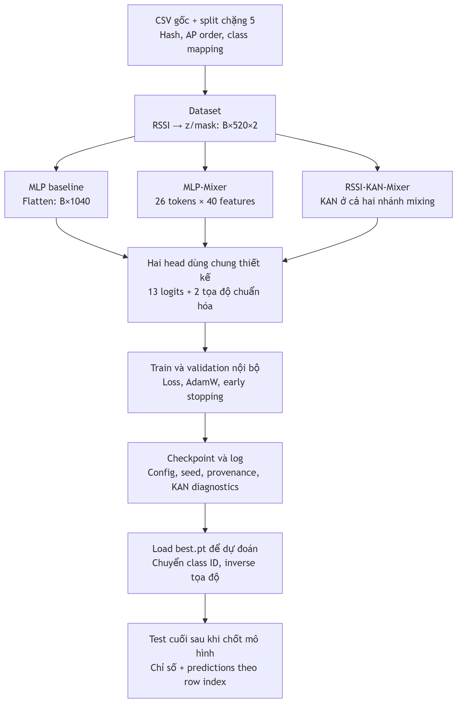

# Chặng 6: Xây dựng và chạy dự án IPS bằng Python/PyTorch

Chặng này biến [thiết kế chặng 4](../chang_04/README.md) và [gói dữ liệu chặng 5](../chang_05/README.md) thành chương trình chạy được. Học lần lượt sáu buổi: môi trường → dữ liệu → baseline → Mixer → KAN-Mixer → huấn luyện/lưu/dự đoán. Mã đã được tạo trong repo, nhưng hãy đọc thiết kế và khối mã của từng buổi trước khi chạy.

**Mục tiêu:** bạn giải thích được mỗi tensor đi đâu, tự chạy ba mô hình, tìm được checkpoint/log, và dự đoán từ CSV chỉ có RSSI. Không cần sao chép một file dài chứa toàn bộ dự án.

**Quy ước:** “theo nguồn” là thông tin từ bài báo/mã tác giả/tài liệu chính thức; “đề xuất” là thiết kế IPS của chúng ta; “đã chạy” là kết quả thực tế tại repo. Các lượt smoke dùng kiểm chứng pipeline. Chưa thực hiện benchmark đầy đủ ba mô hình × ba seed × tối đa 100 epoch.



## Buổi 6.1. Hiểu cấu trúc dự án và môi trường

### Mục tiêu

Biết mỗi thư mục chứa gì, tạo môi trường riêng, cài gói và chạy CLI.

### Giải thích

**Package** là nhóm module Python có thể import. **Module** là một file Python. **CLI** là giao diện chạy bằng lệnh terminal. **Môi trường ảo** tách các thư viện của dự án khỏi thư viện Python chung. Chúng ta đặt package `ips` trong `src/ips` và cài editable: khi sửa mã tại repo, Python dùng mã mới ngay.

Đã sắp xếp lại repo:

```text
D:\IPS_ThacSi
├── README.md
├── pyproject.toml              định nghĩa package và lệnh ips
├── requirements.txt            phiên bản thư viện chính + editable install
├── requirements-lock-cpu.txt   snapshot môi trường CPU đã chạy
├── configs/base.json           thiết kế và ngân sách dùng chung
├── src/ips/
│   ├── data.py                 schema CSV, audit helpers, RSSI transform
│   ├── dataset.py              split bundle, Dataset cho PyTorch
│   ├── models/networks.py      MLP và hai Mixer, hai head
│   ├── models/vendor/          efficient-kan + giấy phép + provenance
│   ├── diagnostics.py          thống kê input từng KANLinear
│   ├── metrics.py              inverse và chỉ số định vị
│   ├── runtime.py              seed, device, config, checkpoint loader
│   ├── train.py                train, validation, early stopping, log
│   ├── predict.py              inference và đánh giá checkpoint
│   └── cli.py / __main__.py    các lệnh python -m ips
├── data/
│   ├── raw/ujiindoorloc/       hai CSV gốc
│   └── processed/uji_group_split_v1/
├── docs/lessons/               chặng 2, 4, 5, 6
├── references/
│   ├── papers/                PDF bài KSE có sẵn
│   └── course_materials/      DOCX chặng 1–3 có sẵn
├── examples/                  CSV RSSI-only và nguồn các dòng ví dụ
├── scripts/run_experiment.ps1
├── tests/test_pipeline.py
├── runs/                      mỗi lượt chạy có thư mục riêng
└── .venv/                     môi trường đã cài tại máy này
```

Các file raw, PDF, DOCX giữ nguyên byte. Các chỉ số dòng split giữ nguyên; chỉ cập nhật đường dẫn và hash của metadata/mã sau di chuyển. Xem [relocation_report.json](../chang_05/artifacts/relocation_report.json). `docs/lessons/chang_05/data_utils.py` là wrapper tương thích; reader dùng chung nằm ở `src/ips/data.py`.

### Lệnh setup từ đầu

Chạy tại PowerShell. Trên máy hiện tại `.venv` đã tồn tại và đã cài xong; không cần tạo lại để thực hành.

```powershell
Set-Location D:\IPS_ThacSi
python --version
python -m venv .venv
.\.venv\Scripts\python.exe -m pip install torch==2.9.0 --index-url https://download.pytorch.org/whl/cpu
.\.venv\Scripts\python.exe -m pip install -r requirements.txt
$env:PYTHONUTF8 = '1'
.\.venv\Scripts\python.exe -m pip check
.\.venv\Scripts\python.exe -m ips --help
```

Đã kiểm chứng Python3.12.1, PyTorch2.9.0+cpu, NumPy2.2.6, scikit-learn1.6.1. Đây là phiên bản của thực nghiệm, không phải lựa chọn theo phiên bản mới nhất. Pyproject yêu cầu Python3.12.x. Nguồn lệnh cài torch CPU và các lựa chọn CUDA của bản 2.9.0: [PyTorch previous versions](https://pytorch.org/get-started/previous-versions/#v290). Không cần torchvision/torchaudio vì chúng ta không đọc ảnh/âm thanh.

`requirements.txt` kết thúc bằng `-e .`: cài package của thư mục hiện tại ở chế độ editable. Dùng đường dẫn Python trong `.venv` trực tiếp nên không cần activate hoặc thay execution policy. `pip check` đúng sẽ báo `No broken requirements found`. `--help` phải có `prepare`, `check`, `train`, `predict`, `evaluate`.

Để tái tạo cả các phiên bản thư viện phụ trên CPU/Windows/Python3.12, thay hai lệnh cài pip bằng:

```powershell
.\.venv\Scripts\python.exe -m pip install -r requirements-lock-cpu.txt
```

Snapshot khóa phiên bản, chưa khóa bằng hash wheel; không bảo đảm kết quả giống bit giữa mọi hệ điều hành/hardware. Nếu dùng CUDA, tạo môi trường/cấu hình riêng với bản torch phù hợp driver theo nguồn PyTorch, rồi lưu lại phiên bản thực tế. Máy hiện tại không có CUDA khả dụng. `--device auto` chọn CUDA khi khả dụng, nếu không chọn CPU; `--device cpu` cố định CPU cho các lượt so sánh.

### Ví dụ và tự kiểm tra

Ví dụ: bạn sửa một lớp ở `src/ips/models/networks.py`; lần chạy `python -m ips check` sau đó dùng mã vừa sửa, không cần copy sang `.venv`.

1. Khác nhau giữa `.venv` và `src/ips` là gì?
2. Vì sao nên gọi cùng một Python cho pip và train?
3. `-e .` giải quyết việc gì?

**Bài tập:** chạy `--help`, ghi chức năng của từng lệnh bằng một câu. Mở `configs/base.json` và chỉ ra trường model, batch size và số epoch tối đa.

## Buổi 6.2. Từ CSV đến Dataset và batch

### Mục tiêu

Đọc đúng nguồn, dùng đúng indices và tạo tensor mà không đưa nhãn vào input.

### Giải thích

**Dataset** cung cấp một mẫu khi được hỏi theo index. **DataLoader** gom nhiều mẫu thành batch và xáo trộn thứ tự train. Thư viện xử lý này thuộc [torch.utils.data, PyTorch2.9](https://docs.pytorch.org/docs/2.9/data.html). Chúng ta dùng `num_workers=0` cho cách chạy đơn giản trên Windows.

Luồng đọc gồm hai khối:

1. [data.py](../../../src/ips/data.py): xác minh header, miền RSSI, giá trị hữu hạn; giữ RSSI và metadata riêng.
2. [dataset.py](../../../src/ips/dataset.py): xác minh manifest/hash, lấy indices, tạo feature và nhãn bằng mapping/scale đã lưu.

`load_bundle` kiểm tra raw/artifact hashes, partition, groups, mapping, AP order và mu/s fit bằng train. Nó không tạo split mới hay fit lại scaler. Khi train, chỉ đọc nội dung tập phát triển; test được kiểm tra hash để nhận diện nguồn. Nhãn test không tham gia vòng chọn checkpoint.

### Lệnh và đầu ra

```powershell
.\.venv\Scripts\python.exe -m ips prepare --verify-only
.\.venv\Scripts\python.exe -m ips check
```

Nếu chưa có raw, tải bằng lệnh chặng 5 ở đường dẫn mới, rồi tạo split:

```powershell
.\.venv\Scripts\python.exe docs/lessons/chang_05/download_data.py
.\.venv\Scripts\python.exe -m ips prepare
```

`prepare` gọi kiểm kê → tạo split → kiểm chứng. `check` đọc một batch hai mẫu, chạy forward cả ba mô hình và in số tham số/kích thước. Không huấn luyện ở lệnh này.

### Khối mã cần hiểu

```python
self.features = torch.from_numpy(feature_transform(data.rssi[indices]))
self.xy_original = data.metadata[indices, :2].copy()
center = np.asarray(preprocessing["coordinates"]["center"], dtype=np.float64)
scale = preprocessing["coordinates"]["shared_scale"]
self.xy = torch.from_numpy(((self.xy_original - center) / scale).astype(np.float32))
```

`indices` chọn đúng hàng CSV gốc. `feature_transform` chỉ đọc 520 RSSI, tạo `(z,mask)` như chặng 5; không đọc tòa/tầng/phòng/tọa độ. Feature và target huấn luyện dùng float32. Tọa độ gốc và inverse dùng float64 để giữ độ chính xác khi y có giá trị cỡ4.864.800. Nhãn class dùng int64 cho CrossEntropy.

Với batch64:

| Tensor | Shape | Vai trò |
|---|---|---|
| features | `[64,520,2]` | 520 cặp z/mask |
| class targets | `[64]` | Class ID 0–12 |
| normalized xy | `[64,2]` | Nhãn tọa độ cho loss |
| original xy | `[N,2]` ở Dataset | Đánh giá sau inverse |

Batch cuối có thể ít hơn64; code dùng kích thước B thực tế. Giữ toàn bộ AP và mẫu toàn100. DataLoader train `shuffle=True`, validation `False`, không `drop_last`. Generator xáo trộn được seed riêng cùng model seed; cùng seed có cùng thứ tự batch giữa ba kiến trúc.

### Ví dụ và tự kiểm tra

Ví dụ học: RSSI `[-52,100,-104,0]` tạo `[(0.5,1),(0,0),(0,1),(1,1)]`. MLP thấy tám số; Mixer ghép các AP theo thứ tự đã lưu. Không phát hiện và tín hiệu yếu nhất vẫn phân biệt nhờ mask.

1. Vì sao không fit tọa độ trong constructor bằng cả train+validation?
2. Shape features khác shape class targets ở điểm nào?
3. Vì sao không sort AP theo độ mạnh từng mẫu?

**Bài tập:** tra một row_index train và tìm class ID của nó. Tính feature của hai AP bằng tay, rồi đối chiếu `feature_transform` trong file dữ liệu.

## Buổi 6.3. Baseline MLP trước khi dùng Mixer

### Mục tiêu

Hiểu mô hình đơn giản, hai head và chạy vòng train đầu tiên.

### Thiết kế

Baseline là mốc đối chiếu để kiểm tra pipeline và xem kiến trúc phức tạp có ích không. Dùng thiết kế đã chốt:

```text
[B,520,2] → flatten[B,1040]
→ Linear1040→128 → GELU → Dropout0.1
→ Linear128→64 → GELU → Dropout0.1
→ LayerNorm64
→ head phân loại Linear64→13
→ head tọa độ Linear64→2
```

Các lớp nằm trong [networks.py](../../../src/ips/models/networks.py): `MLPBaseline` và `PositionHeads`. Linear học cách kết hợp tín hiệu; GELU tạo phép biến đổi phi tuyến; dropout giảm phụ thuộc vào một số đặc trưng. LayerNorm chuẩn hóa biểu diễn của từng mẫu. Hai head cùng đọc biểu diễn 64 chiều nhưng có tham số riêng.

Khối quan trọng:

```python
return {"logits": self.classifier(representation),
        "xy": self.coordinates(representation)}
```

Logits là điểm số chưa softmax; xy là tọa độ chuẩn hóa, không bị ép vào0…1. Head tọa độ có thể dự đoán ngoài vùng train. Cần inverse rồi phân tích lỗi, không tự clipping vào vùng test.

### Chạy baseline đầu tiên

```powershell
.\.venv\Scripts\python.exe -m ips train --model mlp --seed 42 --device cpu --smoke --run-dir runs/my_first_mlp
```

**Smoke check** là chạy nhỏ để kiểm tra toàn luồng: 256 train,128 validation, một epoch. Chọn subset cố định theo quota lớp từ indices gốc; đủ13 lớp ở dữ liệu hiện tại. Train shuffle dùng seed42. Center/scale vẫn dùng train đầy đủ đã lưu, không fit lại bằng subset. Xem `smoke_indices.json` để biết mẫu nào đã dùng.

Sau lệnh, phải có `best.pt`, `last.pt`, `history.csv`, `run_metadata.json`, `summary.json`. Terminal in loss và chỉ số validation. Các số của smoke không dùng làm bằng chứng so sánh kiến trúc.

Chạy toàn bộ train với ngân sách ngắn để quan sát learning curve:

```powershell
.\.venv\Scripts\python.exe -m ips train --model mlp --seed 42 --device cpu --epochs 2 --run-dir runs/my_mlp_two_epochs
```

Mô hình baseline đã chạy thật hai epoch ở `runs/baseline_stage6/mlp_seed42`. Đọc log đã có nếu muốn xem trước; đường dẫn `my_*` là lượt mới cho bạn thực hành, không ghi đè run đã kiểm chứng.

### Ví dụ và tự kiểm tra

Ví dụ học: cùng một biểu diễn giúp xác định cả tòa/tầng và vị trí ngang. Dự đoán đúng tòa nhưng sai tọa độ vẫn có loss tọa độ; tọa độ ngang đúng nhưng sai tầng vẫn có loss phân loại.

1. Vì sao không softmax ở `PositionHeads` trước CrossEntropy?
2. Vì sao head tọa độ không có sigmoid?
3. Baseline đã đủ dự đoán vị trí, vậy Mixer cần chứng minh thêm điều gì?

**Bài tập:** giải thích các chiều1040,128,64,13,2. Mở `history.csv`, kiểm tra loss là tổng loss phân loại cộng lambda×loss tọa độ.

## Buổi 6.4. Cài MLP-Mixer và kiểm tra trục mixing

### Mục tiêu

Đọc được embedding, hai nhánh mixing, residual và pooling.

### Theo nguồn và phần đề xuất

[MLP-Mixer của Tolstikhin và cộng sự](https://arxiv.org/abs/2105.01601) phân biệt trộn token và trộn channel. Trong IPS, chúng ta đề xuất token gồm20 AP, mỗi AP có2 feature; không coi các nhóm này là vùng ảnh hoặc khẳng định các AP gần nhau về vật lý.

Thiết kế:

```text
[B,520,2] → reshape[B,26,40]
→ shared Linear40→64 → [B,26,64]
→ 2 MixerBlock
→ LayerNorm64 → mean theo26 tokens → [B,64]
→ cùng hai head như baseline
```

**Shared** nghĩa là cùng một lớp được áp ở mọi token. `mean(dim=1)` lấy trung bình trên trục token, không trộn batch. Block giữ nguyên shape `[B,26,64]` để cộng residual.

### Khối mã quan trọng

```python
token_update = self.token_mixer(
    self.token_norm(x).transpose(1, 2)
).transpose(1, 2)
x = x + token_update
return x + self.channel_mixer(self.channel_norm(x))
```

Với token branch: LayerNorm theo64 channel → chuyển vị `[B,64,26]` → MLP26→32→26 → chuyển về `[B,26,64]`. Mỗi channel dùng cùng phép biến đổi26 tokens.

Với channel branch: LayerNorm → MLP64→128→64 trên chiều cuối. Mỗi token dùng cùng phép biến đổi64 channels. Mỗi MLP có GELU giữa hai Linear và dropout sau từng Linear. Residual cộng output của nhánh vào input tương ứng.

### Lệnh và kiểm tra

```powershell
.\.venv\Scripts\python.exe -m ips train --model mlp_mixer --seed 42 --device cpu --smoke --run-dir runs/my_first_mlp_mixer
.\.venv\Scripts\python.exe -m unittest discover -s tests -v
```

Test trục mixing không chỉ kiểm tra shape. Nó dùng tensor nhỏ và các ma trận hoán vị biết trước, rồi đối chiếu kết quả tính tay: token branch phải đổi hàng token; channel branch phải đổi phần tử channel trong từng hàng. Nhầm trục vẫn có thể chạy khi kích thước vô tình trùng, nhưng sẽ sai phép tính; test này giúp phát hiện.

### Ví dụ và tự kiểm tra

Ví dụ học `[B=1,T=3,C=2]`: ba token là ba hàng, hai channel là hai cột. Token mixing tạo một giá trị từ ba hàng của cùng cột; channel mixing kết hợp hai cột của cùng hàng.

1. Nếu bỏ transpose trước token MLP, lớp26→32 còn nhận đúng26 feature không?
2. Vì sao chuyển vị trở lại trước cộng residual?
3. Mean pooling theo dim0 sẽ sai ở đâu?

**Bài tập:** viết shape qua mỗi dòng của `MixerBlock.forward` với B=8,T=26,C=64. Giải thích vì sao embedding40→64 vẫn áp được vào tensor ba chiều.

## Buổi 6.5. Cài RSSI-KAN-Mixer với nguồn cố định

### Mục tiêu

Biết phần nào thay MLP bằng KAN, đọc tham số spline và kiểm tra input từng lớp.

### Theo nguồn

[KAN-Mixers của Canuto và cộng sự, v1](https://arxiv.org/html/2503.08939v1), mục2.3, dùng KAN ở cả token-mixing và channel-mixing, với LayerNorm, transpose, residual và dropout. Bài báo sử dụng `efficient-kan` cho các lớp KAN và nghiên cứu ảnh.

Repo này khóa backend tại [commit7b6ce1c87f18c8bc90c208f6b494042344216b11 của efficient-kan](https://github.com/Blealtan/efficient-kan/tree/7b6ce1c87f18c8bc90c208f6b494042344216b11). Đây là commit chúng ta chọn để cài đề tài, không khẳng định nó là commit chính xác tác giả bài KAN-Mixers đã dùng. Có [provenance.json](../../../src/ips/models/vendor/provenance.json) lưu URL/hash, [source nguyên bản](../../../src/ips/models/vendor/efficient_kan.py) và [giấy phép MIT](../../../src/ips/models/vendor/LICENSE.efficient-kan). Không phải cài từ nhánh master thay đổi theo thời gian.

### Biến thể IPS đề xuất đang dùng

Giữ embedding Linear40→64, LayerNorm, residual, pooling và hai head IPS như MLP-Mixer. Chỉ thay hai MLP của mỗi block:

```text
token branch:   KANLinear26→32 → Dropout → KANLinear32→26 → Dropout
channel branch: KANLinear64→128 → Dropout → KANLinear128→64 → Dropout
```

Không thêm GELU giữa hai KAN. Mỗi `KANLinear` trong backend đã có base SiLU cộng nhánh B-spline học được. Vì vậy “không chèn activation ngoài KAN” không có nghĩa lớp KAN hoàn toàn không dùng activation cố định trong cách triển khai này.

Thiết kế IPS dùng grid_size5, spline_order3, grid_range[-3,3], base SiLU và standalone spline scaler; không cập nhật grid trong train, không thêm KAN regularization loss. Đây là siêu tham số đề xuất ở chặng4, không phải hyperparameter benchmark ảnh của bài báo.

Khối mã chính trong `mixing_branch`:

```python
return nn.Sequential(
    KANLinear(width, hidden, **options), nn.Dropout(dropout),
    KANLinear(hidden, width, **options), nn.Dropout(dropout)
)
```

`width` là26 cho token branch,64 cho channel branch. `**options` truyền các tham số KAN vào constructor. API backend nhận tensor nhiều chiều, flatten tạm các trục đầu rồi phục hồi shape; việc này được xác minh từ source đã khóa và test. Hai block có tổng8 lớp KANLinear.

### Hiểu sơ bộ phép tính trong backend

Cho một chiều output j, lớp cộng đóng góp từ từng chiều input i:

\[
y_j=\sum_i\left[w^b_{ji}\,\mathrm{SiLU}(x_i)
 + s_{ji}\sum_k c_{jik}B_k(x_i)\right].
\]

`B_k` là hàm cơ sở B-spline; `c` là hệ số học được; `s` là hệ số scale học được nếu bật standalone scaler; `w^b` là trọng số nhánh base. Grid được lưu dưới dạng buffer trong state_dict nhưng không phải tham số học bằng gradient. Đọc lần lượt constructor → `b_splines` → `forward`; chưa cần hiểu ngay `update_grid` vì protocol v1 không gọi nó.

### Lệnh chạy và diagnostics

```powershell
.\.venv\Scripts\python.exe -m ips train --model kan_mixer --seed 42 --device cpu --smoke --run-dir runs/my_first_kan_mixer
```

Mở `kan_diagnostics.json`. [diagnostics.py](../../../src/ips/diagnostics.py) gắn hook vào **từng KANLinear**, thu input trong hai batch train đầu mỗi epoch. Log có min/max, mean/std, tỷ lệ ngoài miền nominal và ngoài toàn support của knots. Đây là mẫu thống kê giới hạn số batch, không phải phân bố của toàn train hay test. Không thu input validation/test để tự thay grid.

LayerNorm không bảo đảm input nằm trong[-3,3]. Lớp KAN thứ hai nhận output và dropout của lớp thứ nhất, nên cũng phải kiểm tra riêng. Miền nominal khác miền support mở rộng do knots; ngoài nominal chưa đồng nghĩa spline bằng0. Ngoài toàn support thì phần spline hết đóng góp ở đó, nhưng nhánh base SiLU vẫn có thể tạo output. Test đã kiểm tra trường hợp này.

### Số tham số đã đo

| Mô hình | Trainable parameters | Đầu vào | Đầu ra |
|---|---:|---|---|
| MLP | 142.607 | `[B,520,2]` | `[B,13]` + `[B,2]` |
| MLP-Mixer | 40.835 | `[B,520,2]` | `[B,13]` + `[B,2]` |
| RSSI-KAN-Mixer | 365.199 | `[B,520,2]` | `[B,13]` + `[B,2]` |

Số lấy từ `parameter_count(model)`, không đếm buffer grid. Ba mô hình có cùng dữ liệu và quy tắc train, nhưng chưa cùng số tham số. Muốn kết luận chặt hơn về kiến trúc cần thêm thí nghiệm khớp ngân sách từ thiết kế mở rộng chặng4; không sửa kích thước sau khi nhìn test.

### Ví dụ và tự kiểm tra

Ví dụ học: một input của KAN vượt3; kiểm tra nó còn nằm giữa knots ngoài cùng hay không. Không kết luận output của toàn lớp bằng0 chỉ từ việc vượt grid_range.

1. Đề tài thay embedding và head bằng KAN chưa?
2. Vì sao không thêm GELU trong KAN branch hiện tại?
3. Tham số spline, spline scaler và grid buffer khác nhau thế nào?
4. Số tham số của KAN-Mixer lớn hơn có thể ảnh hưởng kết luận so sánh ra sao?

**Bài tập:** mở một dòng diagnostics của token KAN thứ hai, ghi miền min/max và hai tỷ lệ ngoài miền. Giải thích vì sao phải kiểm tra nó thay vì chỉ kiểm tra LayerNorm đầu tiên.

## Buổi 6.6. Huấn luyện, checkpoint, log, dự đoán và xử lý lỗi

### Mục tiêu

Hiểu vòng huấn luyện, dùng best checkpoint để suy luận và biết tìm bằng chứng khi có lỗi.

### Thiết kế vòng huấn luyện

`train.py` chỉ tạo DataLoader train và validation nội bộ. Loss dùng hai nhiệm vụ:

\[
L=L_{CE}+\lambda_{xy}L_{SmoothL1},\qquad\lambda_{xy}=1.
\]

CrossEntropy nhận logits và class ID. SmoothL1 nhận tọa độ chuẩn hóa và beta1. Hai loss đều reduction mean. Nguồn API: [CrossEntropyLoss](https://docs.pytorch.org/docs/2.9/generated/torch.nn.CrossEntropyLoss.html), [SmoothL1Loss](https://docs.pytorch.org/docs/2.9/generated/torch.nn.SmoothL1Loss.html).

Khối cập nhật mỗi batch:

```python
optimizer.zero_grad(set_to_none=True)
output = model(features)
loss, class_loss, xy_loss = combined_loss(output, classes, xy, config["loss"])
loss.backward()
nn.utils.clip_grad_norm_(model.parameters(), 1.0, error_if_nonfinite=True)
optimizer.step()
```

`zero_grad` xóa gradient cũ vì PyTorch cộng dồn gradient. `backward` tính ảnh hưởng tham số lên loss. `clip_grad_norm_` giới hạn norm gradient để tránh bước quá lớn; đây không phải clipping tọa độ. `step` cập nhật trọng số. Code dừng và lưu `failure.json` nếu loss/gradient không hữu hạn.

Dùng [AdamW](https://docs.pytorch.org/docs/2.9/generated/torch.optim.AdamW.html), LR0.001, weight decay0.0001 trên toàn tham số trainable, batch64, không scheduler. Tối đa100 epoch. Validation gọi `model.eval()` và inference_mode, không backward/optimizer.step. Dropout tắt khi validation và suy luận.

Chọn checkpoint bằng mean lỗi Euclid2D validation **sau inverse về tọa độ gốc**. Cần giảm hơn0,01 theo quy ước mét để được xem là cải thiện trong v1; sau15 epoch không cải thiện thì dừng. `best.pt` lưu khi thỏa điều kiện đó, `last.pt` lưu mỗi epoch. Vì có min_delta, best.pt không nhất thiết là epoch có sai số nhỏ nhất tuyệt đối nếu cải thiện dưới0,01. Không chọn checkpoint bằng test hoặc ghép các epoch tốt nhất riêng cho từng chỉ số.

### Chạy ngân sách đầy đủ

```powershell
.\.venv\Scripts\python.exe -m ips train --model mlp --seed 42 --device cpu --run-dir runs/mlp_seed42_full
.\.venv\Scripts\python.exe -m ips train --model mlp_mixer --seed 42 --device cpu --run-dir runs/mlp_mixer_seed42_full
.\.venv\Scripts\python.exe -m ips train --model kan_mixer --seed 42 --device cpu --run-dir runs/kan_mixer_seed42_full
```

Để chạy ba mô hình với seeds42,43,44 và cùng ngân sách:

```powershell
.\scripts\run_experiment.ps1 -OutputRoot runs/experiment_v1 -Device cpu
```

Để kiểm tra script với tập nhỏ:

```powershell
.\scripts\run_experiment.ps1 -Smoke -OutputRoot runs/my_smoke_suite -Device cpu
```

Script chạy tuần tự để không cạnh tranh tài nguyên giữa các mô hình. `--epochs` hoặc `-Epochs` thay ngân sách; nếu so sánh, đặt giống nhau. Mỗi run cần đường dẫn mới. Giữ cả seed thành công/kém, không báo riêng seed tốt nhất. Chặng7 sẽ tổng hợp mean/std và so sánh đầy đủ.

Seed Python/NumPy/PyTorch và generator DataLoader được đặt. Runtime yêu cầu thuật toán deterministic, ghi số threads và hardware. Theo [PyTorch, reproducibility](https://docs.pytorch.org/docs/2.9/notes/randomness.html), không bảo đảm tái lập bitwise giữa các release/platform. Upstream KAN dùng phép giải least squares khi khởi tạo; lưu checkpoint và provenance để ghi lại trạng thái thực tế, không coi seed là toàn bộ bằng chứng.

### Mỗi file log để làm gì?

| File trong run | Nội dung |
|---|---|
| `resolved_config.json` | Cấu hình thực tế, gồm model đã chọn |
| `run_metadata.json` | Seed, software/hardware, số tham số, code hashes, split snapshot, nguồn KAN |
| `history.csv` | Loss train, chỉ số validation, epoch duration, LR, cumulative steps |
| `best.pt` | Trọng số ở checkpoint được chọn và metadata suy luận |
| `last.pt` | Trọng số và optimizer state của epoch cuối |
| `best_validation_metrics.json` | Chỉ số validation tại best checkpoint |
| `kan_diagnostics.json` | Thống kê input từng KANLinear; layers rỗng cho MLP |
| `smoke_indices.json` | Chỉ số subset nếu chạy smoke |
| `summary.json` | Trạng thái hoàn thành, best epoch, steps, thời gian |
| `failure.json` | Loại lỗi và thông báo nếu vòng train thất bại |

Epoch duration gồm train, validation, diagnostics và lưu file trong vòng lặp; không chỉ riêng kernel mô hình. Training_seconds không gồm thời gian đọc dữ liệu/khởi tạo trước vòng lặp. Log này chưa phải phép đo latency hoặc peak memory chuẩn hóa giữa các kiến trúc.

### Checkpoint và dự đoán

Checkpoint lưu `state_dict` thay vì pickle toàn object mô hình. Nó kèm config, preprocessing, AP order và class mapping, nên inference không cần fit lại scaler hay đọc nhãn train. Loader tạo đúng kiến trúc rồi `load_state_dict(strict=True)`, dùng `torch.load(..., weights_only=True)`. Nguồn: [PyTorch serialization](https://docs.pytorch.org/docs/2.9/notes/serialization.html).

Dự đoán từ file RSSI-only mẫu:

```powershell
.\.venv\Scripts\python.exe -m ips predict --checkpoint runs/my_first_mlp/best.pt --csv examples/wifi_scans.csv --output runs/my_first_mlp/new_predictions.csv --device cpu
```

Thay checkpoint để dùng hai Mixer. `examples/wifi_scans.csv` chứa năm dòng lấy từ train để kiểm tra định dạng; không phải benchmark hoặc dữ liệu mới ngoài đời. Source row indices ở `examples/source_rows.json`.

**Input hợp lệ:** header đủ520 AP đúng thứ tự. Có thể thêm đúng chín cột metadata gốc ở sau; predictor chỉ lấy RSSI, bỏ qua nhãn. Nó từ chối header thiếu, đảo AP, RSSI lạ hoặc NaN. Với lần quét ngoài đời, phải ánh xạ AP vào cùng520 vị trí; AP không phát hiện ghi100. AP mới ngoài mapping cần chính sách triển khai riêng. Dataset dùng tên WAP; dự án hiện chưa cung cấp pipeline quét điện thoại/ánh xạ MAC cho triển khai thực địa.

**Output:** row_index của CSV input, dòng CSV, class ID, tòa, tầng, xác suất softmax lớn nhất, pred_x,pred_y đã inverse. `argmax` chọn class ID; mapping chuyển ID thành tòa–tầng. Max softmax là điểm tin cậy của mô hình, chưa được hiệu chỉnh. Tọa độ giữ quy ước mét của dataset và giới hạn CRS từ chặng4.

### Đánh giá checkpoint và lưu dự đoán theo dòng

```powershell
.\.venv\Scripts\python.exe -m ips evaluate --checkpoint runs/my_mlp_two_epochs/best.pt --split validation --output-dir runs/my_mlp_two_epochs/validation --device cpu
```

`evaluate` dùng toàn3912 mẫu validation nội bộ và xác minh hash manifest giống checkpoint. Lưu `metrics.json` cùng `predictions.csv` có nhãn thật, nhãn dự đoán, tọa độ và error2D theo row_index gốc. Chỉ số gồm building/floor/joint accuracy, macro-F1, confusion matrices, MAE/RMSE từng trục, mean/median/p90/RMSE2D, chỉ số theo lớp và metadata. Lỗi điều kiện chỉ tính trên mẫu đoán đúng tòa–tầng có ghi count; không thay thế lỗi toàn bộ mẫu.

Sau khi chốt mô hình/giao thức nghiên cứu, dùng `--split test` với checkpoint training để đánh giá toàn1111 mẫu test. Vòng train không gọi bước này; smoke checkpoint bị từ chối khi đánh giá test. Không dùng test để sửa siêu tham số. Với test USERID toàn0, thống kê theo mã đó không phải phân tích giữa người thật.

### Những kiểm chứng đã thực hiện

- Môi trường riêng cài thành công; `pip check` không báo phụ thuộc hỏng.
- Reader/split sau di chuyển xác minh đúng; raw và indices giữ nguyên.
- Forward ba mô hình đúng shape và số tham số; gradient finite.
- Tám test kiểm tra trục mixing, sentinel, inverse, source KAN và checkpoint đạt.
- Cả ba mô hình chạy smoke256/128, một epoch, lưu/nạp checkpoint và dự đoán RSSI-only năm dòng.
- Baseline MLP chạy hai epoch trên toàn train; đánh giá checkpoint chọn trên toàn validation.
- Không đánh giá chất lượng mô hình trên test cuối trong các lượt kiểm chứng này.

Log thực tế nằm trong `runs/check_stage6/` và `runs/baseline_stage6/`. [verification_report.json](artifacts/verification_report.json) ghi kết quả kiểm chứng và đường dẫn evidence. Không lập bảng thứ hạng kiến trúc từ các lượt ngắn này.

### Lỗi thường gặp

| Lỗi / biểu hiện | Kiểm tra và xử lý |
|---|---|
| `No module named ips` | Dùng Python `.venv`; chạy editable install từ root repo |
| `No module named torch` | Cài bằng đúng `.venv\Scripts\python.exe -m pip` |
| CUDA unavailable | Dùng `--device cpu`; nếu cần GPU, đối chiếu bản torch và driver |
| Hash mismatch | So raw/split/provenance; dùng bundle của checkpoint, không bỏ guard |
| Shape mismatch / matmul | Trace `[B,520,2]→[B,26,40]→[B,26,64]` và transpose |
| `load_state_dict` mismatch | Dùng config trong checkpoint; không nạp weights KAN vào MLP |
| Loss NaN/gradient lỗi | Kiểm tra audit, LR/loss scale; dừng để sửa, không báo kết quả NaN |
| Train loss giảm, validation xấu | Đọc learning curve; điều chỉnh bằng validation, lưu run mới |
| Sai số nhỏ bất thường | Kiểm tra inverse trước tính mét |
| Run/output đã tồn tại | Đặt tên run mới, giữ log cũ để truy nguồn |
| KAN chậm hoặc hết bộ nhớ | Thử batch nhỏ hơn trong run mới; giữ ngân sách so sánh nhất quán |
| Diagnostics ngoài grid nhiều | Đọc cả nominal/support; thay thiết kế có chủ đích trong run mới |

### Tự kiểm tra

1. Vì sao cần `zero_grad` mỗi batch?
2. Vai trò train()/eval() và inference_mode khác nhau thế nào?
3. Best checkpoint chọn bằng chỉ số nào, trên tập nào?
4. Khi suy luận, mapping và coordinate scale lấy từ đâu?
5. Vì sao không kết luận KAN-Mixer tốt hơn từ smoke run?

**Bài tập:** chạy baseline smoke ở thư mục riêng, nạp best.pt để dự đoán năm dòng và tra class ID qua mapping. Chạy hai Mixer smoke cùng seed; kiểm tra các file smoke_indices giống nhau. Viết đoạn mô tả cái đã kiểm chứng và cái cần thêm thực nghiệm; không so subset accuracy với kết quả bài báo.

## Đáp án ngắn và checklist

6.1: `.venv` chứa interpreter/thư viện, `src/ips` chứa mã dự án; cùng Python tránh cài sai môi trường; editable dùng trực tiếp mã repo.

6.2: fit bằng validation khiến thông tin giữ riêng ảnh hưởng chuẩn bị; input ba chiều nhưng class target một chiều; AP order mang danh tính feature.

6.3: CrossEntropy nhận logits; tọa độ chuẩn hóa không giới hạn0…1; Mixer cần chứng minh cải thiện trên cùng giao thức và ghi chi phí.

6.4: token MLP xử lý26 ở chiều cuối sau transpose; chuyển lại để cộng cùngshape; pooling dim0 sẽ trộn các mẫu.

6.5: embedding/head vẫn Linear; KAN có base SiLU/spline; grid là buffer cố định, coefficients/scaler là tham số; ngân sách lớn hơn cần được kiểm tra khi so sánh.

6.6: gradient cộng dồn nên phải xóa; train/eval thay dropout, inference_mode tắt ghi graph; chọn bằng mean2D validation nội bộ; inference đọc metadata checkpoint; smoke chưa trả lời câu hỏi nghiên cứu.

- [ ] Cài và dùng đúng môi trường dự án.
- [ ] Giải thích từng module và shape dữ liệu.
- [ ] Chạy baseline trước hai Mixer.
- [ ] Hiểu hai nhánh Mixer và vị trí thay bằng KAN.
- [ ] Đọc nguồn/commit/giấy phép backend.
- [ ] Giải thích loss, gradient, optimizer và early stopping.
- [ ] Tìm best checkpoint và log/provenance.
- [ ] Dự đoán RSSI-only, đúng AP order và inverse.
- [ ] Phân biệt kiểm tra pipeline với nghiên cứu.
- [ ] Sẵn sàng chạy nhiều seed và phân tích ở chặng7.
