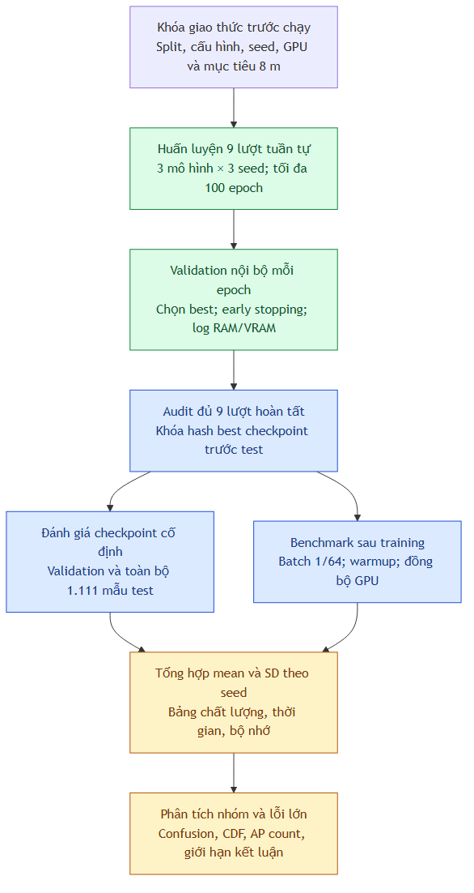

# Chặng 7 — Đánh giá và phân tích IPS

Đích của chặng này là đọc được kết quả một cách đúng nghĩa: mô hình dự đoán đúng tòa/tầng đến đâu, lệch vị trí bao nhiêu mét, mất bao lâu và dùng bao nhiêu bộ nhớ. **7–8 m là mục tiêu cần kiểm chứng, không phải số được điền trước vào bảng.** Giao thức hiện tại định nghĩa đạt mục tiêu là mean2D≤8 m trên **toàn bộ1.111 mẫu test chính thức**, đồng thời công bố riêng chất lượng phân loại. Tốt hơn7 m vẫn đạt; median7 m không thay thế được mean7 m.

**Trạng thái thực nghiệm:** đã hoàn tất cả9 lượt CUDA và đánh giá/benchmark. Mean2D test qua3 seed: MLP15,80±0,43 m; MLP-Mixer15,52±1,75 m; KAN-Mixer15,73±1,51 m. Chưa đạt mục tiêu8 m. Vòng huấn luyện tổng33,32 phút. Xem [bảng đầy đủ](../../../reports/stage7_cuda_v1/README.md) và [diễn giải nhóm lỗi](../../../reports/stage7_cuda_v1/analysis_notes.md); không lấy MAE tọa độ/median thay cho mean2D test để gọi là đạt mục tiêu.

Đây là tài liệu thực hành tiếp nối [chặng 6](../chang_06/README.md). Học theo năm buổi bên dưới. Mã đã có trong repo; nên đọc thiết kế của mỗi buổi trước khi chạy lệnh.

| Thành phần | Tệp cần đọc | Vai trò |
|---|---|---|
| Giao thức khóa trước chạy | `runs/stage7_cuda_v1/protocol_lock.json` | Cấu hình, seed, split, mục tiêu và cách đo |
| Train + log trực tiếp | `scripts/train_stage7.py`, `scripts/run_stage7.ps1` | Chạy tuần tự9 lượt và in từng epoch |
| Chỉ số | `src/ips/metrics.py` | Phân loại, tọa độ, ngưỡng lỗi và nhóm nhãn |
| Đánh giá checkpoint | `src/ips/predict.py` | Xuất metrics và dự đoán từng dòng |
| Đo tài nguyên | `src/ips/resources.py`, `src/ips/benchmark.py` | RAM, VRAM và latency |
| Kiểm tra và tổng hợp | `src/ips/analysis.py`, `scripts/evaluate_stage7.py` | Audit trước test, mean±SD, nhóm lỗi và hình |
| Kết quả thật | [reports/stage7_cuda_v1](../../../reports/stage7_cuda_v1/README.md) | Chỉ sinh sau khi hoàn tất mọi lượt |
| Bảng chưa chạy | [results_template.md](results_template.md) | Ô trống; không có số thực nghiệm giả |

## Buổi 7.1 — Hiểu đúng chỉ số

**Mục tiêu:** phân biệt đúng nhãn tòa/tầng, MAE từng trục và khoảng cách định vị2D; biết tại sao cần nhiều chỉ số.

### Phân loại tòa và tầng

Trước hết, coi mô hình trả lời hai câu: “ở tòa nào?” và “ở tầng nào?”. Head hiện tại dự đoán một trong13 **cặp building/floor hợp lệ**, rồi giải mã ra hai nhãn. Vì vậy có ba kiểu accuracy:

- Building accuracy: tỷ lệ đoán đúng tòa.
- Floor accuracy: tỷ lệ đoán đúng số tầng; có thể đúng số tầng nhưng sai tòa.
- Joint accuracy: đúng cả tòa lẫn tầng trong cùng một mẫu.

Accuracy là số câu trả lời đúng chia tổng số câu trả lời. Nó dễ đọc nhưng có thể che lớp ít mẫu. Ví dụ giảng dạy: có90 mẫu tầng0 và10 mẫu tầng1; luôn đoán tầng0 được90% accuracy dù không nhận ra tầng1.

**Macro-F1** tính F1 riêng cho mỗi lớp rồi lấy trung bình ngang nhau. Với một lớp, precision hỏi “trong các mẫu tôi đoán thuộc lớp này, bao nhiêu mẫu đúng?”, recall hỏi “trong các mẫu thật của lớp này, tôi tìm lại được bao nhiêu?”. Nếu TP là đúng lớp, FP là đoán nhầm vào lớp, FN là bỏ sót lớp:

\[
P=TP/(TP+FP),\quad R=TP/(TP+FN),\quad F1=2PR/(P+R).
\]

Repo dùng danh sách lớp cố định: building0/1/2, floor0…4 và13 cặp building/floor; `zero_division=0`. Lớp không dự đoán được có F1=0; hãy xem support để biết lớp thiếu mẫu. Định nghĩa macro và cách xử lý chia0 đối chiếu [scikit-learn1.6.1](https://scikit-learn.org/1.6/modules/generated/sklearn.metrics.f1_score.html).

**Confusion matrix** là bảng “nhãn thật→nhãn đoán”. Trong repo, hàng là nhãn thật, cột là nhãn dự đoán. Đường chéo là đúng. Ví dụ ô hàng building1, cột building2 chứa những mẫu tòa1 bị đoán sang tòa2. Ma trận count giữ số mẫu; ma trận chuẩn hóa theo hàng cho tỷ lệ trong mỗi lớp. Đọc cả hai để tránh coi10% của10 mẫu tương đương10% của1.000 mẫu.

### Tọa độ và khoảng cách

Mô hình học tọa độ đã chuẩn hóa để số dễ xử lý. Khi đánh giá phải **inverse về tọa độ gốc trước**, giữ float64 để tránh mất độ chính xác ở tọa độ lớn. Với mẫu i, tọa độ thật là `(x_i,y_i)`, dự đoán là `(x̂_i,ŷ_i)`:

\[
d_i=\sqrt{(\hat{x}_i-x_i)^2+(\hat{y}_i-y_i)^2}.
\]

`d_i` là độ dài đoạn nối điểm thật và điểm dự đoán trên mặt phẳng. Dataset dùng quy ước tọa độ theo mét đã giải thích ở chặng5; chưa xác minh đầy đủ CRS. Không dùng công thức Haversine lên các số này, không tự gán EPSG và không giả định chiều cao mỗi tầng.

| Chỉ số | Cách tính | Đọc kết quả |
|---|---|---|
| MAE x/y | Trung bình trị tuyệt đối sai lệch từng trục | Trục nào lệch nhiều hơn |
| RMSE x/y | Căn của trung bình bình phương sai lệch từng trục | Nhạy với lỗi lớn |
| MAE tọa độ | Trung bình trị tuyệt đối trên tất cả2N thành phần x/y | Không phải mean khoảng cách2D |
| RMSE tọa độ | Căn trung bình bình phương trên2N thành phần | RMSE2D/√2 trong bài toán2D này |
| Mean2D | `(d_1+…+d_N)/N` | Lỗi trung bình theo mét trên mọi mẫu |
| Median2D | Trung vị các d_i | Mức lỗi mà một nửa mẫu không vượt quá |
| P90 | Phân vị90% của d_i | Cho thấy phần đuôi lỗi |
| RMSE2D | `sqrt(mean(d_i²))` | Phạt lỗi định vị rất lớn mạnh hơn mean |

**Ví dụ giảng dạy, không phải số thực nghiệm:** hai mẫu có sai lệch `(3,4)` và `(0,8)`. Khoảng cách là5 và8 m; mean2D=6,5 m nhưng MAE tọa độ=(3+4+0+8)/4=3,75 m. Hai con số đều đúng, trả lời hai câu khác nhau. Có thể một mô hình median tốt nhưng mean/P90 xấu do một số điểm lệch rất xa.

### Đánh giá mô hình nhiều đầu ra

Công bố riêng các chỉ số phân loại và tọa độ. Không cộng “accuracy+mean2D”: hai đại lượng khác đơn vị và hướng tốt/xấu. Loss `CE+λSmoothL1` là công cụ học, không phải lỗi định vị theo mét.

Để tóm tắt trải nghiệm IPS, repo có thêm tỷ lệ mẫu **đúng building/floor và d_i≤8 m** trên toàn bộ test. Đây là quy tắc đánh giá do đề tài đề xuất, không phải chuẩn chung bắt buộc. Cũng công bố tỷ lệ chỉ `d_i≤8 m`. Trong ví dụ hai mẫu phía trên, nếu chỉ một mẫu đúng tòa/tầng: tỷ lệ khoảng cách≤8 m là100%, nhưng tỷ lệ đáp ứng cả hai yêu cầu là50%.

Mean2D có điều kiện trên những mẫu đúng tòa/tầng chỉ là chỉ số phụ; luôn kèm số mẫu được giữ. Không lọc mẫu sai tòa/tầng rồi gọi đó là lỗi trên toàn test.

**Tự kiểm tra:**

1. Đúng floor nhưng sai building có được tính joint đúng không?
2. Vì sao mean2D và MAE tọa độ khác nhau?
3. Một mô hình có median7 m và mean14 m đã đạt mục tiêu hiện tại chưa?
4. Vì sao accuracy cao vẫn có thể bỏ sót một tầng hiếm?

**Bài tập:** dùng giấy tính các chỉ số cho hai mẫu ví dụ. Sau đó đọc `test_coordinate_mae_differs_from_euclidean_mean_and_threshold_is_inclusive` trong `tests/test_evaluation.py`; chạy kiểm thử để đối chiếu phép tính.

```powershell
$env:PYTHONUTF8='1'
.\.venv-cuda\Scripts\python.exe -m unittest discover -s tests -v
```

## Buổi 7.2 — So sánh công bằng và tái lập

**Mục tiêu:** biết kiểm tra “cùng điều kiện” trước khi nhìn mô hình nào có số nhỏ hơn.

Tưởng tượng một mô hình được học đúng những điểm xuất hiện trong validation, còn mô hình khác phải dự đoán điểm mới: chênh lệch kết quả khi đó không chỉ do kiến trúc. Vì thế mọi mô hình dùng cùng indices, AP order, RSSI transform, chuẩn hóa tọa độ chỉ fit trên train, mapping13 lớp, loss, optimizer, batch64, GPU và quy tắc chọn checkpoint.

Giao thức tối thiểu khóa `configs/base.json`: AdamW lr0,001, weight decay0,0001, dropout0,1, clip gradient1; tối đa100 epoch; patience15; min_delta0,01 m. “Best” được cập nhật khi validation mean2D nhỏ hơn best cũ ít nhất0,01 m; không nhất thiết là cực tiểu tuyệt đối nếu chênh lệch nhỏ hơn ngưỡng này. Test không được xem trong vòng train.

Số tham số thực tế khác nhau: MLP142.607, MLP-Mixer40.835, KAN-Mixer365.199. **Giao thức này khớp cách học và ngân sách tối đa, chưa khớp tham số/FLOPs/thời gian.** Early stopping còn khiến số bước thực chạy khác nhau. Bảng báo cáo phải ghi epoch, steps và thời gian để người đọc đánh giá chi phí. Thiết kế mở rộng nên thêm một nhánh so sánh gần bằng số tham số và một nhánh cùng ngân sách thời gian; không sửa chúng vào giao thức tối thiểu sau khi xem test.

### Vì sao chạy nhiều seed?

Seed là điểm bắt đầu để sinh số giả ngẫu nhiên: nó ảnh hưởng khởi tạo trọng số, dropout và thứ tự batch. Repo dùng42/43/44 cho từng mô hình, nhưng giữ split seed2026 cố định. Như vậy ba lượt đo biến thiên của việc học trên **cùng split**, không đo biến thiên do chọn một tập test khác.

Với ba điểm số s_1,s_2,s_3:

\[
\bar{s}=\frac{s_1+s_2+s_3}{3},\qquad
SD=\sqrt{\frac{\sum_j(s_j-\bar{s})^2}{3-1}}.
\]

Ví dụ giảng dạy10/11/12 m cho mean11 m và SD1 m. Không chỉ lấy seed10 m để báo. SD này không phải sai số của từng vị trí, không phải khoảng tin cậy95% và không chứng minh ý nghĩa thống kê. Nếu chỉ có một seed, SD chưa xác định; không ghi0 để giả vờ chắc chắn.

Các mẫu đo có thể phụ thuộc nhau do quét gần nhau. Không xem `1.111 mẫu×3 seed` là3.333 quan sát vị trí độc lập. Muốn phân tích bất định sâu hơn, có thể thiết kế resampling theo nhóm đo và nhiều split; cần chỉ rõ loại bất định đang ước lượng.

### Split hiện tại và giới hạn

Train16.025/validation3.912 được tách theo proxy nhóm người–máy–điểm từ tập trainingData.csv. Test là nguyên1.111 dòng của validationData.csv gốc. Nhóm train–validation không giao nhau, nhưng còn chung người, địa điểm và một số RSSI; chưa phải thí nghiệm unseen-user hay unseen-location. Xem [chặng5](../chang_05/README.md) và manifest để đọc bằng chứng rò rỉ/phụ thuộc.

`audit_suite()` kiểm tra đủ9 lượt hoàn tất, budget, cấu hình, phần mã train đã khóa, phần mềm/thiết bị, số mẫu, hash split, số optimizer steps, lịch sử epoch và quy tắc best. Nếu có smoke3 epoch hoặc một run CPU trong suite CUDA, audit phải dừng. `pretest_audit.json` khóa danh sách hash của9 best checkpoint **trước khi đánh giá test**.

**Tự kiểm tra:**

1. Cùng100 epoch tối đa có nghĩa cùng số phép tính thực tế không?
2. Ba seed trên một split kiểm tra được loại biến thiên nào?
3. Vì sao không báo seed có test error nhỏ nhất?
4. Một nhóm đo không giao nhau đã đảm bảo người đo mới chưa?

**Bài tập:** mở hai `run_metadata.json` thuộc hai mô hình, tìm năm trường phải giống nhau và hai trường được phép khác. Giải thích vì sao thay batch cho riêng KAN làm thay đổi tính công bằng của so sánh.

## Buổi 7.3 — Thời gian, RAM và VRAM

**Mục tiêu:** biết mỗi phép đo bao gồm gì; không nhầm dung lượng tham số với bộ nhớ mà chương trình thực sự dùng.

**RAM** là bộ nhớ hệ thống dành cho Python, thư viện, dữ liệu và tensor CPU. **VRAM** là bộ nhớ trên GPU. Trong PyTorch, allocated là bộ nhớ tensor GPU đang dùng; reserved là vùng allocator giữ để tái sử dụng. Reserved thường lớn hơn allocated. Số trong `nvidia-smi` còn phản ánh context, driver và ứng dụng khác; không thay thế trực tiếp cho allocator của mô hình. Nguồn API: [PyTorch2.9 CUDA](https://docs.pytorch.org/docs/2.9/cuda.html).

Số tham số×4 byte chỉ ước lượng storage của tham số float32. Train còn cần gradient, trạng thái AdamW, activation trung gian, input và allocator; suy luận có thể ít hơn vì không lưu graph/gradient. File checkpoint còn chứa optimizer và metadata, nên kích thước `.pt` cũng không phải peak RAM/VRAM.

Repo dùng RSS của **toàn tiến trình**, lấy mẫu10ms qua `psutil.Process().memory_info().rss`. RSS gồm Python và thư viện native, phù hợp hơn `tracemalloc` khi có NumPy/PyTorch. Peak lấy mẫu có thể bỏ lỡ đỉnh ngắn. Windows peak working set ghi trong JSON là đỉnh từ lúc tiến trình bắt đầu, không chỉ riêng khoảng train. Định nghĩa RSS/working set đối chiếu [psutil API](https://psutil.io/api/).

### Hai khoảng huấn luyện

- **Training phase:** vòng epoch gồm forward/backward, optimizer, validation, diagnostics, log và ghi checkpoint.
- **Pipeline:** từ đầu hàm train, thêm tải/kiểm tra dữ liệu và khởi tạo mô hình; chưa tính thời gian Python import trước đó.

`resources.json` lưu cả hai RAM peak và hai thời gian. GPU peak được reset ngay trước vòng train, nhưng tham số/input thường trú vẫn nằm trong allocated lúc reset; không phải chỉ “số byte tăng thêm”. Hai sampler RAM đều có overhead nhỏ và cùng được dùng ở tất cả mô hình.

### Đo suy luận

Latency là thời gian một yêu cầu chờ kết quả. Throughput là số mẫu xử lý trong một giây. Với batch64, máy có thể xử lý nhiều mẫu song song; lấy thời gian batch chia64 là chi phí trung bình trên mẫu, không phải thời gian chờ của một yêu cầu batch1.

**Warmup** cho chương trình chạy trước vài lần để khởi tạo/cache ổn định hơn. Repo dùng10 warmup rồi100 lần đo cho từng mode, từng batch và từng checkpoint. Công việc GPU có thể được xếp hàng bất đồng bộ: phải `torch.cuda.synchronize()` trước khi bắt đầu đồng hồ và sau khi gọi model để đo thời gian hoàn thành thực tế.

| Mode | Bao gồm | Không bao gồm |
|---|---|---|
| Forward | Input đã chuẩn bị trên GPU→logits và xy chuẩn hóa | Tiền xử lý và chuyển CPU/GPU |
| End-to-end trong RAM | RSSI→transform→GPU→model→softmax/class mapping/inverse→mảng CPU | Quét Wi-Fi, đọc CSV/checkpoint, mạng và ghi output |

Mỗi model/seed/batch chạy trong tiến trình mới trên cùng GPU, cùng FP32 và4 luồng CPU. Input là64 fingerprint đầu tiên theo indices train đã lưu, giống nhau cho mọi checkpoint, không lấy từ test. Đây là phép đo đường tính toán, không phải tổng độ trễ của một ứng dụng IPS có quét Wi-Fi thật. Benchmark dùng dữ liệu sẵn trong RAM và không chạy song song với training.

Mỗi lần đo tạo p50/median, p90, mean và SD của100 thời gian. Báo cáo tiếp tục lấy mean±SD của **ba điểm p50 của ba seed**; hai loại SD này khác nhau. Các lần lặp timing phản ánh dao động hệ thống, không đo bất định của vị trí.

**Ví dụ giảng dạy:** một batch64 mất32ms thì throughput=2.000 mẫu/s và chi phí bình quân0,5ms/mẫu. Chưa thể kết luận yêu cầu một mẫu chỉ chờ0,5ms; phải đo batch1 riêng.

**Tự kiểm tra:**

1. Vì sao `.pt`5MB không có nghĩa train chỉ tốn5MB RAM?
2. Vì sao reserved có thể cao hơn allocated?
3. Đồng hồ CPU quanh một phép gọi GPU chưa đồng bộ có thể đo thiếu phần nào?
4. Latency end-to-end hiện tại đã gồm quét Wi-Fi chưa?

**Bài tập:** chọn một `resources.json`, chuyển byte sang MiB bằng cách chia2^20 và tìm peak của đúng khoảng muốn báo. Viết một câu đầy đủ: thiết bị, mode, batch, warmup, số lần lặp, đơn vị và những công đoạn được tính.

## Buổi 7.4 — Chạy, theo dõi, đánh giá và tạo bảng

**Mục tiêu:** đi từ protocol đã khóa đến báo cáo có thể truy nguồn, không điền tay các số đo.

### Bước1: môi trường và kiểm tra

Chạy PowerShell tại `D:\IPS_ThacSi`. `.venv-cuda` đã có trên máy hiện tại; máy khác dùng script setup. Phiên bản của lần đo được khóa trong `requirements-lock-cuda.txt`.

```powershell
.\scripts\setup_cuda.ps1
$env:PYTHONUTF8='1'
.\.venv-cuda\Scripts\python.exe -m ips prepare --verify-only
.\.venv-cuda\Scripts\python.exe -m unittest discover -s tests -v
```

Kiểm tra GPU phải trả về CUDA available=True và đúng RTX4060Ti. Kiểm thử kiểm tra trục mixing, gradient, inverse float64, checkpoint, chỉ số khoảng cách, SD mẫu, alignment của dự đoán và các giao thức không hợp lệ. PASS về pipeline chưa chứng minh đạt8 m.

### Bước2: chạy train và theo dõi từng epoch

```powershell
.\scripts\run_stage7.ps1
```

Lệnh mở ở một terminal bình thường sẽ in trực tiếp các epoch. Lần đang chạy của đề tài đã được khởi động trong cửa sổ PowerShell riêng. Tên suite là `runs/stage7_cuda_v1`. Không chạy thêm cùng lệnh nếu suite này đã tồn tại: runner từ chối ghi đè để tránh trộn kết quả. Muốn thực nghiệm mới, dùng `-OutputRoot runs/stage7_cuda_v2`.

Ở terminal thứ hai, xem log trực tiếp:

```powershell
Get-Content runs/stage7_cuda_v1/terminal.log -Tail 20 -Wait
```

Ctrl+C ở **terminal đọc log** chỉ dừng xem log. Ctrl+C ở **terminal train** có thể ngắt suite. Trường `completed` trong `suite_status.json` là những lượt đã hoàn tất; `current_run` là lượt đang chạy. Runner in `FINISHED ...` với epoch thực chạy, best epoch và thời gian. Dòng có `val_mean2d` là validation nội bộ, không phải test.

Script train dùng `subprocess.Popen` để đọc stdout liên tục, in với `flush=True` và ghi cùng nội dung vào log. Mỗi model/seed là một tiến trình Python riêng. `protocol_lock.json` và `frozen_config.json` được tạo trước lượt đầu; không chỉnh các tệp mã train/cấu hình giữa suite.

### Bước3: audit trước test

Chỉ chạy lệnh sau khi `suite_status.json` báo `training_completed` và có9 `summary.json` trạng thái completed:

```powershell
.\.venv-cuda\Scripts\python.exe -u scripts/evaluate_stage7.py
```

Controller gọi audit trước, lưu `pretest_audit.json`, rồi đánh giá validation đầy đủ và test cho từng best checkpoint; tiếp theo chạy batch1/batch64 benchmark tuần tự. Các evaluation đã hoàn tất có thể được dùng lại khi checkpoint/input/protocol khớp; không đo lại hoặc ghi đè một JSON benchmark đã có. Nếu có tệp output dở dang, đọc trạng thái lỗi trước khi xử lý; đừng sửa số vào JSON để qua guard.

Output từng run:

```text
runs/stage7_cuda_v1/mlp_seed42/
  history.csv                     loss, validation metric, epoch seconds, steps
  best.pt / last.pt               checkpoint, metadata và optimizer
  best_validation_metrics.json    chỉ số lúc chọn best
  run_metadata.json               config, source/split hash, device và seed
  resources.json                  thời gian, RSS, CUDA allocator, tensor bytes
  validation/metrics.json         đánh giá best trên validation đầy đủ
  validation/predictions.csv      dự đoán, nhãn thật và error từng dòng
  test/metrics.json               đánh giá trên mọi dòng test chính thức
  test/predictions.csv             USERID/PHONEID/số AP để phân tích lỗi
  benchmarks/batch1.json          latency/RAM/VRAM
  benchmarks/batch64.json         throughput/RAM/VRAM
```

`row_index` là chỉ số0-based trong CSV nguồn; `csv_line_number=row_index+2` tính cả header. Report kiểm tra alignment và tính lại chỉ số từ CSV dự đoán. Head chỉ nhận RSSI/mask, không nhận nhãn hoặc USERID/PHONEID; các cột này chỉ phục vụ chia tập/phân tích sau dự đoán.

### Bước4: đọc báo cáo và chạy riêng một khối

Controller xuất `reports/stage7_cuda_v1/README.md`, CSV theo seed/nhóm, JSON tổng hợp, log/provenance và các hình PNG/SVG. Checkpoint vẫn ở `runs`, không được đưa vào bảng hoặc commit Git. Các thư mục report phải mới.

```powershell
# Đánh giá riêng validation, vào output mới
.\.venv-cuda\Scripts\python.exe -m ips evaluate --checkpoint runs/stage7_cuda_v1/mlp_seed42/best.pt --split validation --output-dir runs/check_eval_validation --device cuda

# Đo suy luận riêng, sau khi không còn training
.\.venv-cuda\Scripts\python.exe -m ips benchmark --checkpoint runs/stage7_cuda_v1/mlp_seed42/best.pt --csv runs/stage7_cuda_v1/benchmark_inputs.csv --batch-size 1 --warmup 10 --repeats 100 --output runs/check_inference.json --device cuda

# Sinh lại report từ các log đã có, vào thư mục mới
.\.venv-cuda\Scripts\python.exe -m ips report --experiment-root runs/stage7_cuda_v1 --output-dir reports/stage7_recheck
```

Không gọi `evaluate --split test` tùy tiện cho hàng loạt cấu hình để chọn cấu hình có test tốt nhất. Controller hiện tại đánh giá đủ9 checkpoint đã khóa nhằm báo cáo toàn bộ giao thức, không chọn best seed theo test.

**Tự kiểm tra:**

1. Vì sao có cả validation trong vòng train và đánh giá validation sau train?
2. `pretest_audit.json` khóa gì trước khi nhìn test?
3. Muốn kiểm tra một dòng lỗi lớn trong raw, dùng row_index hay csv_line_number thế nào?

**Bài tập:** tìm run seed42 của một mô hình; đối chiếu best epoch trong summary với history và validation metric trong checkpoint metadata. Mở report và truy một ô mean2D trở lại ba metrics.json và predictions.csv tương ứng.

## Buổi 7.5 — Phân tích lỗi và viết kết luận có giới hạn

**Mục tiêu:** giải thích mô hình sai ở đâu, so sánh lợi ích với chi phí và nói rõ kết luận áp dụng trong điều kiện nào.

### Đọc bảng theo thứ tự

1. Xem audit: các lượt có cùng split, transform, budget và thiết bị chưa?
2. Xem building/floor/joint accuracy và macro-F1: lỗi tọa độ thấp có đi cùng đúng tòa/tầng không?
3. Xem mean, median, P90 và RMSE2D trên tất cả mẫu: phần đuôi lỗi có lớn không?
4. Xem ba seed riêng trước mean±SD: cải thiện có lặp lại không hay chỉ một seed tốt?
5. Xem số tham số, steps, train time, B1 latency, B64 throughput và memory: lợi ích có tương xứng chi phí không?

Giữa hai mô hình, có thể tính `Δ_j=mean2D_mô_hình_seed_j−mean2D_MLP_seed_j` rồi tổng hợp ba Δ_j. Δ âm nghĩa là giảm lỗi so với baseline ở seed tương ứng. Đây là so sánh mô tả trên cùng protocol; cùng tên seed không đảm bảo hai kiến trúc có cùng chuỗi khởi tạo, và ba seed không đủ cho kết luận thống kê mạnh.

### Nhóm theo building, floor và người/điện thoại

Trong `group_metrics.csv`, mỗi hàng có model, split, loại nhóm, nhóm cụ thể, số mẫu, mean2D mean/SD và joint accuracy mean/SD. Không so nhóm5 mẫu với nhóm500 mẫu mà bỏ qua support. Mean toàn tập là trung bình theo số mẫu, không phải trung bình ngang nhau của13 nhóm building/floor. Nhóm không có mẫu để trống metric; không ghi lỗi0 m.

**USERID của test chính thức toàn0 là không được ghi nhận**, không phải một người tên0. Phân tích theo người trên validation có ý nghĩa mô tả, nhưng split vẫn có chung người giữa train–validation. **PHONEID0 là mã thiết bị hợp lệ**, không được áp dụng quy tắc USERID cho PHONEID. Các đặc điểm này đã được đối chiếu ở [chặng5](../chang_05/README.md); xem raw/schema trước khi đưa ra diễn giải.

Ví dụ suy luận cần kiểm chứng: “nhóm điện thoạiA lỗi cao” có thể do máy, nhưng cũng có thể do nhóm đó được đo ở các tầng khó hơn hoặc có ít AP hơn. Không kết luận điện thoại gây lỗi chỉ từ bảng nhóm. Nên đối chiếu building/floor, số mẫu và số AP được phát hiện.

### Tìm kiểu lỗi thay vì chỉ nhìn một con số

- Confusion matrix: nhầm các tầng trong cùng tòa hay nhầm tòa? Xem cả count và tỷ lệ theo hàng.
- CDF: ở ngưỡng8/10/20 m, tỷ lệ mẫu được định vị trong bán kính đó là bao nhiêu? Đường cao hơn tại cùng ngưỡng thường tốt hơn ở ngưỡng ấy; không suy ra luôn tốt hơn mọi ngưỡng nếu các đường cắt nhau.
- Worst errors: dùng `worst_test_errors.csv` để mở20 mẫu lệch xa nhất của mỗi seed. Đối chiếu AP count, PHONEID, building/floor thật và dự đoán. Đây là bước mô tả lỗi, không phải lý do xóa mẫu khó.
- Nhóm AP count: ít AP quan sát có đi cùng lỗi cao hơn không? Đó là tương quan trong dữ liệu, chưa chứng minh quan hệ nhân quả.
- Learning curve: train loss giảm mà validation error tăng gợi ý overfitting hoặc dao động tối ưu; best checkpoint khác last checkpoint là điều bình thường.
- KAN diagnostics: đọc fraction ngoài nominal grid và fraction ngoài full knot support. Ngoài nominal grid vẫn có thể còn spline support; ngoài full support vẫn có nhánh base SiLU. Nếu cần đổi grid, thử ở phiên bản dùng validation, không đổi giữa suite.

Repo giữ riêng lỗi khi đúng/sai building/floor trong từng metrics.json. Các nhóm `building_wrong` và `floor_wrong` có thể chồng nhau, nên không cộng số mẫu hai nhóm để suy ra tổng lỗi. Khi so mean có điều kiện giữa mô hình, số mẫu được chọn cũng thay đổi; luôn đọc count kèm theo.

### Nếu chưa đạt7–8 m

Kết luận hợp lệ là “giao thức này chưa đạt mục tiêu trên toàn bộ test”, kèm số đo thật. Không thay mean bằng median, không chỉ báo đúng tòa/tầng, không chọn một seed tốt nhất và không điều chỉnh số liệu.

Một thiết kế mở rộng có thể kiểm chứng:

| Câu hỏi | Thí nghiệm mới | Giữ/ghi rõ điều gì |
|---|---|---|
| Mixer có lợi khi gần bằng tham số? | Chọn widths/blocks để gần ngân sách MLP/KAN | Chọn bằng validation, báo số tham số và compute thực |
| Thứ tự AP/token có quan trọng? | Thứ tự chuẩn, hoán vị cố định, nhóm AP theo thông tin chỉ học từ train | Không dùng tọa độ/nhãn test để xây thứ tự |
| KAN ở nhánh nào có ích? | MLP/MLP, KAN/MLP, MLP/KAN, KAN/KAN | Cùng split, seed, head, preprocessing và budget |
| λxy/grid/dropout ảnh hưởng gì? | Một không gian tìm nhỏ, cùng số thử cho mỗi model | Khóa search budget; chỉ chọn trên validation |
| Có khái quát sang người/máy/điểm mới? | Các split theo user/device/location và nested/group CV | Báo lớp bị thiếu ở train/test và phạm vi đánh giá |
| IPS có dùng được trực tuyến? | B1 latency cộng đo thời gian quét Wi-Fi thật | Không lấy B64 throughput thay cho độ trễ người dùng |

Đây là **đề xuất của người hướng dẫn**, chưa phải kết quả đã công bố hay đã chạy. Sau khi test hiện tại đã được xem, các cải tiến chọn dựa trên hiểu biết từ test đó phải được gọi là thăm dò; cần dữ liệu kiểm chứng mới hoặc thiết kế CV phù hợp để có kết luận mạnh. Phân tích test là hợp lệ cho báo cáo giao thức đã khóa, không biến test thành tập tuning.

### Viết kết luận

Mẫu câu, chỉ điền từ báo cáo thực:

> Trên split …, với … seed và thiết bị …, mô hình … có mean2D … m, joint accuracy … và P90 … m. So với MLP, chênh lệch mean2D ghép theo seed là … m; thời gian/bộ nhớ … . Kết quả này áp dụng cho giao thức …; chưa chứng minh khả năng khái quát sang … . Mục tiêu≤8 m được/không được đáp ứng theo chỉ số đã khóa.

Tránh viết “KAN luôn tốt hơn MLP” hoặc “KAN-Mixer của bài báo đạt… trên UJIIndoorLoc”: đây là biến thể RSSI với token/head/siêu tham số của đề tài, còn [Canuto và cộng sự, v1](https://arxiv.org/abs/2503.08939v1) nghiên cứu ảnh. Mã KAN nền khóa theo [efficient-kan commit7b6ce1c…](https://github.com/Blealtan/efficient-kan/tree/7b6ce1c87f18c8bc90c208f6b494042344216b11); không tự suy ra đây là bản tái lập toàn bộ tác giả.

**Tự kiểm tra:**

1. Nhóm USERID0 ở test chứng minh mô hình tốt cho một người cụ thể không?
2. Hai confusion group sai building/sai floor có loại trừ nhau không?
3. Vì sao không được xóa20 worst errors rồi báo lại lỗi toàn tập?
4. Nếu xem test rồi thiết kế lại token, cần thay đổi cách gọi và xác nhận kết quả thế nào?

**Bài tập:** chọn hai mô hình, viết một đoạn5–7 câu từ bảng kết quả thật: chất lượng, chi phí, một nhóm lỗi và hai giới hạn. Nếu chưa có đủ run thì dùng template để liệt kê những ô chưa đo, không điền số dự đoán vào bảng.

## Sơ đồ đánh giá



Nguồn Mermaid ở [evaluation_flow.mmd](evaluation_flow.mmd), bản vector [evaluation_flow.svg](evaluation_flow.svg). Sơ đồ mô tả giao thức của đề tài, không phải hình từ bài báo.

## Lỗi thường gặp

| Biểu hiện | Ý nghĩa/việc cần làm |
|---|---|
| Suite đã tồn tại | Không chạy trùng; xem status/log hoặc dùng tên suite mới |
| CUDA unavailable | Dùng Python `.venv-cuda`, xem `torch.__version__`/CUDA/driver |
| Audit báo missing/incomplete | Chưa xong9 lượt hoặc có tiến trình lỗi; đọc terminal.log và failure.json |
| Training implementation changed | Đã chỉnh phần train giữa suite; giữ bản khóa hoặc chạy lại suite mới, không sửa hash để vượt kiểm tra |
| Shape/alignment/ground-truth mismatch | Dự đoán không khớp indices/mapping; sửa pipeline trước khi kết luận |
| Evaluation output dở dang | Dừng để xem lỗi; giữ evidence, dùng output/report mới khi sửa |
| JSON chứa NaN/Infinity | Loss/metric không hợp lệ; không dùng dòng đó trong bảng |
| Chữ tiếng Việt lỗi encoding | Đặt `$env:PYTHONUTF8='1'` trước khi chạy |
| GPU benchmark dao động | Ghi điều kiện máy và raw timings; không chỉ chọn một timing thấp nhất |
| Mean test cao hơn validation | Có thể do khác đợt đo/thiết bị/phân bố; đọc nhóm lỗi và split, không tự kết luận bug hay KAN vô ích |

## Đáp án ngắn và checklist

7.1: joint đòi đúng cả hai nhãn; Euclid gộp hai trục trước khi lấy mean; median7/mean14 chưa đạt; accuracy có thể bị lớp nhiều mẫu chi phối.

7.2: cùng max epoch không khớp compute/steps; seed đo biến thiên huấn luyện trên split cố định; chọn best-test seed làm báo cáo thiên lệch; group không giao không đảm bảo user/location mới.

7.3: `.pt` không chứa đầy đủ working memory; allocator giữ vùng cache; GPU bất đồng bộ cần synchronize; benchmark hiện tại chưa đo quét Wi-Fi.

7.4: vòng train dùng validation để chọn epoch; đánh giá cuối xác nhận đúng best và lưu dự đoán từng dòng; pretest audit khóa mọi checkpoint; raw dòng=row_index+2.

7.5: USERID test không có định danh; hai nhóm lỗi có thể chồng; xóa worst làm đổi population đánh giá; thiết kế sau xem test phải gọi là thăm dò và cần xác nhận độc lập.

- [ ] Hiểu đầu ra13 cặp và2 tọa độ; head không dùng metadata làm input.
- [ ] Phân biệt MAE/RMSE tọa độ với mean/RMSE2D.
- [ ] Báo building, floor, joint accuracy/F1 và confusion/support.
- [ ] Giữ đúng split/preprocessing/config/seed/device và đọc audit.
- [ ] Đủ9 lượt thật, không trộn smoke/pilot/CPU vào suite CUDA.
- [ ] Báo mean±SD mẫu qua seed, không chỉ best seed.
- [ ] Đo train/inference time và RAM/VRAM với scope rõ.
- [ ] Đánh giá mọi1.111 mẫu, công bố ngưỡng8 m cùng classification.
- [ ] Phân tích nhóm, worst errors và KAN diagnostics; không bỏ mẫu khó.
- [ ] Viết kết luận có giới hạn; biết thiết kế mở rộng chưa được chạy.

## Nguồn đã đối chiếu

- [UCI UJIIndoorLoc](https://archive.ics.uci.edu/dataset/310/ujiindoorloc): dataset gốc; việc đọc số mẫu, mã100 và metadata thực tế được ghi trong chặng5.
- [scikit-learn1.6.1 F1](https://scikit-learn.org/1.6/modules/generated/sklearn.metrics.f1_score.html): macro averaging, fixed labels và zero division.
- [PyTorch2.9 CUDA](https://docs.pytorch.org/docs/2.9/cuda.html): synchronize, reset peak, max allocated/reserved.
- [PyTorch2.9 reproducibility](https://docs.pytorch.org/docs/2.9/notes/randomness.html): thiết lập seed/deterministic không đảm bảo bitwise giống nhau trên mọi nền tảng.
- [psutil API](https://psutil.io/api/): process RSS và khác biệt memory counters theo hệ điều hành.

Các lựa chọn threshold, seed, split proxy, cách token hóa và giao thức benchmark là thiết kế của đề tài. Số thực nghiệm chỉ có trong report được sinh từ run hoàn tất.
