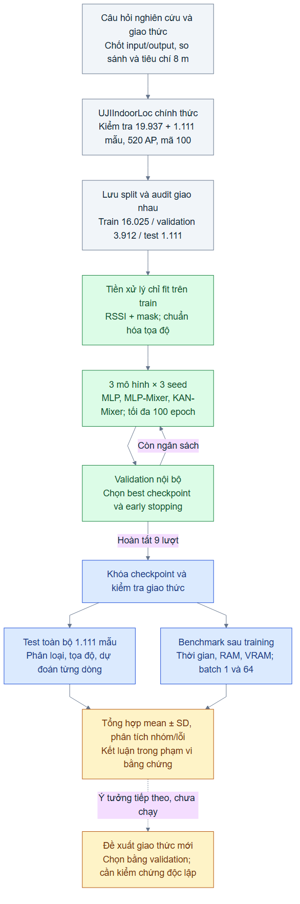

# Chặng 8 — Tổng kết và trình bày đề tài

Mục tiêu của chặng này là kể được một câu chuyện nghiên cứu có bằng chứng: **ta đặt bài toán gì, đã thử cách nào, đo được gì và còn cần kiểm chứng điều gì**. Bộ slide dùng số liệu thật của [suite chặng 7](../../../reports/stage7_cuda_v1/README.md). Không có thực nghiệm huấn luyện mới trong chặng 8.

## Tài liệu để sử dụng

- [PowerPoint 20 slide](presentation/IPS_KAN_Mixer_UJIIndoorLoc.pptx): 18 slide chính và 2 slide phụ lục, khổ 16:9, có ghi chú người thuyết trình. Bảng, biểu đồ và sơ đồ trên slide có thể chỉnh sửa.
- [Bản PDF](presentation/IPS_KAN_Mixer_UJIIndoorLoc.pdf): thuận tiện đọc và chia sẻ.
- [Lời dẫn theo từng slide](presentation/speaker_notes.md): giải thích thuật ngữ, cách chuyển ý và nguồn số liệu.
- [Câu hỏi nghiên cứu và giả thuyết](research_questions.md).
- [Checklist hoàn thành](completion_checklist.md).
- Sơ đồ tổng thể: [PNG](research_workflow.png), [SVG](research_workflow.svg), [mã Mermaid](research_workflow.mmd).

## Buổi 1 — Tóm tắt quy trình nghiên cứu

**Mục tiêu:** phân biệt học mô hình, chọn mô hình và kiểm tra kết quả cuối.

Một fingerprint là một lần quan sát tín hiệu Wi-Fi tại một vị trí. Mô hình nhận tín hiệu của 520 access point (AP), dự đoán một trong 13 cặp tòa/tầng hợp lệ và hai tọa độ. Train giúp mô hình học tham số; validation giúp chọn checkpoint; test giúp đánh giá các checkpoint đã cố định.



Sơ đồ thể hiện vòng lựa chọn chỉ sử dụng train/validation. Khối benchmark đo chi phí sau khi training kết thúc. Tập `validationData.csv` chính thức đóng vai trò **test** trong đề tài, khác với validation nội bộ lấy từ `trainingData.csv`.

**Ví dụ:** seed42 và seed43 có thể dừng ở epoch khác nhau. Ta chọn checkpoint tốt nhất bằng validation của mỗi lượt, rồi đánh giá cả hai trên cùng 1.111 mẫu test. Không chọn seed có test đẹp nhất làm kết quả đại diện.

**Tự kiểm tra:** vì sao sơ đồ không có mũi tên từ test quay về chọn siêu tham số? Vì sao không gộp pilot ba epoch vào bảng kết quả chính?

**Bài tập ngắn:** nhìn sơ đồ và giải thích quy trình trong 90 giây, không đọc tên file hay tên hàm Python.

## Buổi 2 — Câu hỏi, giả thuyết và mức độ bằng chứng

**Mục tiêu:** biến một kỳ vọng thành phép kiểm chứng, đồng thời phân biệt quan sát với nguyên nhân.

“KAN-Mixer tốt hơn” còn quá chung. Cần nói tốt hơn về mean2D, độ chính xác tòa/tầng hay latency; trên tập nào; dưới ngân sách nào. [Bảng câu hỏi](research_questions.md) mô tả phép đo và các thí nghiệm cần thêm. Các tiêu chí mới đề xuất ở chặng 8 chưa phải giả thuyết đăng ký trước của chặng 7.

**Ví dụ từ kết quả thật:** mean2D test của MLP-Mixer là 15,52±1,75 m, MLP là 15,80±0,43 m. Chênh lệch ghép theo seed là −0,28±1,35 m. Có thể nói MLP-Mixer thấp hơn về trung bình trong bảng này. Chưa có cơ sở khẳng định ưu thế thống kê hoặc ưu thế trên mọi bộ dữ liệu.

Mục tiêu 7–8 m được đánh giá bằng **mean khoảng cách 2D trên toàn bộ test**. Không có checkpoint nào trong 9 lượt đạt mean≤8 m. MAE tọa độ validation 7,87 m của KAN-Mixer đo một đại lượng khác, không chứng minh đã đạt mục tiêu.

**Tự kiểm tra:** SD giữa ba seed có phải khoảng tin cậy không? Nhóm có ít AP và lỗi cao có chứng minh thiếu AP là nguyên nhân duy nhất không?

**Bài tập ngắn:** viết một nhận xét quan sát, một suy luận có giới hạn và một giả thuyết chưa thử; ghi rõ loại của mỗi câu.

## Buổi 3 — Chốt trạng thái đề tài

**Mục tiêu:** phân biệt pipeline đã hoàn thành với mục tiêu chất lượng còn thiếu.

Đã có dữ liệu được kiểm tra, ba mô hình, split lưu cố định, chín lượt GPU, checkpoint, log, dự đoán từng mẫu, bảng chất lượng và đo thời gian/bộ nhớ. Việc triển khai và đánh giá giao thức tối thiểu đã hoàn thành. Việc đạt mean2D≤8 m, so sánh khớp tham số và kiểm chứng người/thiết bị mới vẫn cần nghiên cứu thêm.

Xem [checklist](completion_checklist.md), trong đó mỗi mục hoàn thành gắn với bằng chứng. Checkpoint nằm trong `runs/` bị Git bỏ qua; cần lưu trữ riêng nếu muốn người khác tái sử dụng ngay mô hình đã học.

**Ví dụ:** “suy luận 4,95 ms” của KAN-Mixer là trung bình p50 qua ba seed cho batch1, từ RSSI có sẵn trong RAM đến đầu ra trên CPU. Phép đo không bao gồm thời gian điện thoại quét Wi-Fi. RAM peak là toàn tiến trình; VRAM reserved là allocator PyTorch.

**Tự kiểm tra:** cùng tối đa 100 epoch có đồng nghĩa cùng thời gian chạy không? Số tham số có bằng bộ nhớ GPU cao nhất không?

**Bài tập ngắn:** chọn ba mục còn thiếu trong checklist và sắp thứ tự thực hiện, giải thích vì sao. Không sửa giao thức cũ để tìm kết quả đẹp hơn trên test đã xem.

## Buổi 4 — Thuyết trình 15–20 phút

**Mục tiêu:** giải thích được đề tài cho người biết lập trình nhưng mới học IPS.

| Phần | Slide | Thời gian gợi ý |
|---|---:|---:|
| Bài toán và câu hỏi nghiên cứu | 1–3 | 2 phút |
| Dữ liệu và quy trình | 4–7 | 3 phút |
| Kiến trúc và giao thức | 8–11 | 4 phút |
| Kết quả chất lượng và chi phí | 12–16 | 5 phút |
| Giới hạn và kết luận | 17–18 | 2 phút |
| Kích thước tensor, nguồn | 19–20 | Dùng khi hỏi đáp |

Có thể dùng câu mở đầu: “Đề tài so sánh ba mạng cho bài toán dự đoán vị trí từ Wi-Fi. Tôi kiểm tra cả sai số, tốc độ và bộ nhớ. Cấu hình hiện tại chưa đạt mục tiêu 8 m, nhưng đã có một quy trình tái lập để xác định bước cải thiện tiếp theo.”

Đừng đọc mọi con số. Ở bảng chất lượng, giải thích mean2D trước, chỉ ra chênh lệch nhỏ giữa các mô hình, rồi nói về độ biến thiên. Ở bảng chi phí, nhắc phạm vi phép đo trước khi kết luận. Ở slide cuối, phân biệt đóng góp triển khai với đóng góp thuật toán mới.

**Tự kiểm tra:** người nghe có hiểu 100 trong RSSI nghĩa là gì không? Người nghe có phân biệt biến thể IPS tự thiết kế với KAN-Mixers trong bài báo ảnh không?

**Bài tập ngắn:** ghi âm một lần trình bày 5 phút với slide 2, 4, 8, 12, 16, 18. Kiểm tra xem câu kết có được bằng chứng trên slide hỗ trợ không.

## Câu hỏi vấn đáp

1. **IPS dự đoán gì?** Cặp tòa/tầng và tọa độ từ fingerprint Wi-Fi.
2. **100 có phải tín hiệu mạnh?** Không, đây là mã AP không được phát hiện theo UJIIndoorLoc.
3. **Vì sao cần mask?** Cho biết có quan sát AP hay không, kể cả khi giá trị tín hiệu chuẩn hóa bằng 0.
4. **Một token chứa gì?** 20 AP theo thứ tự cột cố định, mỗi AP có tín hiệu chuẩn hóa và mask; token có 40 số.
5. **Token-mixing và channel-mixing khác nhau ở đâu?** Một nhánh trộn 26 nhóm AP, nhánh kia trộn 64 đặc trưng trong mỗi nhóm.
6. **KAN học gì?** Các hệ số của hàm một biến trên cạnh, với backend hiện tại gồm nhánh base SiLU và B-spline.
7. **Mô hình đã tái lập nguyên bản bài báo KAN-Mixers chưa?** Chưa; đề tài dùng cơ chế Mixer từ tài liệu và tự thiết kế token/head IPS.
8. **Vì sao phân loại 13 cặp thay vì 15 tổ hợp?** Dataset chỉ có 13 cặp tòa/tầng hợp lệ.
9. **Split có chứng minh tổng quát hóa sang người mới không?** Không; proxy nhóm đo không giao nhau nhưng train/validation vẫn có chung người và vị trí.
10. **Mean2D và MAE tọa độ khác nhau thế nào?** Mean2D lấy khoảng cách Euclid mỗi mẫu; MAE tọa độ lấy trung bình trị tuyệt đối theo hai trục.
11. **Đã đạt mục tiêu 8 m chưa?** Chưa, toàn bộ 9 checkpoint đều có mean2D test trên 8 m.
12. **KAN có ít lỗi thông thường hơn nhưng vẫn RMSE cao hơn được không?** Có; median thấp hơn có thể đi cùng một số lỗi cực lớn.
13. **Có thể đưa nhãn building/floor thật vào head tọa độ khi suy luận không?** Không; lúc triển khai chỉ có tín hiệu và nhãn/xác suất do mô hình dự đoán.
14. **Thời gian 33,32 phút gồm gì?** Tổng vòng train+validation của 9 lượt, có logging/diagnostics/checkpoint; chưa gồm startup và đánh giá cuối.
15. **Muốn cải thiện sau khi đã xem test thì làm gì?** Lập giao thức mới, chọn bằng validation/nested group CV; dùng dữ liệu độc lập để xác nhận mạnh hơn. Báo cáo trên test cũ là thăm dò.

## Dàn ý báo cáo nghiên cứu

1. Giới thiệu bài toán, mục tiêu và câu hỏi nghiên cứu.
2. Kiến thức và tài liệu: fingerprinting, MLP-Mixer, KAN, phiên bản KAN-Mixers.
3. Dữ liệu, kiểm tra chất lượng, split và nguy cơ rò rỉ.
4. Biến thể IPS, loss và giao thức so sánh.
5. Kết quả thật, sai số theo nhóm, thời gian và bộ nhớ.
6. Giới hạn, kết luận trong phạm vi giao thức và thí nghiệm kế tiếp.
7. Phụ lục cấu hình, môi trường, hash, lệnh và nguồn.

## Nguồn và phạm vi

- [UCI UJIIndoorLoc](https://archive.ics.uci.edu/dataset/310/ujiindoorloc): mô tả dữ liệu, mã RSSI và nguồn tải. Số hàng/cột còn được kiểm tra trên CSV trong repo ở chặng 5.
- [Tolstikhin và cộng sự, MLP-Mixer](https://arxiv.org/abs/2105.01601): cơ chế trộn token và channel trong kiến trúc ảnh.
- [Liu và cộng sự, KAN](https://arxiv.org/abs/2404.19756): mô hình học hàm trên cạnh.
- [Canuto và cộng sự, KAN-Mixers v1](https://arxiv.org/abs/2503.08939v1): công trình phân loại ảnh. Token hóa RSSI và hai head trong repo là thiết kế IPS của đề tài.
- [efficient-kan, commit khóa](https://github.com/Blealtan/efficient-kan/tree/7b6ce1c87f18c8bc90c208f6b494042344216b11): backend đang dùng; provenance và giấy phép nằm trong `src/ips/models/vendor/`.
- [Kết quả, cấu hình và bằng chứng cục bộ](../../../reports/stage7_cuda_v1/README.md): nguồn của mọi con số thực nghiệm trên slide.

Ngày tổng kết: 08/10/2026. Tọa độ giữ quy ước mét của dataset; chưa xác minh đầy đủ CRS/EPSG, không suy ra sai số 3D từ nhãn tầng.

## Dựng lại slide

Script [build_stage8.cjs](../../../scripts/build_stage8.cjs) đọc trực tiếp JSON kết quả chặng 7, kiểm tra ba seed và tạo bảng/biểu đồ cùng lời dẫn. Thư viện slide tách khỏi môi trường Python huấn luyện:

```powershell
npm install --prefix runs/stage8_build pptxgenjs@4.0.1 --no-audit --no-fund
node scripts/build_stage8.cjs
# Cần PowerPoint trên Windows để xuất PDF và ảnh xem trước
powershell -NoProfile -File scripts/render_stage8.ps1
```

Ảnh kiểm tra và log dựng nằm trong `runs/stage8_build/`, không đưa vào thư mục sản phẩm. Xem [release 4.0.1](https://github.com/gitbrent/PptxGenJS/releases/tag/v4.0.1) cho thư viện dựng slide, không phải thư viện huấn luyện.
