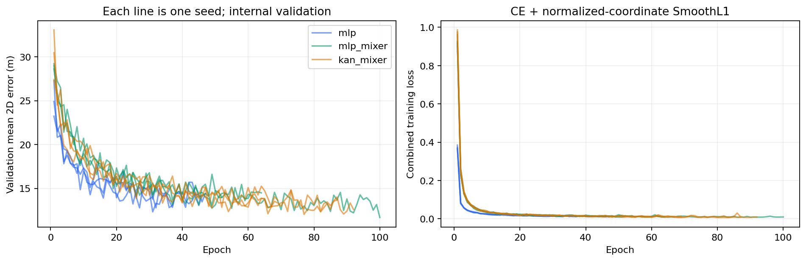
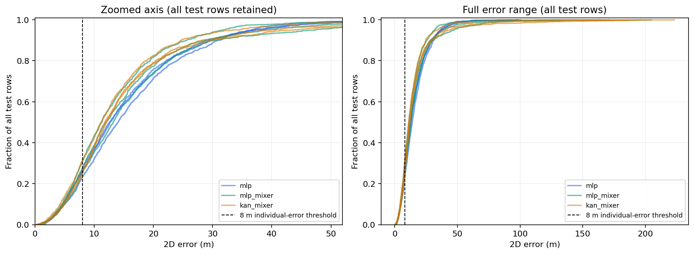
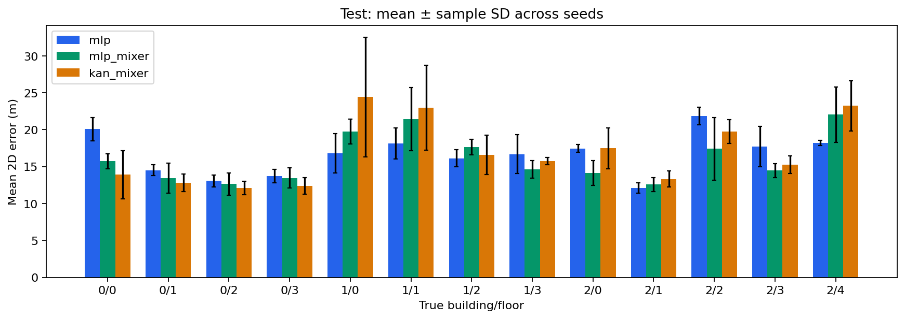

# Kết quả chặng 7: UJIIndoorLoc

Đọc thêm [diễn giải kết quả và các nhóm lỗi](analysis_notes.md), được viết từ số đo của suite này sau khi hoàn tất; không có lượt tuning bổ sung trên test.

Bảng được sinh từ log và dự đoán thật sau khi kiểm tra giao thức. Mỗi ô tổng hợp là trung bình ± độ lệch chuẩn mẫu trên seed42/43/44 (ddof=1), không phải khoảng tin cậy.

Thiết bị: NVIDIA GeForce RTX 4060 Ti; PyTorch2.9.0+cu128; batch64; FP32; 4 luồng CPU. Train16.025/validation3.912/test1.111. Tất cả checkpoint chọn bằng validation nội bộ; test giữ nguyên toàn bộ mẫu.

## Validation nội bộ

| Mô hình | Building acc (%) | Building macro-F1 (%) | Floor acc (%) | Floor macro-F1 (%) | Joint acc (%) | Joint macro-F1 (%) |
|---|---:|---:|---:|---:|---:|---:|
| mlp | 99.75 ± 0.15 | 99.76 ± 0.14 | 98.24 ± 0.14 | 98.48 ± 0.09 | 98.23 ± 0.13 | 98.28 ± 0.14 |
| mlp_mixer | 99.63 ± 0.22 | 99.63 ± 0.21 | 98.39 ± 0.36 | 98.57 ± 0.37 | 98.36 ± 0.36 | 98.29 ± 0.33 |
| kan_mixer | 99.64 ± 0.17 | 99.65 ± 0.17 | 98.24 ± 0.61 | 98.44 ± 0.57 | 98.21 ± 0.57 | 98.21 ± 0.51 |

| Mô hình | MAE tọa độ (m) | RMSE tọa độ (m) | Mean 2D (m) | Median 2D (m) | P90 2D (m) | RMSE 2D (m) |
|---|---:|---:|---:|---:|---:|---:|
| mlp | 8.26 ± 0.43 | 11.85 ± 0.37 | 12.88 ± 0.62 | 10.78 ± 0.71 | 23.23 ± 1.03 | 16.75 ± 0.52 |
| mlp_mixer | 8.14 ± 0.51 | 12.06 ± 0.43 | 12.64 ± 0.84 | 10.66 ± 0.91 | 21.72 ± 1.21 | 17.05 ± 0.60 |
| kan_mixer | 7.87 ± 0.10 | 11.98 ± 0.50 | 12.25 ± 0.19 | 10.16 ± 0.07 | 20.96 ± 0.71 | 16.94 ± 0.70 |

MAE/RMSE tọa độ lấy trên hai trục; mean2D là trung bình khoảng cách Euclid của từng mẫu. Không thay thế các chỉ số này cho nhau. MAE/RMSE từng trục có trong `per_seed_metrics.csv` và `aggregate_metrics.json`.

## Test chính thức

| Mô hình | Building acc (%) | Building macro-F1 (%) | Floor acc (%) | Floor macro-F1 (%) | Joint acc (%) | Joint macro-F1 (%) |
|---|---:|---:|---:|---:|---:|---:|
| mlp | 99.64 ± 0.24 | 99.58 ± 0.30 | 91.00 ± 0.24 | 89.74 ± 0.24 | 90.97 ± 0.29 | 89.47 ± 0.17 |
| mlp_mixer | 99.55 ± 0.27 | 99.50 ± 0.25 | 92.65 ± 1.53 | 91.41 ± 1.63 | 92.56 ± 1.67 | 91.16 ± 1.59 |
| kan_mixer | 99.22 ± 0.27 | 99.10 ± 0.31 | 90.79 ± 0.50 | 89.79 ± 0.72 | 90.70 ± 0.43 | 88.70 ± 0.93 |

| Mô hình | MAE tọa độ (m) | RMSE tọa độ (m) | Mean 2D (m) | Median 2D (m) | P90 2D (m) | RMSE 2D (m) |
|---|---:|---:|---:|---:|---:|---:|
| mlp | 10.11 ± 0.27 | 13.70 ± 0.11 | 15.80 ± 0.43 | 13.09 ± 0.81 | 29.86 ± 0.96 | 19.37 ± 0.15 |
| mlp_mixer | 9.97 ± 1.10 | 14.76 ± 2.36 | 15.52 ± 1.75 | 12.16 ± 0.97 | 28.21 ± 2.49 | 20.88 ± 3.34 |
| kan_mixer | 10.10 ± 0.94 | 16.49 ± 2.47 | 15.73 ± 1.51 | 11.69 ± 0.49 | 27.59 ± 2.57 | 23.32 ± 3.49 |

MAE/RMSE tọa độ lấy trên hai trục; mean2D là trung bình khoảng cách Euclid của từng mẫu. Không thay thế các chỉ số này cho nhau. MAE/RMSE từng trục có trong `per_seed_metrics.csv` và `aggregate_metrics.json`.

## Kiểm chứng mục tiêu 7–8 m

| Mô hình | Mean 2D test (m) | Seed đạt mean≤8 m | Mẫu có lỗi≤8 m (%) | Đúng building/floor và lỗi≤8 m (%) |
|---|---:|---:|---:|---:|
| mlp | 15.80 ± 0.43 | 0/3 | 25.29 ± 1.87 | 24.42 ± 1.82 |
| mlp_mixer | 15.52 ± 1.75 | 0/3 | 27.84 ± 2.75 | 26.58 ± 2.30 |
| kan_mixer | 15.73 ± 1.51 | 0/3 | 27.30 ± 3.50 | 25.98 ± 3.22 |

**Chưa đạt mục tiêu mean2D≤8 m trên toàn bộ test với cấu hình đã khóa.** Đây là kết quả đo, không được sửa bảng hay tinh chỉnh theo test để đạt mục tiêu.

Ngưỡng8 m cho từng mẫu là một chỉ số khác với mean≤8 m. Sai tòa/tầng không được loại khỏi mean2D; xem riêng lỗi có điều kiện trong metrics từng seed.

## Chi phí huấn luyện

| Mô hình | Tham số | Epoch thực chạy | Thời gian train+val (giây) | RAM peak train (MiB) | VRAM allocated (MiB) | VRAM reserved (MiB) |
|---|---:|---:|---:|---:|---:|---:|
| mlp | 142607 | 43.00 ± 6.08 | 82.61 ± 25.15 | 1318.91 ± 0.40 | 67.99 ± 0.00 | 70.00 ± 0.00 |
| mlp_mixer | 40835 | 72.00 ± 24.98 | 180.70 ± 98.33 | 1348.20 ± 0.48 | 76.92 ± 0.00 | 100.00 ± 0.00 |
| kan_mixer | 365199 | 82.67 ± 12.10 | 403.17 ± 40.33 | 1465.16 ± 0.32 | 414.54 ± 0.00 | 466.00 ± 0.00 |

Tổng thời gian vòng huấn luyện của9 lượt: **33.32 phút**. Có validation, diagnostics, logging và lưu checkpoint; không gồm khởi tạo/tải dữ liệu và công đoạn đánh giá cuối. Pipeline RAM peak được lưu riêng trong JSON.

Cùng ngân sách tối đa100 epoch, patience15, min_delta0,01 m; số epoch/steps thực tế khác nhau do early stopping. Tham số, FLOPs và thời gian không được khớp bằng nhau. RAM là RSS toàn tiến trình lấy mẫu10ms; VRAM là allocator PyTorch, không gồm mọi ứng dụng/context của GPU. Thời gian đo trong phiên desktop hiện tại, không phải máy benchmark được cô lập hoàn toàn; không ngoại suy nguyên số sang máy khác.

## Suy luận

| Mô hình | B1 forward p50 (ms) | B1 end-to-end p50 (ms) | B1 end-to-end p90 (ms) | B64 end-to-end throughput (mẫu/s) | B1 RAM peak (MiB) | B1 VRAM reserved (MiB) |
|---|---:|---:|---:|---:|---:|---:|
| mlp | 0.25 ± 0.00 | 0.46 ± 0.00 | 0.52 ± 0.01 | 98388.39 ± 5589.20 | 807.87 ± 0.22 | 34.00 ± 0.00 |
| mlp_mixer | 0.91 ± 0.01 | 1.19 ± 0.04 | 1.71 ± 0.46 | 47487.84 ± 1145.37 | 857.87 ± 0.15 | 34.00 ± 0.00 |
| kan_mixer | 4.55 ± 0.07 | 4.95 ± 0.05 | 5.43 ± 0.17 | 12365.97 ± 385.70 | 932.17 ± 0.58 | 36.00 ± 0.00 |

Mỗi checkpoint/batch chạy trong tiến trình mới,10 warmup+100 lần đo cho từng mode. End-to-end là RSSI trong RAM→tiền xử lý→GPU→dự đoán và inverse→mảng CPU; không gồm quét Wi-Fi, đọc CSV/checkpoint hoặc ghi file. B64 đo throughput; thời gian chia64 không phải latency trực tuyến B1. Không chạy benchmark đồng thời với training.

## Chênh lệch với baseline và phân tích lỗi

| Mô hình | Δ mean2D test so với MLP, ghép theo seed (m) |
|---|---:|
| mlp_mixer | -0.28 ± 1.35 |
| kan_mixer | -0.07 ± 1.42 |

Δ âm nghĩa là lỗi thấp hơn baseline trong giao thức này. Ba seed là mô tả độ biến thiên do khởi tạo/thứ tự batch; không đủ để tuyên bố ý nghĩa thống kê hay tính ưu việt chung.

- `group_metrics.csv`: theo building, floor, building/floor, PHONEID, USERID và số AP phát hiện; mỗi nhóm có số mẫu và mean±SD.
- Test có USERID0 không được ghi nhận; không xem đó là một người. Phân tích theo người thực hiện trên validation, vẫn không chứng minh khái quát sang người mới.
- `worst_test_errors.csv`:20 lỗi lớn nhất mỗi model/seed, kèm nhãn thật/dự đoán, điện thoại và số AP. Dùng để tìm mẫu lỗi; không xóa mẫu khỏi báo cáo.
- `kan_diagnostics_summary.csv`: các lớp KAN ở best và last epoch, lấy từ2 batch train/epoch; không đại diện toàn bộ train/test. `artifacts/*/kan_diagnostics.json` giữ log theo epoch. Ngoài nominal grid không đồng nghĩa mất mọi spline; ngoài full knot support vẫn có nhánh base SiLU.

## Giới hạn và bước tiếp theo

Split theo nhóm đo là proxy, còn chung người/điểm và một số RSSI giữa train–validation. Official test là một đợt dữ liệu riêng, không đại diện mọi nhà/tòa/thiết bị. Tọa độ dùng quy ước mét của UJIIndoorLoc; chưa xác minh đầy đủ CRS, không suy ra lỗi3D từ nhãn tầng.

Nếu cần cải thiện mục tiêu8 m: lập phiên bản thực nghiệm mới chỉ dùng train/validation để chọn token/AP ordering, λxy, dropout, độ rộng, KAN grid và quy tắc split. Vì test này đã được xem, kết quả cải tiến trên cùng test là thăm dò; cần dữ liệu kiểm chứng mới hoặc nested/group CV để có kết luận mạnh hơn. Không gọi các thay đổi đó là kết quả của giao thức đã khóa.

## Hình và bằng chứng

Các confusion matrix chuẩn hóa theo hàng, trung bình ba seed, nằm ở `figures/confusion_*.png`; JSON giữ các ma trận count gốc của từng seed. `fairness_audit.json`, `protocol_lock.json`, hash checkpoint và dự đoán từng dòng cho phép truy nguồn bảng.
